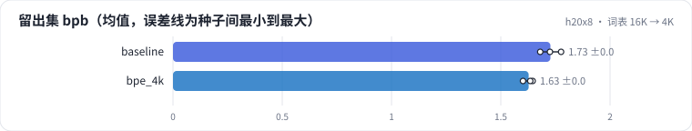
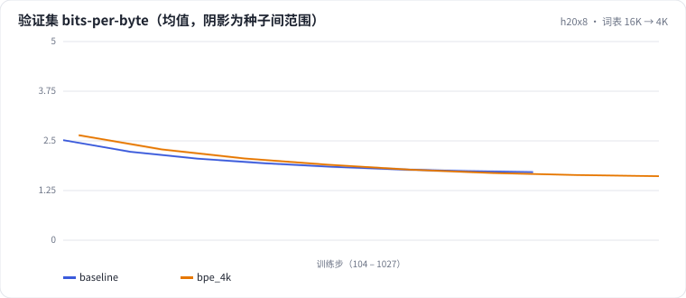

<!-- 本页由 python -m labkit docs 从 ../lesson.yaml 和 results/ 生成，不要手改 -->

[← 先估算](05-estimate.md) · [课程首页](../README.md) · [词表 16K → 64K →](07-vocab-64k.md)

# 第 6 步 / 共 15 步：词表 16K → 4K

> 阶段 3 / 6：**词表大小与分词方式** · 场景：`bpe_4k`（对照 `baseline`）

同一份 100 MB 训练文本、同一个模型，只把 BPE 词表从 16384 降到 4096。4K 词表放不下多数常用汉字，会有更多汉字回退成字节；同样的文本切成更多 token，训练步数更多。

## 这一步跑了什么

| 场景 | 作用 | 说明 | 相对基线改了什么 | 种子（H20） |
| - | - | - | - | - |
| `baseline` | 对照 | 基线：16K 字节级 BPE（本语料训练），精确 + MinHash 去重，训练集 100 MB | — | 3 |
| `bpe_4k` | 本步 | BPE 词表 4K（其余同基线） | `vocab_size=4096` | 3 |

## 先预测

**和 16K 比，4K 词表的干净留出集 bpb（3 种子均值）会怎样？**

- **A.** 4K 明显更差（高 0.02 以上）
- **B.** 差不多（±0.02 以内）
- **C.** 4K 明显更好（低 0.02 以上）

> 先选定一个（记下来），再展开下面的实测。bpb 差异小于 0.02 或小于种子间波动，都按“差不多”算。

## 实测

展开实测：H20 · 小 GPT（1060 万主体参数）从零训练 100 MB 中文维基 · 每个场景 3 种子（已有 6 / 6 个运行）

| 场景 | 类型 | 留出集 bpb | 验证集 每 token loss | 每 token 字节数 | 常用字被拆比例 | embedding 占比 | 训练 token 数 | 留出集 bpb：与 `baseline` 差 | 留出集 bpb：各种子 | 断言 |
| - | - | - | - | - | - | - | - | - | - | - |
| `baseline` | 基线 | 1.727 ± 0.048 | 4.343 ± 0.122 | 3.66 ± 0.00 | 0.1% ± 0.0 | 37.2% ± 0.0 | 27,262,976.0 ± 0.0 | — | s0 1.725 / s1 1.776 / s2 1.680 | 通过 |
| `bpe_4k` | 候选改动 | 1.627 ± 0.023 | 3.324 ± 0.047 | 2.98 ± 0.00 | 4.2% ± 0.0 | 12.9% ± 0.0 | 33,652,736.0 ± 0.0 | -0.100 | s0 1.646 / s1 1.601 / s2 1.635 |  |

运行目录（每个目录里有 `summary.json` 指标、`evidence.json` 证据摘要、`predictions.jsonl` 逐条预测、`log.txt` 日志）：

- `baseline` [s0](../../../results/h20x8/L01/baseline/s0-39279f/) · [s1](../../../results/h20x8/L01/baseline/s1-cbec53/) · [s2](../../../results/h20x8/L01/baseline/s2-618736/)
- `bpe_4k` [s0](../../../results/h20x8/L01/bpe_4k/s0-2c023d/) · [s1](../../../results/h20x8/L01/bpe_4k/s1-c2b9c3/) · [s2](../../../results/h20x8/L01/bpe_4k/s2-8fbfb9/)

## 看完实测再想一步

每 token loss 和 bpb 的排序一致吗？验证集 bpb 曲线是从训练早期就分开，还是最后才分开？

---

[← 先估算](05-estimate.md) · [课程首页](../README.md) · [词表 16K → 64K →](07-vocab-64k.md)
