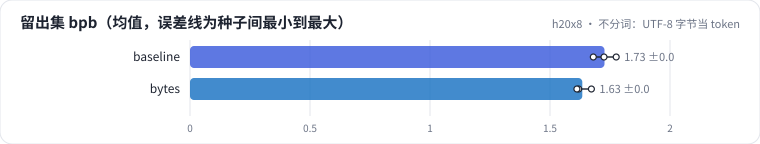
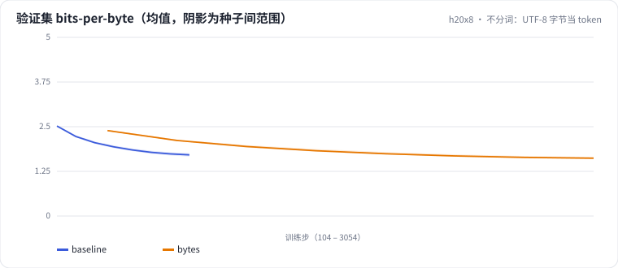

<!-- 本页由 python -m labkit docs 从 ../lesson.yaml 和 results/ 生成，不要手改 -->

[← 词表 16K → 64K](07-vocab-64k.md) · [课程首页](../README.md) · [直接用 Qwen2.5 的分词器 →](09-qwen.md)

# 第 8 步 / 共 15 步：不分词：UTF-8 字节当 token

> 阶段 3 / 6：**词表大小与分词方式** · 场景：`bytes`（对照 `baseline`）

不训练分词器，直接把每个 UTF-8 字节当一个 token（词表 257）。同样 100 MB 文本，token 数是 BPE 的约 3.7 倍，所以模型多走了 3.7 倍的训练步；但 512 token 的上下文只覆盖约 170 个汉字。

## 这一步跑了什么

| 场景 | 作用 | 说明 | 相对基线改了什么 | 种子（H20） |
| - | - | - | - | - |
| `baseline` | 对照 | 基线：16K 字节级 BPE（本语料训练），精确 + MinHash 去重，训练集 100 MB | — | 3 |
| `bytes` | 本步 | 不分词：UTF-8 字节当 token（词表 257），一个汉字 3 个 token | `tokenizer=bytes` | 3 |

## 先预测

**和 16K BPE 比，字节级的干净留出集 bpb（3 种子均值）会怎样？**

- **A.** 字节级明显更差（高 0.05 以上）
- **B.** 差不多（±0.05 以内）
- **C.** 字节级明显更好（低 0.05 以上）

> 先选定一个（记下来），再展开下面的实测。bpb 差异小于 0.02 或小于种子间波动，都按“差不多”算。

## 实测

展开实测：H20 · 小 GPT（1060 万主体参数）从零训练 100 MB 中文维基 · 每个场景 3 种子（已有 6 / 6 个运行）

| 场景 | 类型 | 留出集 bpb | 验证集 每 token loss | 训练 token 数 | 训练秒数 | 训练吞吐（字节/秒） | 留出集 bpb：与 `baseline` 差 | 留出集 bpb：各种子 | 断言 |
| - | - | - | - | - | - | - | - | - | - |
| `baseline` | 基线 | 1.727 ± 0.048 | 4.343 ± 0.122 | 27,262,976.0 ± 0.0 | 79 ± 0 | 1,742,576 ± 5,879 | — | s0 1.725 / s1 1.776 / s2 1.680 | 通过 |
| `bytes` | 候选改动 | 1.635 ± 0.033 | 1.121 ± 0.023 | 100,073,472.0 ± 0.0 | 208 ± 7 | 641,836 ± 2,543 | -0.092 | s0 1.673 / s1 1.620 / s2 1.612 | 通过 |

运行目录（每个目录里有 `summary.json` 指标、`evidence.json` 证据摘要、`predictions.jsonl` 逐条预测、`log.txt` 日志）：

- `baseline` [s0](../../../results/h20x8/L01/baseline/s0-39279f/) · [s1](../../../results/h20x8/L01/baseline/s1-cbec53/) · [s2](../../../results/h20x8/L01/baseline/s2-618736/)
- `bytes` [s0](../../../results/h20x8/L01/bytes/s0-e4f925/) · [s1](../../../results/h20x8/L01/bytes/s1-bef0e7/) · [s2](../../../results/h20x8/L01/bytes/s2-89359c/)

## 看完实测再想一步

训练曲线（按步数）谁先降下来？同样的墙钟时间，谁处理的文本多？

---

[← 词表 16K → 64K](07-vocab-64k.md) · [课程首页](../README.md) · [直接用 Qwen2.5 的分词器 →](09-qwen.md)
