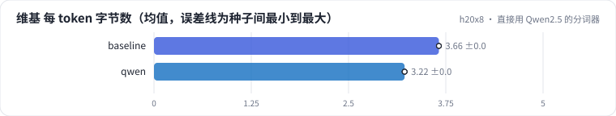
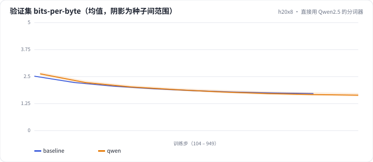

<!-- 本页由 python -m labkit docs 从 ../lesson.yaml 和 results/ 生成，不要手改 -->

[← 不分词：UTF-8 字节当 token](08-bytes.md) · [课程首页](../README.md) · [BPE 训练文本里混入广告 →](10-tok-ads.md)

# 第 9 步 / 共 15 步：直接用 Qwen2.5 的分词器

> 阶段 3 / 6：**词表大小与分词方式** · 场景：`qwen`（对照 `baseline`）

业务上最常见的做法：不自己训分词器，直接用基座模型的。Qwen2.5 的词表约 15.2 万，在海量多语种语料（中英文、代码……）上训练。其余全部同基线。

## 这一步跑了什么

| 场景 | 作用 | 说明 | 相对基线改了什么 | 种子（H20） |
| - | - | - | - | - |
| `baseline` | 对照 | 基线：16K 字节级 BPE（本语料训练），精确 + MinHash 去重，训练集 100 MB | — | 3 |
| `qwen` | 本步 | 直接用 Qwen2.5 的分词器（约 15.2 万词表） | `tokenizer=qwen` | 3 |

## 先预测

**在这份维基验证集上，Qwen2.5 分词器的每 token 字节数，和本语料训练的 16K BPE 比？**

- **A.** Qwen 压缩得更好（高 5% 以上）
- **B.** 差不多（±5% 以内）
- **C.** Qwen 压缩得更差（低 5% 以上）

> 先选定一个（记下来），再展开下面的实测。bpb 差异小于 0.02 或小于种子间波动，都按“差不多”算。

## 实测

展开实测：H20 · 小 GPT（1060 万主体参数）从零训练 100 MB 中文维基 · 每个场景 3 种子（已有 6 / 6 个运行）

| 场景 | 类型 | 维基 每 token 字节数 | 广告 每条 token 数 | 留出集 bpb | embedding 占比 | 训练秒数 | 维基 每 token 字节数：与 `baseline` 差 | 维基 每 token 字节数：各种子 | 断言 |
| - | - | - | - | - | - | - | - | - | - |
| `baseline` | 基线 | 3.66 ± 0.00 | 26.3 ± 0.0 | 1.727 ± 0.048 | 37.2% ± 0.0 | 79 ± 0 | — | s0 3.66 / s1 3.66 / s2 3.66 | 通过 |
| `qwen` | 候选改动 | 3.22 ± 0.00 | 23.2 ± 0.0 | 1.659 ± 0.087 | 84.6% ± 0.0 | 292 ± 3 | -0.44 | s0 3.22 / s1 3.22 / s2 3.22 |  |

运行目录（每个目录里有 `summary.json` 指标、`evidence.json` 证据摘要、`predictions.jsonl` 逐条预测、`log.txt` 日志）：

- `baseline` [s0](../../../results/h20x8/L01/baseline/s0-39279f/) · [s1](../../../results/h20x8/L01/baseline/s1-cbec53/) · [s2](../../../results/h20x8/L01/baseline/s2-618736/)
- `qwen` [s0](../../../results/h20x8/L01/qwen/s0-e6bc06/) · [s1](../../../results/h20x8/L01/qwen/s1-ccafbe/) · [s2](../../../results/h20x8/L01/qwen/s2-c45331/)

## 看完实测再想一步

维基和广告上，两个分词器的压缩率排序一样吗？

---

[← 不分词：UTF-8 字节当 token](08-bytes.md) · [课程首页](../README.md) · [BPE 训练文本里混入广告 →](10-tok-ads.md)
