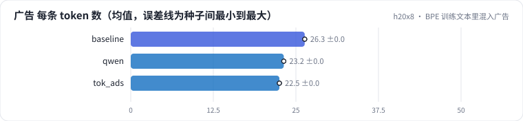

<!-- 本页由 python -m labkit docs 从 ../lesson.yaml 和 results/ 生成，不要手改 -->

[← 直接用 Qwen2.5 的分词器](09-qwen.md) · [课程首页](../README.md) · [只做精确去重 →](11-dedup-exact.md)

# 第 10 步 / 共 15 步：BPE 训练文本里混入广告

> 阶段 4 / 6：**词表的领域** · 场景：`tok_ads`（对照 `baseline`）

训练 BPE 的 20 MB 文本里，10% 换成模板生成的广告文案（和评估用的 60 条人工广告不重叠）。**语言模型的训练数据完全不变**，只改了词表：广告高频词（"满减""包邮""第二件半价"）有机会合并成整词。

## 这一步跑了什么

| 场景 | 作用 | 说明 | 相对基线改了什么 | 种子（H20） |
| - | - | - | - | - |
| `baseline` | 对照 | 基线：16K 字节级 BPE（本语料训练），精确 + MinHash 去重，训练集 100 MB | — | 3 |
| `qwen` | 参照 | 直接用 Qwen2.5 的分词器（约 15.2 万词表） | `tokenizer=qwen` | 3 |
| `tok_ads` | 本步 | BPE 训练文本里 10% 换成模板广告文案（LM 训练数据不变，只改词表） | `tok_ads_ratio=0.1` | 3 |

## 先预测

**60 条人工广告，平均每条 token 数和基线比会怎样？**

- **A.** 减少 15% 以上
- **B.** 减少 5% - 15%
- **C.** 变化不到 5%

> 先选定一个（记下来），再展开下面的实测。bpb 差异小于 0.02 或小于种子间波动，都按“差不多”算。

## 实测

展开实测：H20 · 小 GPT（1060 万主体参数）从零训练 100 MB 中文维基 · 每个场景 3 种子（已有 9 / 9 个运行）

| 场景 | 类型 | 广告 每条 token 数 | 维基 每 token 字节数 | 广告 bpb | 留出集 bpb | 广告 每条 token 数：与 `baseline` 差 | 广告 每条 token 数：各种子 | 断言 |
| - | - | - | - | - | - | - | - | - |
| `baseline` | 基线 | 26.3 ± 0.0 | 3.66 ± 0.00 | 3.507 ± 0.017 | 1.727 ± 0.048 | — | s0 26.3 / s1 26.3 / s2 26.3 | 通过 |
| `qwen` | 候选改动 | 23.2 ± 0.0 | 3.22 ± 0.00 | 3.414 ± 0.018 | 1.659 ± 0.087 | -3.2 | s0 23.2 / s1 23.2 / s2 23.2 |  |
| `tok_ads` | 候选改动 | 22.5 ± 0.0 | 3.64 ± 0.00 | 3.431 ± 0.013 | 1.736 ± 0.031 | -3.8 | s0 22.5 / s1 22.5 / s2 22.5 |  |

运行目录（每个目录里有 `summary.json` 指标、`evidence.json` 证据摘要、`predictions.jsonl` 逐条预测、`log.txt` 日志）：

- `baseline` [s0](../../../results/h20x8/L01/baseline/s0-39279f/) · [s1](../../../results/h20x8/L01/baseline/s1-cbec53/) · [s2](../../../results/h20x8/L01/baseline/s2-618736/)
- `qwen` [s0](../../../results/h20x8/L01/qwen/s0-e6bc06/) · [s1](../../../results/h20x8/L01/qwen/s1-ccafbe/) · [s2](../../../results/h20x8/L01/qwen/s2-c45331/)
- `tok_ads` [s0](../../../results/h20x8/L01/tok_ads/s0-ef559c/) · [s1](../../../results/h20x8/L01/tok_ads/s1-0da723/) · [s2](../../../results/h20x8/L01/tok_ads/s2-cd1869/)

## 看完实测再想一步

广告上少了几个 token？维基上的压缩率付出了多少？

---

[← 直接用 Qwen2.5 的分词器](09-qwen.md) · [课程首页](../README.md) · [只做精确去重 →](11-dedup-exact.md)
