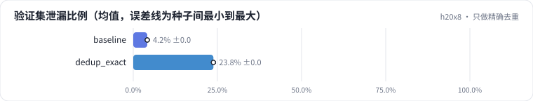

<!-- 本页由 python -m labkit docs 从 ../lesson.yaml 和 results/ 生成，不要手改 -->

[← BPE 训练文本里混入广告](10-tok-ads.md) · [课程首页](../README.md) · [关掉去重，验证集变乐观了 →](12-fault.md)

# 第 11 步 / 共 15 步：只做精确去重

> 阶段 5 / 6：**去重与验证集** · 场景：`dedup_exact`（对照 `baseline`）

回到 16K BPE，改去重方式。基线是"精确去重 + MinHash 近似去重"；这个场景**只做精确去重**（去掉空白后逐字相同的才删）。注入的副本一半是逐字相同，一半删了 1-2 句、前后加了转载声明——后一半精确去重删不掉。

## 这一步跑了什么

| 场景 | 作用 | 说明 | 相对基线改了什么 | 种子（H20） |
| - | - | - | - | - |
| `baseline` | 对照 | 基线：16K 字节级 BPE（本语料训练），精确 + MinHash 去重，训练集 100 MB | — | 3 |
| `dedup_exact` | 本步 | 只做精确去重：删句、加转载声明的近似副本留下 | `dedup=exact` | 3 |

## 先预测

**只做精确去重时，验证集里有多少比例的文档，它的同源文档（原文或副本）进了训练集？**

- **A.** 不到 5%
- **B.** 5% - 20%
- **C.** 20% 以上

> 先选定一个（记下来），再展开下面的实测。bpb 差异小于 0.02 或小于种子间波动，都按“差不多”算。

## 实测

展开实测：H20 · 小 GPT（1060 万主体参数）从零训练 100 MB 中文维基 · 每个场景 3 种子（已有 6 / 6 个运行）

| 场景 | 类型 | 验证集泄漏比例 | 训练集副本占字节 | 去重删掉的文档数 | 留出集 bpb | 验证集泄漏比例：与 `baseline` 差 | 验证集泄漏比例：各种子 | 断言 |
| - | - | - | - | - | - | - | - | - |
| `baseline` | 基线 | 4.2% ± 0.0 | 0.9% ± 0.0 | 117,170.0 ± 0.0 | 1.727 ± 0.048 | — | s0 4.2% / s1 4.2% / s2 4.2% | 通过 |
| `dedup_exact` | 候选改动 | 23.8% ± 0.0 | 25.4% ± 0.0 | 67,348.0 ± 0.0 | 1.772 ± 0.029 | +19.7 个点 | s0 23.8% / s1 23.8% / s2 23.8% |  |

运行目录（每个目录里有 `summary.json` 指标、`evidence.json` 证据摘要、`predictions.jsonl` 逐条预测、`log.txt` 日志）：

- `baseline` [s0](../../../results/h20x8/L01/baseline/s0-39279f/) · [s1](../../../results/h20x8/L01/baseline/s1-cbec53/) · [s2](../../../results/h20x8/L01/baseline/s2-618736/)
- `dedup_exact` [s0](../../../results/h20x8/L01/dedup_exact/s0-dce1e0/) · [s1](../../../results/h20x8/L01/dedup_exact/s1-78e928/) · [s2](../../../results/h20x8/L01/dedup_exact/s2-024221/)

## 看完实测再想一步

精确去重删掉了多少篇？和注入的副本数比呢？

---

[← BPE 训练文本里混入广告](10-tok-ads.md) · [课程首页](../README.md) · [关掉去重，验证集变乐观了 →](12-fault.md)
