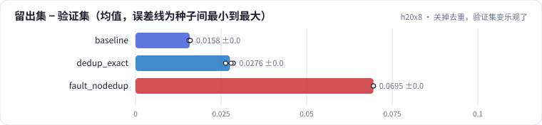
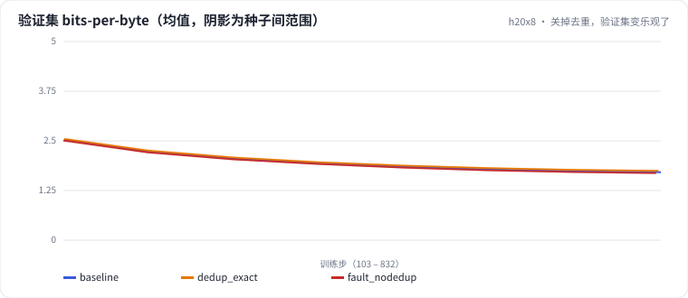

<!-- 本页由 python -m labkit docs 从 ../lesson.yaml 和 results/ 生成，不要手改 -->

[← 只做精确去重](11-dedup-exact.md) · [课程首页](../README.md) · [诊断：验证集为什么更乐观 →](13-diagnose.md)

# 第 12 步 / 共 15 步：关掉去重，验证集变乐观了

> 阶段 5 / 6：**去重与验证集** · 场景：`fault_nodedup`（对照 `baseline`）

同事为了省时间把去重整个关掉（MinHash 在 CPU 上要跑几十秒），重新训了一遍，只看验证集就下了结论。训练文本还是 100 MB，模型、分词器都不变。

我们手里多一样东西：**干净留出集 test**（注入副本之前就拿走，各场景完全相同）。同一个模型上，"留出集 bpb − 验证集 bpb"衡量验证集有多乐观。基线模型上它是 +0.016 ± +0.000——两批不同文档本身的难易差，不是泄漏（基线的验证集泄漏比例只有 4.2% ± 0.0%）。

## 这一步跑了什么

| 场景 | 作用 | 说明 | 相对基线改了什么 | 种子（H20） |
| - | - | - | - | - |
| `baseline` | 对照 | 基线：16K 字节级 BPE（本语料训练），精确 + MinHash 去重，训练集 100 MB | — | 3 |
| `dedup_exact` | 参照 | 只做精确去重：删句、加转载声明的近似副本留下 | `dedup=exact` | 3 |
| `fault_nodedup` | 本步 | 不去重：转载副本随机落进训练集和验证集 | `dedup=none` | 3 |

## 先预测

**不去重的模型上，"留出集 − 验证集"的 bpb 差，比基线大多少？**

- **A.** 几乎不变（不到 0.01）
- **B.** 大 0.01 - 0.05
- **C.** 大 0.05 以上

> 先选定一个（记下来），再展开下面的实测。bpb 差异小于 0.02 或小于种子间波动，都按“差不多”算。

## 实测

展开实测：H20 · 小 GPT（1060 万主体参数）从零训练 100 MB 中文维基 · 每个场景 3 种子（已有 9 / 9 个运行）

展开实测：H20 · 小 GPT（1060 万主体参数）从零训练 100 MB 中文维基 · 每个场景 3 种子（已有 8 / 9 个运行）

| 场景 | 类型 | 留出集 − 验证集 | 验证集 bpb | 留出集 bpb | 验证集泄漏比例 | 训练集副本占字节 | 留出集 − 验证集：与 `baseline` 差 | 留出集 − 验证集：各种子 | 断言 |
| - | - | - | - | - | - | - | - | - | - |
| `baseline` | 基线 | +0.016 ± +0.000 | 1.711 ± 0.048 | 1.727 ± 0.048 | 4.2% ± 0.0 | 0.9% ± 0.0 | — | s0 +0.016 / s1 +0.016 / s2 +0.016 | 通过 |
| `dedup_exact` | 候选改动 | +0.028 ± +0.001 | 1.745 ± 0.030 | 1.772 ± 0.029 | 23.8% ± 0.0 | 25.4% ± 0.0 | +0.012 | s0 +0.026 / s1 +0.029 / s2 +0.028 |  |
| `fault_nodedup` | 教学故障 | +0.068 ± +0.002 | 1.690 ± 0.022 | 1.758 ± 0.021 | 39.0% ± 0.0 | 42.2% ± 0.0 | +0.052 | s0 +0.069 / s1 +0.066 / s2 +0.070 | 通过 |
| `fault_nodedup` | 教学故障 | +0.069 ± +0.000 | 1.680 ± 0.021 | 1.749 ± 0.021 | 39.0% ± 0.0 | 42.2% ± 0.0 | +0.054 | s0 +0.069 / s2 +0.070 | 通过 |

运行目录（每个目录里有 `summary.json` 指标、`evidence.json` 证据摘要、`predictions.jsonl` 逐条预测、`log.txt` 日志）：

- `baseline` [s0](../../../results/h20x8/L01/baseline/s0-39279f/) · [s1](../../../results/h20x8/L01/baseline/s1-cbec53/) · [s2](../../../results/h20x8/L01/baseline/s2-618736/)
- `dedup_exact` [s0](../../../results/h20x8/L01/dedup_exact/s0-dce1e0/) · [s1](../../../results/h20x8/L01/dedup_exact/s1-78e928/) · [s2](../../../results/h20x8/L01/dedup_exact/s2-024221/)
- `fault_nodedup` [s0](../../../results/h20x8/L01/fault_nodedup/s0-37d57c/) · [s1](../../../results/h20x8/L01/fault_nodedup/s1-3dac52/) · [s2](../../../results/h20x8/L01/fault_nodedup/s2-a17333/)
- `fault_nodedup` [s0](../../../results/h20x8/L01/fault_nodedup/s0-37d57c/) · [s2](../../../results/h20x8/L01/fault_nodedup/s2-a17333/)

## 看完实测再想一步

验证集和留出集，哪个变得多？

---

[← 只做精确去重](11-dedup-exact.md) · [课程首页](../README.md) · [诊断：验证集为什么更乐观 →](13-diagnose.md)
