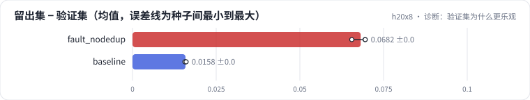

<!-- 本页由 python -m labkit docs 从 ../lesson.yaml 和 results/ 生成，不要手改 -->

[← 关掉去重，验证集变乐观了](12-fault.md) · [课程首页](../README.md) · [背过几遍才算背下来 →](14-leak.md)

# 第 13 步 / 共 15 步：诊断：验证集为什么更乐观

> 阶段 5 / 6：**去重与验证集** · 场景：`baseline`（对照 `fault_nodedup`）

模型、分词器、超参、训练文本量都没变，只是去重关了；验证集比干净留出集更乐观了。按需逐级点开线索，然后点选根因。

## 这一步跑了什么

| 场景 | 作用 | 说明 | 相对基线改了什么 | 种子（H20） |
| - | - | - | - | - |
| `fault_nodedup` | 对照 | 不去重：转载副本随机落进训练集和验证集 | `dedup=none` | 3 |
| `baseline` | 本步 | 基线：16K 字节级 BPE（本语料训练），精确 + MinHash 去重，训练集 100 MB | — | 3 |

## 线索

逐条展开，看到能下判断为止。

线索 1

对比干净留出集：基线 验证集 1.711 ± 0.048 / 留出集 1.727 ± 0.048；不去重 验证集 1.690 ± 0.022 / 留出集 1.758 ± 0.021。两个集合是一起变的吗？
对比干净留出集：基线 验证集 1.711 ± 0.048 / 留出集 1.727 ± 0.048；不去重 验证集 1.680 ± 0.021 / 留出集 1.749 ± 0.021。两个集合是一起变的吗？

线索 2

看语料统计：验证集里同源文档进了训练集的比例，基线 4.2% ± 0.0%，不去重 39.0% ± 0.0%；不去重时训练集里副本占字节 42.2% ± 0.0%。

线索 3

同一个模型内部拆开看：不去重时，验证集里同源文档在训练集有 8 篇以上的那部分 bpb 1.505 ± 0.027，从没被转载过的原文 1.756 ± 0.021。
同一个模型内部拆开看：不去重时，验证集里同源文档在训练集有 8 篇以上的那部分 bpb 1.493 ± 0.023，从没被转载过的原文 1.747 ± 0.020。

## 先预测

**验证集变得更乐观的主要原因是什么？**

- **A.** 重复数据相当于多训了几轮，模型在所有文本上都学得更好了
- **B.** 转载副本分别落进训练集和验证集，验证集里有模型背过的文章
- **C.** 不去重时验证集换了一批更容易的文档，是抽样差异
- **D.** 转载声明这类模板句在验证集里很多，模型很容易预测

> 先选定一个（记下来），再展开下面的实测。bpb 差异小于 0.02 或小于种子间波动，都按“差不多”算。

## 实测

展开实测：H20 · 小 GPT（1060 万主体参数）从零训练 100 MB 中文维基 · 每个场景 3 种子（已有 6 / 6 个运行）

| 场景 | 类型 | 留出集 − 验证集 | 验证集泄漏比例 | 同源 ≥ 8 篇的部分 bpb | 未转载原文 bpb | 留出集 − 验证集：与 `fault_nodedup` 差 | 留出集 − 验证集：各种子 | 断言 |
| - | - | - | - | - | - | - | - | - |
| `fault_nodedup` | 教学故障 | +0.068 ± +0.002 | 39.0% ± 0.0 | 1.505 ± 0.027 | 1.756 ± 0.021 | — | s0 +0.069 / s1 +0.066 / s2 +0.070 | 通过 |
| `baseline` | 基线 | +0.016 ± +0.000 | 4.2% ± 0.0 | — | 1.729 ± 0.048 | -0.052 | s0 +0.016 / s1 +0.016 / s2 +0.016 | 通过 |

展开实测：H20 · 小 GPT（1060 万主体参数）从零训练 100 MB 中文维基 · 每个场景 3 种子（已有 5 / 6 个运行）

| 场景 | 类型 | 留出集 − 验证集 | 验证集泄漏比例 | 同源 ≥ 8 篇的部分 bpb | 未转载原文 bpb | 留出集 − 验证集：与 `fault_nodedup` 差 | 留出集 − 验证集：各种子 | 断言 |
| - | - | - | - | - | - | - | - | - |
| `fault_nodedup` | 教学故障 | +0.069 ± +0.000 | 39.0% ± 0.0 | 1.493 ± 0.023 | 1.747 ± 0.020 | — | s0 +0.069 / s2 +0.070 | 通过 |
| `baseline` | 基线 | +0.016 ± +0.000 | 4.2% ± 0.0 | — | 1.729 ± 0.048 | -0.054 | s0 +0.016 / s1 +0.016 / s2 +0.016 | 通过 |

运行目录（每个目录里有 `summary.json` 指标、`evidence.json` 证据摘要、`predictions.jsonl` 逐条预测、`log.txt` 日志）：

- `fault_nodedup` [s0](../../../results/h20x8/L01/fault_nodedup/s0-37d57c/) · [s1](../../../results/h20x8/L01/fault_nodedup/s1-3dac52/) · [s2](../../../results/h20x8/L01/fault_nodedup/s2-a17333/)
- `fault_nodedup` [s0](../../../results/h20x8/L01/fault_nodedup/s0-37d57c/) · [s2](../../../results/h20x8/L01/fault_nodedup/s2-a17333/)
- `baseline` [s0](../../../results/h20x8/L01/baseline/s0-39279f/) · [s1](../../../results/h20x8/L01/baseline/s1-cbec53/) · [s2](../../../results/h20x8/L01/baseline/s2-618736/)

---

[← 关掉去重，验证集变乐观了](12-fault.md) · [课程首页](../README.md) · [背过几遍才算背下来 →](14-leak.md)
