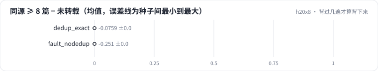

<!-- 本页由 python -m labkit docs 从 ../lesson.yaml 和 results/ 生成，不要手改 -->

[← 诊断：验证集为什么更乐观](13-diagnose.md) · [课程首页](../README.md) · [回顾 →](15-keycard.md)

# 第 14 步 / 共 15 步：背过几遍才算背下来

> 阶段 5 / 6：**去重与验证集** · 场景：`fault_nodedup`（对照 `baseline`）

量化"背过"的效果。不去重的模型上，把验证集按"训练集里有几篇同源文档"拆开：**1-2 篇**（大多数转载只有一两份）、**8 篇以上**（被转载几十次的长尾文章），和**从没被转载过的原文**比。

## 这一步跑了什么

| 场景 | 作用 | 说明 | 相对基线改了什么 | 种子（H20） |
| - | - | - | - | - |
| `baseline` | 对照 | 基线：16K 字节级 BPE（本语料训练），精确 + MinHash 去重，训练集 100 MB | — | 3 |
| `dedup_exact` | 参照 | 只做精确去重：删句、加转载声明的近似副本留下 | `dedup=exact` | 3 |
| `fault_nodedup` | 本步 | 不去重：转载副本随机落进训练集和验证集 | `dedup=none` | 3 |

## 先预测

**不去重的模型上，"训练集里有 8 篇以上同源文档"的那部分验证文档，bpb 比从没被转载过的原文低多少？**

- **A.** 不到 0.1
- **B.** 0.1 - 0.5
- **C.** 0.5 以上

> 先选定一个（记下来），再展开下面的实测。bpb 差异小于 0.02 或小于种子间波动，都按“差不多”算。

## 实测

展开实测：H20 · 小 GPT（1060 万主体参数）从零训练 100 MB 中文维基 · 每个场景 3 种子（已有 8 / 9 个运行）

| 场景 | 类型 | 同源 ≥ 8 篇 − 未转载 | 同源 1-2 篇 − 未转载 | 被转载原文 − 未转载原文 | 验证集泄漏比例 | 同源 ≥ 8 篇 − 未转载：与 `baseline` 差 | 同源 ≥ 8 篇 − 未转载：各种子 | 断言 |
| - | - | - | - | - | - | - | - | - |
| `baseline` | 基线 | — | -0.693 ± +0.019 | -0.057 ± +0.001 | 4.2% ± 0.0 | — | — | 通过 |
| `dedup_exact` | 候选改动 | -0.076 ± +0.013 | -0.000 ± +0.004 | -0.068 ± +0.001 | 23.8% ± 0.0 | — | s0 -0.062 / s1 -0.088 / s2 -0.078 |  |
| `fault_nodedup` | 教学故障 | -0.255 ± +0.003 | -0.067 ± +0.001 | -0.076 ± +0.002 | 39.0% ± 0.0 | — | s0 -0.253 / s2 -0.257 | 通过 |

运行目录（每个目录里有 `summary.json` 指标、`evidence.json` 证据摘要、`predictions.jsonl` 逐条预测、`log.txt` 日志）：

- `baseline` [s0](../../../results/h20x8/L01/baseline/s0-39279f/) · [s1](../../../results/h20x8/L01/baseline/s1-cbec53/) · [s2](../../../results/h20x8/L01/baseline/s2-618736/)
- `dedup_exact` [s0](../../../results/h20x8/L01/dedup_exact/s0-dce1e0/) · [s1](../../../results/h20x8/L01/dedup_exact/s1-78e928/) · [s2](../../../results/h20x8/L01/dedup_exact/s2-024221/)
- `fault_nodedup` [s0](../../../results/h20x8/L01/fault_nodedup/s0-37d57c/) · [s2](../../../results/h20x8/L01/fault_nodedup/s2-a17333/)

## 看完实测再想一步

1-2 篇和 8 篇以上，差了几倍？基线和只做精确去重的这两列是多少？

---

[← 诊断：验证集为什么更乐观](13-diagnose.md) · [课程首页](../README.md) · [回顾 →](15-keycard.md)
