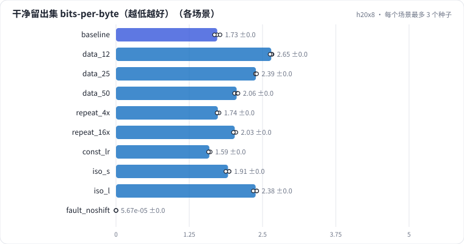

# L02 预训练 next-token：6ND 与实测 FLOPs、token 预算、数据重复、学习率调度、等算力下的模型大小

沿用 L01 的语料、16K BPE 和小 GPT，把预训练的"账"算清楚：每 token 多少 FLOPs、6ND 漏掉了什么、这张卡的 MFU 是多少；token 预算翻倍 bpb 降多少；同样的算力，数据重复 4 遍、16 遍各亏多少；余弦退火贡献了多少；等算力下模型该大还是该小。最后诊断一次"loss 降到接近 0"的数据 bug。

## 怎么学（只看 GitHub 就够）

按下面“步骤”表从第 1 步往下点。每一页先给问题和选项，**先选定一个再展开“实测”**；实测里有结果表、证据图和运行目录链接。作业进度见 [作业看板](../../jobs/README.md)。参考答案和解析只在私有工作台里。

## 任务

**出发点**：要给"在业务语料上继续预训练"立项，得先回答三个数量级问题：要多少卡时？loss 降到哪里算够？数据不够时能不能重复用？这些都能在训练之前估出来，估算的工具就是 **6ND** 和 scaling 曲线。

这一课直接复用 L01 的环境（同一份 100 MB 中文维基训练流、同一个 16K BPE、同一个小 GPT），只改"怎么用 token"：

- **token 预算**：只用训练流的前 12.5% / 25% / 50% / 100%，每个预算都把学习率调度完整跑完；
- **数据重复**：独特数据只有 1/4、1/16，但重复 4 遍、16 遍，训练 token 数和基线相同；
- **学习率调度**：余弦退火 vs warmup 后保持恒定；
- **等算力**：算力固定为"基线模型训 50 MB"，换一个小一号（620 万主体）和大一号（2530 万主体）的模型，各自能看多少 token 由算力倒推。

| 集合 | 大小 | 用途 |
| - | - | - |
| 训练流 | 100 MB 文本，约 2700 万 token | 按场景取前缀、重复 |
| 验证集 | 约 10 MB | 训练中看曲线；8 个评估点 |
| 干净留出集 test | 10 MB | 各场景完全相同：主指标 |
| 已见数据 seen | 训练前缀开头的最多 10 MB | 只用来算"验证 − 已见"的记忆差 |

## 规模与边界

- **H20 档**：小 GPT（d=384、6 层、6 头、SwiGLU 1024、RoPE、tied embedding，序列 512），batch 64 × 512，AdamW lr 2e-3，warmup 2% + 余弦降到 10%；bf16 autocast；每个场景 3 个种子。
- **保留了**：next-token 交叉熵、FLOPs 的完整记账（主体、输出层、注意力）、学习率调度、数据受限时重复训练的机制、等算力比较的方法。
- **缩小了**：模型 1000 万级、数据 2700 万 token，**每参数 token 数只有 1-2**（Chinchilla 最优约 20），所有场景都处在严重欠训练区；等算力的大小模型都**没有重新调学习率**。
- **未验证**：大模型上的 scaling 指数、最优每参数 token 数；数据重复在更大数据集上的衰减速度（Muennighoff 2023 的结论是 4 遍以内几乎无损，这里的数据受限得多）。

## 步骤

<!-- labkit:path -->
| # | 阶段 | 步骤 | 这一步回答的问题 | 场景 | H20 结果 |
| - | - | - | - | - | - |
| 1 | 理解任务 | [场景与痛点](steps/01-pain.md) | 继续预训练要多少卡时、loss 降到哪里算够、数据不够能不能重复用——训练之前能估出来吗？ | — | — |
| 2 | 理解任务 | [流程结构](steps/02-flow.md) |  | — | — |
| 3 | 理解任务 | [追踪一个 batch](steps/03-trace.md) |  | — | — |
| 4 | 理解任务 | [代码导读](steps/04-code.md) |  | — | — |
| 5 | 先估算 | [先估算](steps/05-estimate.md) | 基线把 100 MB 训练流过一遍，训练总 FLOPs 大约是多少？（1 PF = 10¹⁵ FLOPs） | — | — |
| 6 | token 预算 | [训练数据减半](steps/06-data-half.md) | 和基线（100 MB）比，干净留出集 bpb（3 种子均值）会差多少？ | `data_50` | 3 / 3 |
| 7 | token 预算 | [数据翻 3 倍，bpb 降多少](steps/07-scaling.md) | 从 12.5 MB 到 100 MB，留出集 bpb 一共降多少？ | `data_12` | 3 / 3 |
| 8 | token 预算 | [跑完的 25 MB vs 途中的 25 MB](steps/08-anneal.md) | 完整跑完的 25 MB 预算，和基线训练到 25 MB 时相比，验证集 bpb 怎样？ | `data_25` | 3 / 3 |
| 9 | 数据重复 | [25 MB × 4 遍 vs 100 MB × 1 遍](steps/09-repeat4.md) | 和 100 MB 不重复的基线比，留出集 bpb 差多少？ | `repeat_4x` | 3 / 3 |
| 10 | 数据重复 | [6 MB × 16 遍：背下来多少](steps/10-repeat16.md) | 重复 16 遍后，"验证集 bpb − 已见数据 bpb"大约是多少？ | `repeat_16x` | 3 / 3 |
| 11 | 学习率调度 | [不做余弦退火](steps/11-const.md) | 和余弦退火比，留出集 bpb 差多少？ | `const_lr` | 3 / 3 |
| 12 | 等算力下的模型大小 | [同样算力，换小模型多看数据](steps/12-iso-small.md) | 等算力下，小模型 vs 中模型（data_50），留出集 bpb 怎样？ | `iso_s` | 3 / 3 |
| 13 | 等算力下的模型大小 | [同样算力，换大模型少看数据](steps/13-iso-large.md) | 等算力下，大模型 vs 中模型（data_50），留出集 bpb 怎样？ | `iso_l` | 3 / 3 |
| 14 | 故障诊断 | [同事重构了数据代码](steps/14-fault.md) | 重构后，干净留出集 bpb 和基线比怎样？ | `fault_noshift` | 3 / 3 |
| 15 | 故障诊断 | [诊断：为什么好得不可能](steps/15-diagnose.md) | loss 降到接近 0 的根因是什么？ | `baseline` | 3 / 3 |
| 16 | 带走 | [回顾](steps/16-keycard.md) |  | — | — |
<!-- /labkit:path -->

## 场景与结果

<!-- labkit:results -->

展开结果（先自己预测，再看）

**h20x8**：8 × NVIDIA H20，每张卡一个运行。语料、分词器（16K BPE）和 L01 完全相同（缓存共用）；小 GPT（d=384、6 层，主体约 1060 万参数）从零训练，基线 = L01 基线（同配置同代码时直接复用）（已有 30 / 30 个运行）

| 场景 | 类型 | 留出集 bpb | 训练 token | 独特数据 MB | 遍数 | 验证 − 已见 bpb | 训练 PFLOPs | MFU | 训练秒数 | 断言 |
| - | - | - | - | - | - | - | - | - | - | - |
| `baseline` | 基线 | 1.7271 ± 0.0478 (n=3) | 27262976.0000 ± 0.0000 (n=3) | 100.3400 ± 0.0000 (n=3) | 1.0000 ± 0.0000 (n=3) | 0.0057 ± 0.0011 (n=3) | 2.9596 ± 0.0000 (n=3) | 0.3486 ± 0.0012 (n=3) | 79.3333 ± 0.2082 (n=3) | 通过 |
| `data_12` | 候选改动 | 2.6488 ± 0.0186 (n=3) | 3407872.0000 ± 0.0000 (n=3) | 12.5400 ± 0.0000 (n=3) | 1.0000 ± 0.0000 (n=3) | 0.0060 ± 0.0012 (n=3) | 0.3700 ± 0.0000 (n=3) | 0.3824 ± 0.0190 (n=3) | 25.8333 ± 0.1528 (n=3) | 通过 |
| `data_25` | 候选改动 | 2.3867 ± 0.0117 (n=3) | 6815744.0000 ± 0.0000 (n=3) | 25.0800 ± 0.0000 (n=3) | 1.0000 ± 0.0000 (n=3) | 0.0044 ± 0.0014 (n=3) | 0.7399 ± 0.0000 (n=3) | 0.3946 ± 0.0111 (n=3) | 33.6333 ± 0.1155 (n=3) | 通过 |
| `data_50` | 候选改动 | 2.0579 ± 0.0309 (n=3) | 13631488.0000 ± 0.0000 (n=3) | 50.1700 ± 0.0000 (n=3) | 1.0000 ± 0.0000 (n=3) | 0.0093 ± 0.0023 (n=3) | 1.4798 ± 0.0000 (n=3) | 0.3299 ± 0.0020 (n=3) | 48.1667 ± 0.2082 (n=3) | 通过 |
| `repeat_4x` | 候选改动 | 1.7374 ± 0.0188 (n=3) | 27262976.0000 ± 0.0000 (n=3) | 25.0800 ± 0.0000 (n=3) | 4.0000 ± 0.0000 (n=3) | 0.1211 ± 0.0051 (n=3) | 2.9596 ± 0.0000 (n=3) | 0.3514 ± 0.0008 (n=3) | 76.8667 ± 0.2082 (n=3) | 通过 |
| `repeat_16x` | 候选改动 | 2.0257 ± 0.0214 (n=3) | 27262976.0000 ± 0.0000 (n=3) | 6.2700 ± 0.0000 (n=3) | 16.0000 ± 0.0000 (n=3) | 0.7303 ± 0.0416 (n=3) | 2.9596 ± 0.0000 (n=3) | 0.3510 ± 0.0007 (n=3) | 76.6333 ± 0.0577 (n=3) | 通过 |
| `const_lr` | 候选改动 | 1.5930 ± 0.0148 (n=3) | 27262976.0000 ± 0.0000 (n=3) | 100.3400 ± 0.0000 (n=3) | 1.0000 ± 0.0000 (n=3) | 0.0084 ± 0.0016 (n=3) | 2.9596 ± 0.0000 (n=3) | 0.3511 ± 0.0007 (n=3) | 76.7667 ± 0.1528 (n=3) |  |
| `iso_s` | 候选改动 | 1.9114 ± 0.0334 (n=3) | 20119552.0000 ± 0.0000 (n=3) | 100.3400 ± 0.0000 (n=3) | 1.0000 ± 0.0000 (n=3) | -0.0011 ± 0.0013 (n=3) | 1.4801 ± 0.0000 (n=3) | 0.3063 ± 0.0005 (n=3) | 46.7333 ± 0.0577 (n=3) | 通过 |
| `iso_l` | 候选改动 | 2.3818 ± 0.0350 (n=3) | 6881280.0000 ± 0.0000 (n=3) | 100.3400 ± 0.0000 (n=3) | 1.0000 ± 0.0000 (n=3) | -0.0165 ± 0.0018 (n=3) | 1.4777 ± 0.0000 (n=3) | 0.3594 ± 0.0201 (n=3) | 57.2667 ± 0.1528 (n=3) | 通过 |
| `fault_noshift` | 教学故障 | 0.0001 ± 0.0000 (n=3) | 27262976.0000 ± 0.0000 (n=3) | 100.3400 ± 0.0000 (n=3) | 1.0000 ± 0.0000 (n=3) | -0.0001 ± 0.0001 (n=3) | 2.9596 ± 0.0000 (n=3) | 0.3505 ± 0.0004 (n=3) | 76.9667 ± 0.1155 (n=3) | 通过 |

<!-- /labkit:results -->

## 证据图

<!-- labkit:figures -->

展开证据图（先自己预测，再看）

- **h20x8**：[主指标](figures/h20x8-metrics.svg)

  

<!-- /labkit:figures -->

## 代码

<!-- labkit:code -->
| 代码段 | 位置 |
| - | - |
| `clean` | [projects/tinylm/corpus.py#L44](../../projects/tinylm/corpus.py#L44) |
| `minhash` | [projects/tinylm/corpus.py#L111](../../projects/tinylm/corpus.py#L111) |
| `build` | [projects/tinylm/corpus.py#L219](../../projects/tinylm/corpus.py#L219) |
| `flops_budget` | [projects/tinylm/experiment.py#L42](../../projects/tinylm/experiment.py#L42) |
| `docmask` | [projects/tinylm/model.py#L61](../../projects/tinylm/model.py#L61) |
| `moe` | [projects/tinylm/model.py#L88](../../projects/tinylm/model.py#L88) |
| `attention` | [projects/tinylm/model.py#L142](../../projects/tinylm/model.py#L142) |
| `mla` | [projects/tinylm/model.py#L161](../../projects/tinylm/model.py#L161) |
| `norm` | [projects/tinylm/model.py#L190](../../projects/tinylm/model.py#L190) |
| `gpt` | [projects/tinylm/model.py#L200](../../projects/tinylm/model.py#L200) |
| `kvcache` | [projects/tinylm/model.py#L296](../../projects/tinylm/model.py#L296) |
| `train_bpe` | [projects/tinylm/tokenizer.py#L85](../../projects/tinylm/tokenizer.py#L85) |
| `compression` | [projects/tinylm/tokenizer.py#L137](../../projects/tinylm/tokenizer.py#L137) |
| `schedule` | [projects/tinylm/train.py#L31](../../projects/tinylm/train.py#L31) |
| `batch` | [projects/tinylm/train.py#L71](../../projects/tinylm/train.py#L71) |
| `evaluate` | [projects/tinylm/train.py#L80](../../projects/tinylm/train.py#L80) |
| `budget` | [projects/tinylm/train.py#L141](../../projects/tinylm/train.py#L141) |
| `train` | [projects/tinylm/train.py#L162](../../projects/tinylm/train.py#L162) |
<!-- /labkit:code -->
