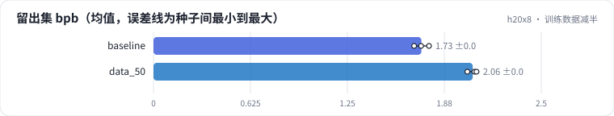
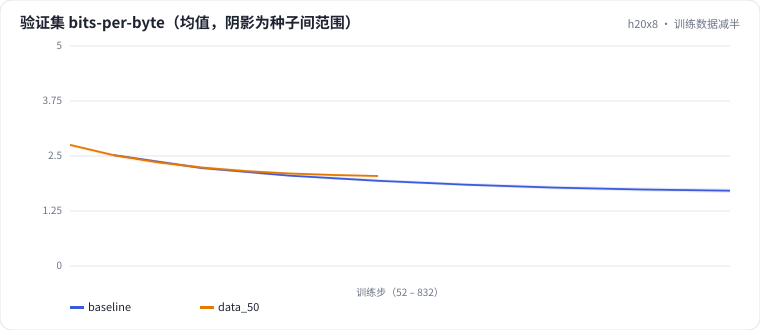

<!-- 本页由 python -m labkit docs 从 ../lesson.yaml 和 results/ 生成，不要手改 -->

[← 先估算](05-estimate.md) · [课程首页](../README.md) · [数据翻 3 倍，bpb 降多少 →](07-scaling.md)

# 第 6 步 / 共 16 步：训练数据减半

> 阶段 3 / 8：**token 预算** · 场景：`data_50`（对照 `baseline`）

只用训练流的前 50%（约 50 MB、1350 万 token），学习率调度按自己的步数完整跑完。模型、语料、分词器都不变。

## 这一步跑了什么

| 场景 | 作用 | 说明 | 相对基线改了什么 | 种子（H20） |
| - | - | - | - | - |
| `baseline` | 对照 | 基线：100 MB 训练流过一遍，余弦调度（= L01 基线） | — | 3 |
| `data_50` | 本步 | 只用前 50% | `data_frac=0.5` | 3 |

## 先预测

**和基线（100 MB）比，干净留出集 bpb（3 种子均值）会差多少？**

- **A.** 差不多（差 0.05 以内）
- **B.** 差 0.05 - 0.15
- **C.** 差 0.15 以上

> 先选定一个（记下来），再展开下面的实测。bpb 差异小于 0.05（H20 上 3 种子均值之差的噪声量级）或小于种子间波动，都按“差不多”算。

## 实测

展开实测：H20 · 小 GPT（1060 万主体参数）从零训练中文维基 · 每个场景 3 种子（已有 6 / 6 个运行）

| 场景 | 类型 | 留出集 bpb | 训练 token | 每参数 token | 训练秒数 | 留出集 bpb：与 `baseline` 差 | 留出集 bpb：各种子 | 断言 |
| - | - | - | - | - | - | - | - | - |
| `baseline` | 基线 | 1.727 ± 0.048 | 27,262,976.0 ± 0.0 | 1.61 ± 0.00 | 79 ± 0 | — | s0 1.725 / s1 1.776 / s2 1.680 | 通过 |
| `data_50` | 候选改动 | 2.058 ± 0.031 | 13,631,488.0 ± 0.0 | 0.81 ± 0.00 | 48 ± 0 | +0.331 | s0 2.023 / s1 2.068 / s2 2.082 | 通过 |

运行目录（每个目录里有 `summary.json` 指标、`evidence.json` 证据摘要、`predictions.jsonl` 逐条预测、`log.txt` 日志）：

- `baseline` [s0](../../../results/h20x8/L02/baseline/s0-39279f/) · [s1](../../../results/h20x8/L02/baseline/s1-cbec53/) · [s2](../../../results/h20x8/L02/baseline/s2-618736/)
- `data_50` [s0](../../../results/h20x8/L02/data_50/s0-97075e/) · [s1](../../../results/h20x8/L02/data_50/s1-3791eb/) · [s2](../../../results/h20x8/L02/data_50/s2-b28c6d/)

## 看完实测再想一步

两条验证集曲线在前一半是重合的吗？50 MB 那条最后一段为什么下降得更快？

---

[← 先估算](05-estimate.md) · [课程首页](../README.md) · [数据翻 3 倍，bpb 降多少 →](07-scaling.md)
