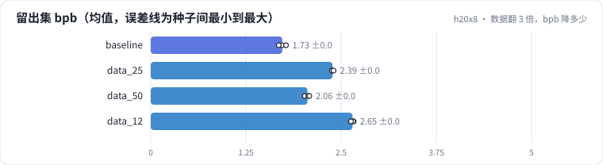
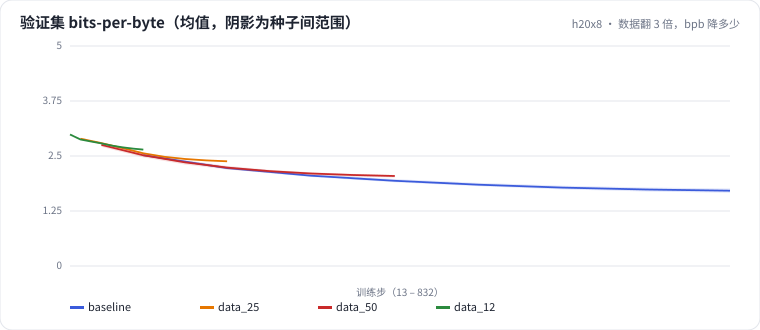

<!-- 本页由 python -m labkit docs 从 ../lesson.yaml 和 results/ 生成，不要手改 -->

[← 训练数据减半](06-data-half.md) · [课程首页](../README.md) · [跑完的 25 MB vs 途中的 25 MB →](08-anneal.md)

# 第 7 步 / 共 16 步：数据翻 3 倍，bpb 降多少

> 阶段 3 / 8：**token 预算** · 场景：`data_12`（对照 `baseline`）

四个 token 预算：12.5 MB、25 MB、50 MB、100 MB，每次翻倍，每个都把调度跑完。从 12.5 MB 到 100 MB 是三次翻倍（8 倍数据）。

## 这一步跑了什么

| 场景 | 作用 | 说明 | 相对基线改了什么 | 种子（H20） |
| - | - | - | - | - |
| `baseline` | 对照 | 基线：100 MB 训练流过一遍，余弦调度（= L01 基线） | — | 3 |
| `data_25` | 参照 | 只用前 25% | `data_frac=0.25` | 3 |
| `data_50` | 参照 | 只用前 50% | `data_frac=0.5` | 3 |
| `data_12` | 本步 | 只用训练流前 12.5%（约 12.5 MB），调度按自己的步数跑完 | `data_frac=0.125` | 3 |

## 先预测

**从 12.5 MB 到 100 MB，留出集 bpb 一共降多少？**

- **A.** 降 0.3 以上
- **B.** 降 0.1 - 0.3
- **C.** 降不到 0.1

> 先选定一个（记下来），再展开下面的实测。bpb 差异小于 0.02 或小于种子间波动，都按“差不多”算。

## 实测

展开实测：H20 · 小 GPT（1060 万主体参数）从零训练中文维基 · 每个场景 3 种子（已有 12 / 12 个运行）

| 场景 | 类型 | 留出集 bpb | 独特数据 MB | 步数 | 留出集 bpb：与 `baseline` 差 | 留出集 bpb：各种子 | 断言 |
| - | - | - | - | - | - | - | - |
| `baseline` | 基线 | 1.727 ± 0.048 | 100.3 ± 0.0 | 832.0 ± 0.0 | — | s0 1.725 / s1 1.776 / s2 1.680 | 通过 |
| `data_25` | 候选改动 | 2.387 ± 0.012 | 25.1 ± 0.0 | 208.0 ± 0.0 | +0.660 | s0 2.381 / s1 2.379 / s2 2.400 | 通过 |
| `data_50` | 候选改动 | 2.058 ± 0.031 | 50.2 ± 0.0 | 416.0 ± 0.0 | +0.331 | s0 2.023 / s1 2.068 / s2 2.082 | 通过 |
| `data_12` | 候选改动 | 2.649 ± 0.019 | 12.5 ± 0.0 | 104.0 ± 0.0 | +0.922 | s0 2.664 / s1 2.655 / s2 2.628 | 通过 |

运行目录（每个目录里有 `summary.json` 指标、`evidence.json` 证据摘要、`predictions.jsonl` 逐条预测、`log.txt` 日志）：

- `baseline` [s0](../../../results/h20x8/L02/baseline/s0-39279f/) · [s1](../../../results/h20x8/L02/baseline/s1-cbec53/) · [s2](../../../results/h20x8/L02/baseline/s2-618736/)
- `data_25` [s0](../../../results/h20x8/L02/data_25/s0-9bc5fb/) · [s1](../../../results/h20x8/L02/data_25/s1-55cbd6/) · [s2](../../../results/h20x8/L02/data_25/s2-d9484c/)
- `data_50` [s0](../../../results/h20x8/L02/data_50/s0-97075e/) · [s1](../../../results/h20x8/L02/data_50/s1-3791eb/) · [s2](../../../results/h20x8/L02/data_50/s2-b28c6d/)
- `data_12` [s0](../../../results/h20x8/L02/data_12/s0-65b515/) · [s1](../../../results/h20x8/L02/data_12/s1-a3c948/) · [s2](../../../results/h20x8/L02/data_12/s2-b43e21/)

## 看完实测再想一步

每次翻倍的收益是不变、变大还是变小？

---

[← 训练数据减半](06-data-half.md) · [课程首页](../README.md) · [跑完的 25 MB vs 途中的 25 MB →](08-anneal.md)
