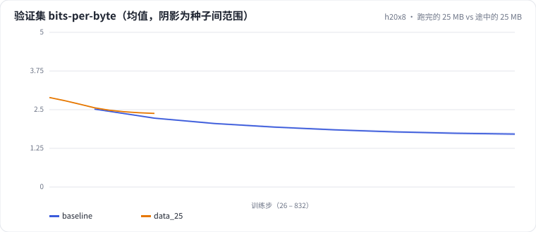

<!-- 本页由 python -m labkit docs 从 ../lesson.yaml 和 results/ 生成，不要手改 -->

[← 数据翻 3 倍，bpb 降多少](07-scaling.md) · [课程首页](../README.md) · [25 MB × 4 遍 vs 100 MB × 1 遍 →](09-repeat4.md)

# 第 8 步 / 共 16 步：跑完的 25 MB vs 途中的 25 MB

> 阶段 3 / 8：**token 预算** · 场景：`data_25`（对照 `baseline`）

能不能省事：只跑一次 100 MB，在训练到 25 MB 时看一眼验证集，就当作"25 MB 预算的结果"？对比两者：data_25 是把余弦完整跑完的 25 MB 预算；基线在训练途中刚看完 25 MB 时，学习率还在高位。

## 这一步跑了什么

| 场景 | 作用 | 说明 | 相对基线改了什么 | 种子（H20） |
| - | - | - | - | - |
| `baseline` | 对照 | 基线：100 MB 训练流过一遍，余弦调度（= L01 基线） | — | 3 |
| `data_25` | 本步 | 只用前 25% | `data_frac=0.25` | 3 |

## 先预测

**完整跑完的 25 MB 预算，和基线训练到 25 MB 时相比，验证集 bpb 怎样？**

- **A.** 跑完的更好（低 0.05 以上）
- **B.** 差不多（±0.05）
- **C.** 跑完的更差（高 0.05 以上）

> 先选定一个（记下来），再展开下面的实测。bpb 差异小于 0.05（H20 上 3 种子均值之差的噪声量级）或小于种子间波动，都按“差不多”算。

## 实测

展开实测：H20 · 小 GPT（1060 万主体参数）从零训练中文维基 · 每个场景 3 种子（已有 6 / 6 个运行）

| 场景 | 类型 | 25 MB 处验证 bpb | 100 MB 处验证 bpb | 步数 | 25 MB 处验证 bpb：与 `baseline` 差 | 25 MB 处验证 bpb：各种子 | 断言 |
| - | - | - | - | - | - | - | - |
| `baseline` | 基线 | 2.225 ± 0.031 | 1.711 ± 0.048 | 832.0 ± 0.0 | — | s0 2.218 / s1 2.258 / s2 2.198 | 通过 |
| `data_25` | 候选改动 | 2.379 ± 0.012 | — | 208.0 ± 0.0 | +0.154 | s0 2.373 / s1 2.371 / s2 2.392 | 通过 |

运行目录（每个目录里有 `summary.json` 指标、`evidence.json` 证据摘要、`predictions.jsonl` 逐条预测、`log.txt` 日志）：

- `baseline` [s0](../../../results/h20x8/L02/baseline/s0-39279f/) · [s1](../../../results/h20x8/L02/baseline/s1-cbec53/) · [s2](../../../results/h20x8/L02/baseline/s2-618736/)
- `data_25` [s0](../../../results/h20x8/L02/data_25/s0-9bc5fb/) · [s1](../../../results/h20x8/L02/data_25/s1-55cbd6/) · [s2](../../../results/h20x8/L02/data_25/s2-d9484c/)

## 看完实测再想一步

验证集曲线上，data_25 的终点落在基线曲线的上方还是下方？基线在 25 MB 时的学习率是多少？

---

[← 数据翻 3 倍，bpb 降多少](07-scaling.md) · [课程首页](../README.md) · [25 MB × 4 遍 vs 100 MB × 1 遍 →](09-repeat4.md)
