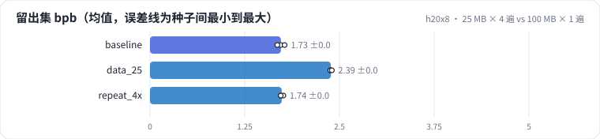
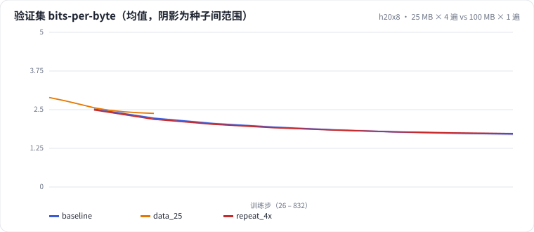

<!-- 本页由 python -m labkit docs 从 ../lesson.yaml 和 results/ 生成，不要手改 -->

[← 跑完的 25 MB vs 途中的 25 MB](08-anneal.md) · [课程首页](../README.md) · [6 MB × 16 遍：背下来多少 →](10-repeat16.md)

# 第 9 步 / 共 16 步：25 MB × 4 遍 vs 100 MB × 1 遍

> 阶段 4 / 8：**数据重复** · 场景：`repeat_4x`（对照 `baseline`）

独特数据只有 25 MB，重复 4 遍（每遍重新打乱），训练 token 数和算力都和基线相同。业务语料不够时，这是最常见的做法。

## 这一步跑了什么

| 场景 | 作用 | 说明 | 相对基线改了什么 | 种子（H20） |
| - | - | - | - | - |
| `baseline` | 对照 | 基线：100 MB 训练流过一遍，余弦调度（= L01 基线） | — | 3 |
| `data_25` | 参照 | 只用前 25% | `data_frac=0.25` | 3 |
| `repeat_4x` | 本步 | 前 25% 过 4 遍（训练 token 数和基线相同，独特数据只有 1/4） | `data_frac=0.25`, `epochs=4` | 3 |

## 先预测

**和 100 MB 不重复的基线比，留出集 bpb 差多少？**

- **A.** 差不多（差 0.02 以内）
- **B.** 差 0.02 - 0.08
- **C.** 差 0.08 以上

> 先选定一个（记下来），再展开下面的实测。bpb 差异小于 0.02 或小于种子间波动，都按“差不多”算。

## 实测

展开实测：H20 · 小 GPT（1060 万主体参数）从零训练中文维基 · 每个场景 3 种子（已有 9 / 9 个运行）

| 场景 | 类型 | 留出集 bpb | 验证 − 已见 bpb | 遍数 | 独特数据 MB | 留出集 bpb：与 `baseline` 差 | 留出集 bpb：各种子 | 断言 |
| - | - | - | - | - | - | - | - | - |
| `baseline` | 基线 | 1.727 ± 0.048 | +0.006 ± +0.001 | 1 ± 0 | 100.3 ± 0.0 | — | s0 1.725 / s1 1.776 / s2 1.680 | 通过 |
| `data_25` | 候选改动 | 2.387 ± 0.012 | +0.004 ± +0.001 | 1 ± 0 | 25.1 ± 0.0 | +0.660 | s0 2.381 / s1 2.379 / s2 2.400 | 通过 |
| `repeat_4x` | 候选改动 | 1.737 ± 0.019 | +0.121 ± +0.005 | 4 ± 0 | 25.1 ± 0.0 | +0.010 | s0 1.728 / s1 1.759 / s2 1.725 | 通过 |

运行目录（每个目录里有 `summary.json` 指标、`evidence.json` 证据摘要、`predictions.jsonl` 逐条预测、`log.txt` 日志）：

- `baseline` [s0](../../../results/h20x8/L02/baseline/s0-39279f/) · [s1](../../../results/h20x8/L02/baseline/s1-cbec53/) · [s2](../../../results/h20x8/L02/baseline/s2-618736/)
- `data_25` [s0](../../../results/h20x8/L02/data_25/s0-9bc5fb/) · [s1](../../../results/h20x8/L02/data_25/s1-55cbd6/) · [s2](../../../results/h20x8/L02/data_25/s2-d9484c/)
- `repeat_4x` [s0](../../../results/h20x8/L02/repeat_4x/s0-b2042a/) · [s1](../../../results/h20x8/L02/repeat_4x/s1-4b6007/) · [s2](../../../results/h20x8/L02/repeat_4x/s2-a979e9/)

## 看完实测再想一步

25 MB × 4 落在 25 MB × 1 和 100 MB × 1 之间的什么位置？

---

[← 跑完的 25 MB vs 途中的 25 MB](08-anneal.md) · [课程首页](../README.md) · [6 MB × 16 遍：背下来多少 →](10-repeat16.md)
