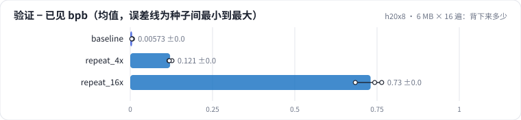
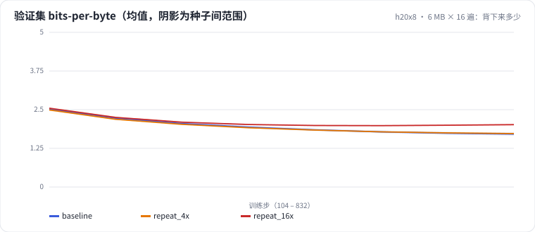

<!-- 本页由 python -m labkit docs 从 ../lesson.yaml 和 results/ 生成，不要手改 -->

[← 25 MB × 4 遍 vs 100 MB × 1 遍](09-repeat4.md) · [课程首页](../README.md) · [不做余弦退火 →](11-const.md)

# 第 10 步 / 共 16 步：6 MB × 16 遍：背下来多少

> 阶段 4 / 8：**数据重复** · 场景：`repeat_16x`（对照 `baseline`）

再极端一点：独特数据只有 6.25 MB，重复 16 遍。除了留出集，我们还在训练前缀开头的一段"已见数据"上评估，"验证 − 已见"就是模型对见过的文本额外背下来的部分。

## 这一步跑了什么

| 场景 | 作用 | 说明 | 相对基线改了什么 | 种子（H20） |
| - | - | - | - | - |
| `baseline` | 对照 | 基线：100 MB 训练流过一遍，余弦调度（= L01 基线） | — | 3 |
| `repeat_4x` | 参照 | 前 25% 过 4 遍（训练 token 数和基线相同，独特数据只有 1/4） | `data_frac=0.25`, `epochs=4` | 3 |
| `repeat_16x` | 本步 | 前 6.25% 过 16 遍 | `data_frac=0.0625`, `epochs=16` | 3 |

## 先预测

**重复 16 遍后，"验证集 bpb − 已见数据 bpb"大约是多少？**

- **A.** 不到 0.05：几乎没背
- **B.** 0.05 - 0.3
- **C.** 0.3 以上：背下了很多

> 先选定一个（记下来），再展开下面的实测。bpb 差异小于 0.05（H20 上 3 种子均值之差的噪声量级）或小于种子间波动，都按“差不多”算。

## 实测

展开实测：H20 · 小 GPT（1060 万主体参数）从零训练中文维基 · 每个场景 3 种子（已有 9 / 9 个运行）

| 场景 | 类型 | 验证 − 已见 bpb | 留出集 bpb | 已见数据 bpb | 遍数 | 验证 − 已见 bpb：与 `baseline` 差 | 验证 − 已见 bpb：各种子 | 断言 |
| - | - | - | - | - | - | - | - | - |
| `baseline` | 基线 | +0.006 ± +0.001 | 1.727 ± 0.048 | 1.706 ± 0.047 | 1 ± 0 | — | s0 +0.006 / s1 +0.007 / s2 +0.005 | 通过 |
| `repeat_4x` | 候选改动 | +0.121 ± +0.005 | 1.737 ± 0.019 | 1.606 ± 0.015 | 4 ± 0 | +0.115 | s0 +0.118 / s1 +0.127 / s2 +0.119 | 通过 |
| `repeat_16x` | 候选改动 | +0.730 ± +0.042 | 2.026 ± 0.021 | 1.285 ± 0.043 | 16 ± 0 | +0.725 | s0 +0.684 / s1 +0.764 / s2 +0.743 | 通过 |

运行目录（每个目录里有 `summary.json` 指标、`evidence.json` 证据摘要、`predictions.jsonl` 逐条预测、`log.txt` 日志）：

- `baseline` [s0](../../../results/h20x8/L02/baseline/s0-39279f/) · [s1](../../../results/h20x8/L02/baseline/s1-cbec53/) · [s2](../../../results/h20x8/L02/baseline/s2-618736/)
- `repeat_4x` [s0](../../../results/h20x8/L02/repeat_4x/s0-b2042a/) · [s1](../../../results/h20x8/L02/repeat_4x/s1-4b6007/) · [s2](../../../results/h20x8/L02/repeat_4x/s2-a979e9/)
- `repeat_16x` [s0](../../../results/h20x8/L02/repeat_16x/s0-841291/) · [s1](../../../results/h20x8/L02/repeat_16x/s1-ad863a/) · [s2](../../../results/h20x8/L02/repeat_16x/s2-9ccf36/)

## 看完实测再想一步

16 遍的验证集曲线在后半段还在下降吗？

---

[← 25 MB × 4 遍 vs 100 MB × 1 遍](09-repeat4.md) · [课程首页](../README.md) · [不做余弦退火 →](11-const.md)
