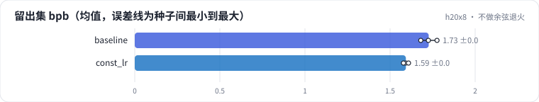
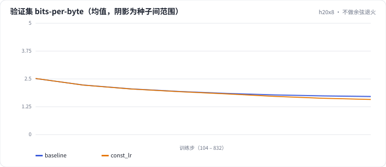

<!-- 本页由 python -m labkit docs 从 ../lesson.yaml 和 results/ 生成，不要手改 -->

[← 6 MB × 16 遍：背下来多少](10-repeat16.md) · [课程首页](../README.md) · [同样算力，换小模型多看数据 →](12-iso-small.md)

# 第 11 步 / 共 16 步：不做余弦退火

> 阶段 5 / 8：**学习率调度** · 场景：`const_lr`（对照 `baseline`）

warmup 之后学习率保持 2e-3 不变，一直到最后。其余完全同基线。

## 这一步跑了什么

| 场景 | 作用 | 说明 | 相对基线改了什么 | 种子（H20） |
| - | - | - | - | - |
| `baseline` | 对照 | 基线：100 MB 训练流过一遍，余弦调度（= L01 基线） | — | 3 |
| `const_lr` | 本步 | warmup 后学习率保持不变（不做余弦退火） | `lr_schedule=constant` | 3 |

## 先预测

**和余弦退火比，留出集 bpb 差多少？**

- **A.** 差不多（差 0.02 以内）
- **B.** 差 0.02 - 0.06
- **C.** 差 0.06 以上

> 先选定一个（记下来），再展开下面的实测。bpb 差异小于 0.02 或小于种子间波动，都按“差不多”算。

## 实测

展开实测：H20 · 小 GPT（1060 万主体参数）从零训练中文维基 · 每个场景 3 种子（已有 6 / 6 个运行）

| 场景 | 类型 | 留出集 bpb | 50% 处验证 bpb | 最后 5% 训练 loss | 留出集 bpb：与 `baseline` 差 | 留出集 bpb：各种子 | 断言 |
| - | - | - | - | - | - | - | - |
| `baseline` | 基线 | 1.727 ± 0.048 | 1.936 ± 0.036 | 4.338 ± 0.170 | — | s0 1.725 / s1 1.776 / s2 1.680 | 通过 |
| `const_lr` | 候选改动 | 1.593 ± 0.015 | 1.928 ± 0.020 | 4.016 ± 0.081 | -0.134 | s0 1.592 / s1 1.608 / s2 1.579 |  |

运行目录（每个目录里有 `summary.json` 指标、`evidence.json` 证据摘要、`predictions.jsonl` 逐条预测、`log.txt` 日志）：

- `baseline` [s0](../../../results/h20x8/L02/baseline/s0-39279f/) · [s1](../../../results/h20x8/L02/baseline/s1-cbec53/) · [s2](../../../results/h20x8/L02/baseline/s2-618736/)
- `const_lr` [s0](../../../results/h20x8/L02/const_lr/s0-cb7d6d/) · [s1](../../../results/h20x8/L02/const_lr/s1-f5ac28/) · [s2](../../../results/h20x8/L02/const_lr/s2-220e56/)

## 看完实测再想一步

两条曲线是从什么时候开始分开的？

---

[← 6 MB × 16 遍：背下来多少](10-repeat16.md) · [课程首页](../README.md) · [同样算力，换小模型多看数据 →](12-iso-small.md)
