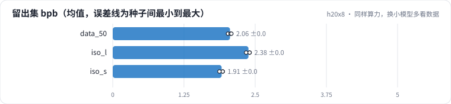
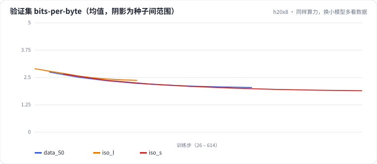

<!-- 本页由 python -m labkit docs 从 ../lesson.yaml 和 results/ 生成，不要手改 -->

[← 不做余弦退火](11-const.md) · [课程首页](../README.md) · [同样算力，换大模型少看数据 →](13-iso-large.md)

# 第 12 步 / 共 16 步：同样算力，换小模型多看数据

> 阶段 6 / 8：**等算力下的模型大小** · 场景：`iso_s`（对照 `data_50`）

算力固定为"基线模型训 50 MB"（约 1.5 PF）。换一个小一号的模型：d = 320、5 层，主体约 620 万参数，每 token 的训练 FLOPs 约是基线的 2/3，同样的算力能看约 1.5 倍的 token。学习率没有重调。

## 这一步跑了什么

| 场景 | 作用 | 说明 | 相对基线改了什么 | 种子（H20） |
| - | - | - | - | - |
| `data_50` | 对照 | 只用前 50% | `data_frac=0.5` | 3 |
| `iso_l` | 参照 | 等算力大模型：d=512、8 层（主体约 2530 万），算力和 data_50 相同，看更少 token | `d_model=512`, `n_layer=8`, `n_head=8`, `d_ff=1376`, `flops_budget_frac=0.5` | 3 |
| `iso_s` | 本步 | 等算力小模型：d=320、5 层（主体约 620 万），算力和 data_50 相同，看更多 token | `d_model=320`, `n_layer=5`, `n_head=5`, `d_ff=864`, `flops_budget_frac=0.5` | 3 |

## 先预测

**等算力下，小模型 vs 中模型（data_50），留出集 bpb 怎样？**

- **A.** 小模型更好（低 0.05 以上）
- **B.** 差不多（±0.05）
- **C.** 小模型更差（高 0.05 以上）

> 先选定一个（记下来），再展开下面的实测。bpb 差异小于 0.05（H20 上 3 种子均值之差的噪声量级）或小于种子间波动，都按“差不多”算。

## 实测

展开实测：H20 · 小 GPT（1060 万主体参数）从零训练中文维基 · 每个场景 3 种子（已有 9 / 9 个运行）

| 场景 | 类型 | 留出集 bpb | 训练 PFLOPs | 每参数 token | 主体参数 | 留出集 bpb：与 `data_50` 差 | 留出集 bpb：各种子 | 断言 |
| - | - | - | - | - | - | - | - | - |
| `data_50` | 候选改动 | 2.058 ± 0.031 | 1.48 ± 0.00 | 0.81 ± 0.00 | 10,621,824.0 ± 0.0 | — | s0 2.023 / s1 2.068 / s2 2.082 | 通过 |
| `iso_l` | 候选改动 | 2.382 ± 0.035 | 1.48 ± 0.00 | 0.20 ± 0.00 | 25,305,600.0 ± 0.0 | +0.324 | s0 2.402 / s1 2.341 / s2 2.402 | 通过 |
| `iso_s` | 候选改动 | 1.911 ± 0.033 | 1.48 ± 0.00 | 1.76 ± 0.00 | 6,198,720.0 ± 0.0 | -0.147 | s0 1.932 / s1 1.930 / s2 1.873 | 通过 |

运行目录（每个目录里有 `summary.json` 指标、`evidence.json` 证据摘要、`predictions.jsonl` 逐条预测、`log.txt` 日志）：

- `data_50` [s0](../../../results/h20x8/L02/data_50/s0-97075e/) · [s1](../../../results/h20x8/L02/data_50/s1-3791eb/) · [s2](../../../results/h20x8/L02/data_50/s2-b28c6d/)
- `iso_l` [s0](../../../results/h20x8/L02/iso_l/s0-3b83a4/) · [s1](../../../results/h20x8/L02/iso_l/s1-35b376/) · [s2](../../../results/h20x8/L02/iso_l/s2-628c66/)
- `iso_s` [s0](../../../results/h20x8/L02/iso_s/s0-a957c7/) · [s1](../../../results/h20x8/L02/iso_s/s1-aa931a/) · [s2](../../../results/h20x8/L02/iso_s/s2-10000d/)

## 看完实测再想一步

三个模型的训练 PFLOPs 一样吗？小模型的验证曲线在相同 FLOPs 处是不是更低？

---

[← 不做余弦退火](11-const.md) · [课程首页](../README.md) · [同样算力，换大模型少看数据 →](13-iso-large.md)
