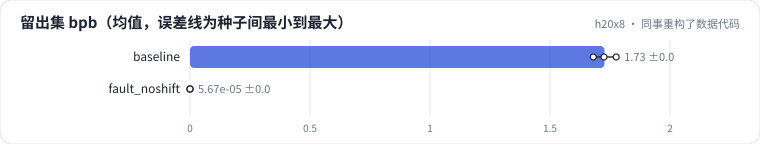
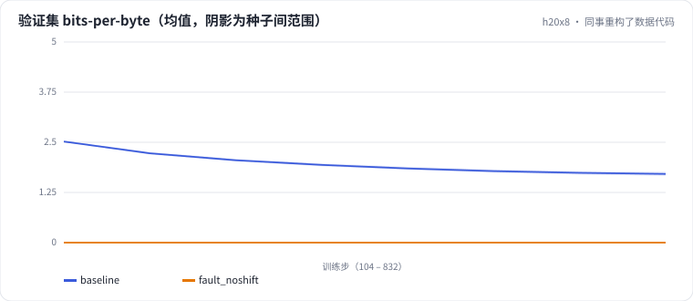

<!-- 本页由 python -m labkit docs 从 ../lesson.yaml 和 results/ 生成，不要手改 -->

[← 同样算力，换大模型少看数据](13-iso-large.md) · [课程首页](../README.md) · [诊断：为什么好得不可能 →](15-diagnose.md)

# 第 14 步 / 共 16 步：同事重构了数据代码

> 阶段 7 / 8：**故障诊断** · 场景：`fault_noshift`（对照 `baseline`）

同事重构了切块的代码，说"顺手简化了一下索引"，模型、语料、超参都没动。重新训练后，他在群里说：效果大幅提升了。

## 这一步跑了什么

| 场景 | 作用 | 说明 | 相对基线改了什么 | 种子（H20） |
| - | - | - | - | - |
| `baseline` | 对照 | 基线：100 MB 训练流过一遍，余弦调度（= L01 基线） | — | 3 |
| `fault_noshift` | 本步 | 数据代码重构后目标没有右移（y = x） | `target_offset=0` | 3 |

## 先预测

**重构后，干净留出集 bpb 和基线比怎样？**

- **A.** 低 1 以上：好得不可能
- **B.** 低 0.05 - 1：确实大幅提升
- **C.** 差不多或更差

> 先选定一个（记下来），再展开下面的实测。bpb 差异小于 0.02 或小于种子间波动，都按“差不多”算。

## 实测

展开实测：H20 · 小 GPT（1060 万主体参数）从零训练中文维基 · 每个场景 3 种子（已有 6 / 6 个运行）

| 场景 | 类型 | 留出集 bpb | 验证集 bpb | warmup 结束时 loss | 留出集 bpb：与 `baseline` 差 | 留出集 bpb：各种子 | 断言 |
| - | - | - | - | - | - | - | - |
| `baseline` | 基线 | 1.727 ± 0.048 | 1.711 ± 0.048 | 7.755 ± 0.178 | — | s0 1.725 / s1 1.776 / s2 1.680 | 通过 |
| `fault_noshift` | 教学故障 | 0.000 ± 0.000 | 0.000 ± 0.000 | 1.644 ± 0.048 | -1.727 | s0 0.000 / s1 0.000 / s2 0.000 | 通过 |

运行目录（每个目录里有 `summary.json` 指标、`evidence.json` 证据摘要、`predictions.jsonl` 逐条预测、`log.txt` 日志）：

- `baseline` [s0](../../../results/h20x8/L02/baseline/s0-39279f/) · [s1](../../../results/h20x8/L02/baseline/s1-cbec53/) · [s2](../../../results/h20x8/L02/baseline/s2-618736/)
- `fault_noshift` [s0](../../../results/h20x8/L02/fault_noshift/s0-f368ad/) · [s1](../../../results/h20x8/L02/fault_noshift/s1-751f00/) · [s2](../../../results/h20x8/L02/fault_noshift/s2-4ee885/)

## 看完实测再想一步

loss 曲线是在什么时候降到底的？

---

[← 同样算力，换大模型少看数据](13-iso-large.md) · [课程首页](../README.md) · [诊断：为什么好得不可能 →](15-diagnose.md)
