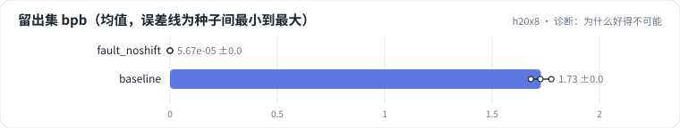
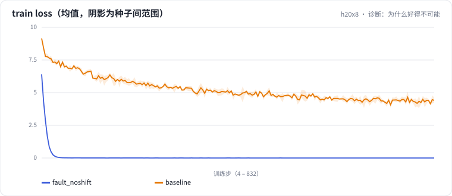

<!-- 本页由 python -m labkit docs 从 ../lesson.yaml 和 results/ 生成，不要手改 -->

[← 同事重构了数据代码](14-fault.md) · [课程首页](../README.md) · [回顾 →](16-keycard.md)

# 第 15 步 / 共 16 步：诊断：为什么好得不可能

> 阶段 7 / 8：**故障诊断** · 场景：`baseline`（对照 `fault_noshift`）

模型、语料、超参都没变，只动了切块的代码；loss 很快降到接近 0，留出集也一样低。按需逐级点开线索，然后点选根因。

## 这一步跑了什么

| 场景 | 作用 | 说明 | 相对基线改了什么 | 种子（H20） |
| - | - | - | - | - |
| `fault_noshift` | 对照 | 数据代码重构后目标没有右移（y = x） | `target_offset=0` | 3 |
| `baseline` | 本步 | 基线：100 MB 训练流过一遍，余弦调度（= L01 基线） | — | 3 |

## 线索

逐条展开，看到能下判断为止。

线索 1

对比干净留出集：基线 1.727 ± 0.048，重构后 0.000 ± 0.000；验证集泄漏比例 基线 4.2% ± 0.0%，重构后 4.2% ± 0.0%。留出集从没进过训练，它也一样低说明什么？

线索 2

看 loss 降得多快：warmup 刚结束（总步数的 2%）时，基线 loss 7.755 ± 0.178，重构后 1.644 ± 0.048。

线索 3

batch 自检：第一个 batch 里 y 和 x 逐位置相等的比例，基线 1.6% ± 0.1%，重构后 100.0% ± 0.0%。去 trace 里看 x 和 y 的前 8 个 token。

## 先预测

**loss 降到接近 0 的根因是什么？**

- **A.** 验证集和留出集混进了训练集（泄漏）
- **B.** 目标没有右移，模型只要把当前位置的输入抄过去
- **C.** 学习率太大，模型把训练集背下来了
- **D.** 评估只算了一小部分容易的窗口

> 先选定一个（记下来），再展开下面的实测。bpb 差异小于 0.05（H20 上 3 种子均值之差的噪声量级）或小于种子间波动，都按“差不多”算。

## 实测

展开实测：H20 · 小 GPT（1060 万主体参数）从零训练中文维基 · 每个场景 3 种子（已有 6 / 6 个运行）

| 场景 | 类型 | 留出集 bpb | warmup 结束时 loss | y 与 x 逐位相等比例 | 验证集泄漏比例 | 留出集 bpb：与 `fault_noshift` 差 | 留出集 bpb：各种子 | 断言 |
| - | - | - | - | - | - | - | - | - |
| `fault_noshift` | 教学故障 | 0.000 ± 0.000 | 1.644 ± 0.048 | 100.0% ± 0.0 | 4.2% ± 0.0 | — | s0 0.000 / s1 0.000 / s2 0.000 | 通过 |
| `baseline` | 基线 | 1.727 ± 0.048 | 7.755 ± 0.178 | 1.6% ± 0.1 | 4.2% ± 0.0 | +1.727 | s0 1.725 / s1 1.776 / s2 1.680 | 通过 |

运行目录（每个目录里有 `summary.json` 指标、`evidence.json` 证据摘要、`predictions.jsonl` 逐条预测、`log.txt` 日志）：

- `fault_noshift` [s0](../../../results/h20x8/L02/fault_noshift/s0-f368ad/) · [s1](../../../results/h20x8/L02/fault_noshift/s1-751f00/) · [s2](../../../results/h20x8/L02/fault_noshift/s2-4ee885/)
- `baseline` [s0](../../../results/h20x8/L02/baseline/s0-39279f/) · [s1](../../../results/h20x8/L02/baseline/s1-cbec53/) · [s2](../../../results/h20x8/L02/baseline/s2-618736/)

---

[← 同事重构了数据代码](14-fault.md) · [课程首页](../README.md) · [回顾 →](16-keycard.md)
