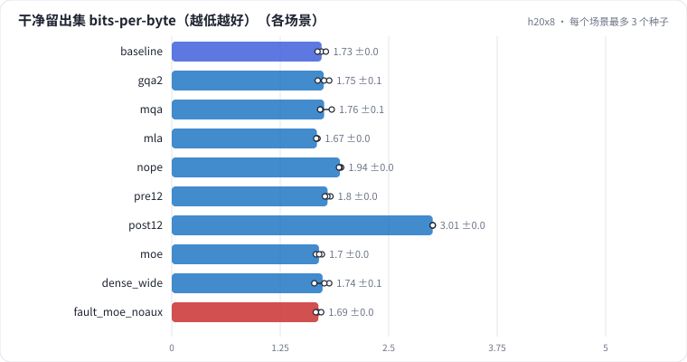

# L03 模型结构消融：MHA / GQA / MQA / MLA 的 KV cache 与质量，NoPE，Pre-Norm 与 Post-Norm，Dense 与 MoE

在 L02 的训练循环上每次只换一处结构：MHA → GQA → MQA → MLA，看 KV cache 省了多少、质量付出多少；去掉 RoPE；12 层 Post-Norm 对 Pre-Norm；Dense FFN 对同激活算力的 MoE、对同总参数的宽 Dense。最后诊断一次"MoE 去掉负载均衡损失"：质量看不出问题，但专家并行时最忙的那张卡会拖住整层。

## 怎么学（只看 GitHub 就够）

按下面“步骤”表从第 1 步往下点。每一页先给问题和选项，**先选定一个再展开“实测”**；实测里有结果表、证据图和运行目录链接。作业进度见 [作业看板](../../jobs/README.md)。参考答案和解析只在私有工作台里。

## 任务

**出发点**：选基座、读技术报告时满眼结构名词：GQA、MLA、RoPE、Pre-Norm、MoE。它们各自省的是什么——训练算力、参数、还是推理时的 KV cache 带宽？省下来的代价是什么？这一课把它们拆开，各量一遍。

做法：沿用 L01 / L02 的语料、16K BPE 和训练配置，基线是 6 层 MHA、RoPE、Pre-RMSNorm、SwiGLU。每个场景只换一处结构：

| 维度 | 场景 | 省的是什么 |
| - | - | - |
| 注意力 | GQA（2 组 KV）、MQA（1 组）、MLA（96 维潜向量 + 32 维 RoPE key） | 推理 KV cache 的显存和带宽 |
| 位置编码 | 不加位置编码（NoPE） | 无（看 RoPE 值多少） |
| Norm 位置 | 12 层 Pre-Norm vs 12 层 Post-Norm | 无（看深层稳定性） |
| FFN | MoE 8 专家 top-2（激活参数同 Dense）、宽 Dense（总参数同 MoE） | 用参数换质量，不加每 token 算力 |

**注意**：KV 字节、参数量、FLOPs 是**确定量**，和模型大小无关，可以直接外推；bpb 的差在这个规模上常常只有 0.01-0.03，和种子噪声同量级，**小模型上的质量差异不外推**。

## 规模与边界

- **H20 档**：小 GPT（d=384、6 层、6 头、D=64、SwiGLU 1024），序列 512，batch 64，lr 2e-3，100 MB 中文维基过一遍；bf16；每个场景 3 个种子。Post-Norm 对比用 12 层，两边其余完全相同。MoE 用朴素的逐专家循环（没有 grouped GEMM），耗时不代表生产实现。
- **保留了**：各注意力变体的张量形状和 KV cache 字节数、MLA 的低秩压缩 + 解耦 RoPE、Pre / Post-Norm 的残差结构、MoE 的 top-k 路由和 Switch 负载均衡损失。
- **缩小了**：模型只有 6-12 层，序列 512；Post-Norm 在大模型、大学习率下才更容易发散；MoE 只有 8 个专家。
- **未验证**：长上下文外推（NoPE、RoPE 缩放）；MLA 推理时把 up 投影吸收进 q / o 的实现；MoE 在专家并行下的真实通信开销。

## 步骤

<!-- labkit:path -->
| # | 阶段 | 步骤 | 这一步回答的问题 | 场景 | H20 结果 |
| - | - | - | - | - | - |
| 1 | 理解任务 | [场景与痛点](steps/01-pain.md) | GQA、MLA、RoPE、Pre-Norm、MoE 各省的是训练算力、参数还是推理带宽？代价是什么？ | — | — |
| 2 | 理解任务 | [流程结构](steps/02-flow.md) |  | — | — |
| 3 | 理解任务 | [追踪一层注意力](steps/03-trace.md) |  | — | — |
| 4 | 理解任务 | [代码导读](steps/04-code.md) |  | — | — |
| 5 | 先估算 | [先估算](steps/05-estimate.md) | Qwen2.5-7B（28 层、28 个查询头、4 个 KV 头、D = 128、bf16），每个 token 的 KV cache 是多少？ | — | — |
| 6 | 注意力变体 | [GQA：6 个查询头共享 2 组 KV](steps/06-gqa.md) | 和 MHA 比，GQA（2 组）的留出集 bpb 怎样？ | `gqa2` | 3 / 3 |
| 7 | 注意力变体 | [MQA：只剩 1 组 KV](steps/07-mqa.md) | 和 MHA 比，MQA 的留出集 bpb 怎样？ | `mqa` | 3 / 3 |
| 8 | 注意力变体 | [同样的 KV 字节，MLA 对 MQA](steps/08-mla.md) | 同样的 KV cache 字节，MLA 和 MQA 比，留出集 bpb 怎样？ | `mla` | 3 / 3 |
| 9 | 位置编码 | [去掉位置编码](steps/09-nope.md) | 去掉 RoPE，留出集 bpb 会差多少？ | `nope` | 3 / 3 |
| 10 | Norm 位置 | [12 层 Post-Norm](steps/10-post.md) | 12 层 Post-Norm 和 12 层 Pre-Norm 比，留出集 bpb 怎样？ | `post12` | 3 / 3 |
| 11 | MoE | [MoE：同样的激活算力](steps/11-moe.md) | 和 Dense 基线比，MoE 的留出集 bpb 怎样？ | `moe` | 3 / 3 |
| 12 | MoE | [MoE 对同总参数的宽 Dense](steps/12-moe-wide.md) | MoE 比同总参数的宽 Dense 差多少？ | `moe` | 3 / 3 |
| 13 | MoE | [去掉负载均衡损失](steps/13-fault.md) | 去掉负载均衡后，最忙的专家分到的 token 是平均的几倍？（top-2 / 8 专家时最多 4 倍） | `fault_moe_noaux` | 3 / 3 |
| 14 | MoE | [诊断：去掉负载均衡的代价在哪](steps/14-diagnose.md) | 去掉负载均衡损失，最主要的问题是什么？ | `moe` | 3 / 3 |
| 15 | 带走 | [回顾](steps/15-keycard.md) |  | — | — |
<!-- /labkit:path -->

## 场景与结果

<!-- labkit:results -->

展开结果（先自己预测，再看）

**h20x8**：8 × NVIDIA H20，每张卡一个运行。语料、分词器（16K BPE）和 L01 完全相同（缓存共用）；基线小 GPT（d=384、6 层、MHA 6 头）= L01 基线，每个场景只换一处结构（已有 30 / 30 个运行）

| 场景 | 类型 | 留出集 bpb | KV cache 每 token 字节 | 总参数 | 激活参数 | 每 token 训练 FLOPs | 专家负载 最大/平均 | 梯度范数最大值 | 训练秒数 | 断言 |
| - | - | - | - | - | - | - | - | - | - | - |
| `baseline` | 基线 | 1.7271 ± 0.0478 (n=3) | 9216.0000 ± 0.0000 (n=3) | 16913280.0000 ± 0.0000 (n=3) | 16913280.0000 ± 0.0000 (n=3) | 108557568.0000 ± 0.0000 (n=3) | — | 5.8545 ± 2.5481 (n=3) | 79.3333 ± 0.2082 (n=3) |  |
| `gqa2` | 候选改动 | 1.7510 ± 0.0667 (n=3) | 3072.0000 ± 0.0000 (n=3) | 15733632.0000 ± 0.0000 (n=3) | 15733632.0000 ± 0.0000 (n=3) | 101479680.0000 ± 0.0000 (n=3) | — | 11.1444 ± 11.2948 (n=3) | 72.2333 ± 0.2887 (n=3) | 通过 |
| `mqa` | 候选改动 | 1.7561 ± 0.0762 (n=3) | 1536.0000 ± 0.0000 (n=3) | 15438720.0000 ± 0.0000 (n=3) | 15438720.0000 ± 0.0000 (n=3) | 99710208.0000 ± 0.0000 (n=3) | — | 12.2641 ± 9.8080 (n=3) | 70.7667 ± 0.2082 (n=3) | 通过 |
| `mla` | 候选改动 | 1.6729 ± 0.0075 (n=3) | 1536.0000 ± 0.0000 (n=3) | 16324032.0000 ± 0.0000 (n=3) | 16324032.0000 ± 0.0000 (n=3) | 106791552.0000 ± 0.0000 (n=3) | — | 9.3231 ± 2.8803 (n=3) | 81.9667 ± 0.4933 (n=3) | 通过 |
| `nope` | 候选改动 | 1.9385 ± 0.0128 (n=3) | 9216.0000 ± 0.0000 (n=3) | 16913280.0000 ± 0.0000 (n=3) | 16913280.0000 ± 0.0000 (n=3) | 108557568.0000 ± 0.0000 (n=3) | — | 9.1083 ± 8.1021 (n=3) | 67.8000 ± 0.2000 (n=3) |  |
| `pre12` | 候选改动 | 1.7961 ± 0.0318 (n=3) | 18432.0000 ± 0.0000 (n=3) | 27534720.0000 ± 0.0000 (n=3) | 27534720.0000 ± 0.0000 (n=3) | 179364096.0000 ± 0.0000 (n=3) | — | 6.1489 ± 1.7278 (n=3) | 128.8667 ± 0.5774 (n=3) | 通过 |
| `post12` | 候选改动 | 3.0073 ± 0.0002 (n=3) | 18432.0000 ± 0.0000 (n=3) | 27534720.0000 ± 0.0000 (n=3) | 27534720.0000 ± 0.0000 (n=3) | 179364096.0000 ± 0.0000 (n=3) | — | 1.5140 ± 0.2984 (n=3) | 128.8667 ± 0.5508 (n=3) |  |
| `moe` | 候选改动 | 1.6967 ± 0.0340 (n=3) | 9216.0000 ± 0.0000 (n=3) | 38165376.0000 ± 0.0000 (n=3) | 16931712.0000 ± 0.0000 (n=3) | 108668160.0000 ± 0.0000 (n=3) | 1.3718 ± 0.0652 (n=3) | 23.5410 ± 4.0333 (n=3) | 128.0667 ± 1.4434 (n=3) | 通过 |
| `dense_wide` | 候选改动 | 1.7385 ± 0.0875 (n=3) | 9216.0000 ± 0.0000 (n=3) | 38146944.0000 ± 0.0000 (n=3) | 38146944.0000 ± 0.0000 (n=3) | 235959552.0000 ± 0.0000 (n=3) | — | 8.6838 ± 4.7065 (n=3) | 131.3333 ± 0.5033 (n=3) | 通过 |
| `fault_moe_noaux` | 教学故障 | 1.6902 ± 0.0307 (n=3) | 9216.0000 ± 0.0000 (n=3) | 38165376.0000 ± 0.0000 (n=3) | 16931712.0000 ± 0.0000 (n=3) | 108668160.0000 ± 0.0000 (n=3) | 3.0320 ± 0.2545 (n=3) | 20.6825 ± 20.2284 (n=3) | 130.2000 ± 0.5568 (n=3) | 通过 |

<!-- /labkit:results -->

## 证据图

<!-- labkit:figures -->

展开证据图（先自己预测，再看）

- **h20x8**：[主指标](figures/h20x8-metrics.svg)

  

<!-- /labkit:figures -->

## 代码

<!-- labkit:code -->
| 代码段 | 位置 |
| - | - |
| `clean` | [projects/tinylm/corpus.py#L44](../../projects/tinylm/corpus.py#L44) |
| `minhash` | [projects/tinylm/corpus.py#L111](../../projects/tinylm/corpus.py#L111) |
| `build` | [projects/tinylm/corpus.py#L219](../../projects/tinylm/corpus.py#L219) |
| `flops_budget` | [projects/tinylm/experiment.py#L42](../../projects/tinylm/experiment.py#L42) |
| `docmask` | [projects/tinylm/model.py#L61](../../projects/tinylm/model.py#L61) |
| `moe` | [projects/tinylm/model.py#L88](../../projects/tinylm/model.py#L88) |
| `attention` | [projects/tinylm/model.py#L142](../../projects/tinylm/model.py#L142) |
| `mla` | [projects/tinylm/model.py#L161](../../projects/tinylm/model.py#L161) |
| `norm` | [projects/tinylm/model.py#L190](../../projects/tinylm/model.py#L190) |
| `gpt` | [projects/tinylm/model.py#L200](../../projects/tinylm/model.py#L200) |
| `kvcache` | [projects/tinylm/model.py#L296](../../projects/tinylm/model.py#L296) |
| `train_bpe` | [projects/tinylm/tokenizer.py#L85](../../projects/tinylm/tokenizer.py#L85) |
| `compression` | [projects/tinylm/tokenizer.py#L137](../../projects/tinylm/tokenizer.py#L137) |
| `schedule` | [projects/tinylm/train.py#L31](../../projects/tinylm/train.py#L31) |
| `batch` | [projects/tinylm/train.py#L71](../../projects/tinylm/train.py#L71) |
| `evaluate` | [projects/tinylm/train.py#L80](../../projects/tinylm/train.py#L80) |
| `budget` | [projects/tinylm/train.py#L141](../../projects/tinylm/train.py#L141) |
| `train` | [projects/tinylm/train.py#L162](../../projects/tinylm/train.py#L162) |
<!-- /labkit:code -->
