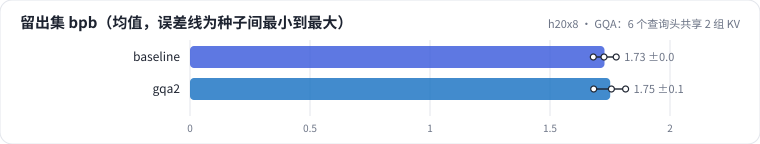
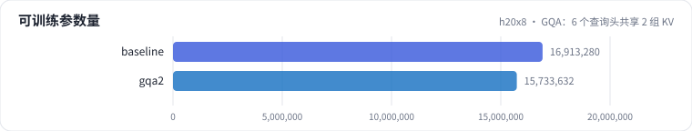
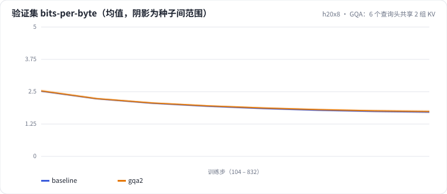

<!-- 本页由 python -m labkit docs 从 ../lesson.yaml 和 results/ 生成，不要手改 -->

[← 先估算](05-estimate.md) · [课程首页](../README.md) · [MQA：只剩 1 组 KV →](07-mqa.md)

# 第 6 步 / 共 15 步：GQA：6 个查询头共享 2 组 KV

> 阶段 3 / 7：**注意力变体** · 场景：`gqa2`（对照 `baseline`）

KV 头从 6 个降到 2 个，每 token 的 KV cache 少 2/3。k、v 投影的参数也跟着少了：每层注意力参数从约 59 万降到约 39 万。

## 这一步跑了什么

| 场景 | 作用 | 说明 | 相对基线改了什么 | 种子（H20） |
| - | - | - | - | - |
| `baseline` | 对照 | 基线：MHA 6 头、RoPE、Pre-Norm、Dense SwiGLU（= L01 基线） | — | 3 |
| `gqa2` | 本步 | GQA：6 个查询头共享 2 组 KV | `n_kv_head=2` | 3 |

## 先预测

**和 MHA 比，GQA（2 组）的留出集 bpb 怎样？**

- **A.** 更好（低 0.02 以上）
- **B.** 差不多（±0.02）
- **C.** 更差（高 0.02 以上）

> 先选定一个（记下来），再展开下面的实测。bpb 差异小于 0.02 或小于种子间波动，都按“差不多”算。

## 实测

展开实测：H20 · 小 GPT（6 层 d=384）从零训练 100 MB 中文维基 · 每个场景只换一处结构 · 3 种子（已有 6 / 6 个运行）

| 场景 | 类型 | 留出集 bpb | KV 每 token 字节 | 每层注意力参数 | 训练 token/s | 留出集 bpb：与 `baseline` 差 | 留出集 bpb：各种子 | 断言 |
| - | - | - | - | - | - | - | - | - |
| `baseline` | 基线 | 1.727 ± 0.048 | 9,216.0 ± 0.0 | 589,824.0 ± 0.0 | 475,284.0 ± 1,603.0084216871726 | — | s0 1.725 / s1 1.776 / s2 1.680 |  |
| `gqa2` | 候选改动 | 1.751 ± 0.067 | 3,072.0 ± 0.0 | 393,216.0 ± 0.0 | 504,868.3333333333 ± 1,694.463435230555 | +0.024 | s0 1.756 / s1 1.682 / s2 1.815 | 通过 |

运行目录（每个目录里有 `summary.json` 指标、`evidence.json` 证据摘要、`predictions.jsonl` 逐条预测、`log.txt` 日志）：

- `baseline` [s0](../../../results/h20x8/L03/baseline/s0-39279f/) · [s1](../../../results/h20x8/L03/baseline/s1-cbec53/) · [s2](../../../results/h20x8/L03/baseline/s2-618736/)
- `gqa2` [s0](../../../results/h20x8/L03/gqa2/s0-2f77b4/) · [s1](../../../results/h20x8/L03/gqa2/s1-f3e901/) · [s2](../../../results/h20x8/L03/gqa2/s2-1c86c8/)

## 看完实测再想一步

质量差和种子间波动比，哪个大？

---

[← 先估算](05-estimate.md) · [课程首页](../README.md) · [MQA：只剩 1 组 KV →](07-mqa.md)
