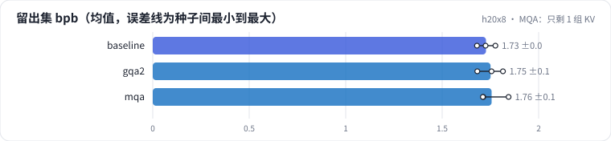
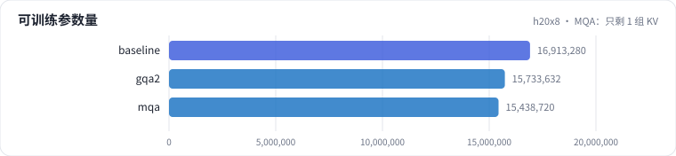
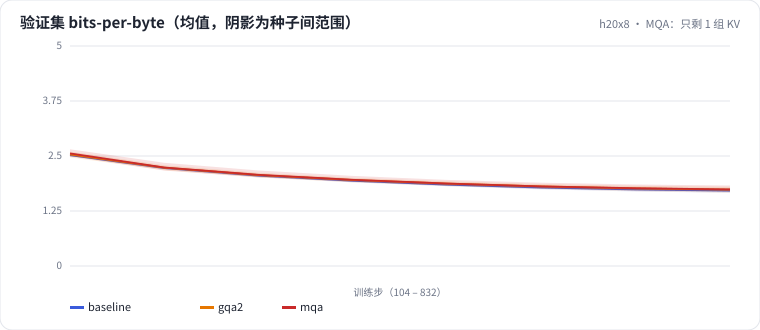

<!-- 本页由 python -m labkit docs 从 ../lesson.yaml 和 results/ 生成，不要手改 -->

[← GQA：6 个查询头共享 2 组 KV](06-gqa.md) · [课程首页](../README.md) · [同样的 KV 字节，MLA 对 MQA →](08-mla.md)

# 第 7 步 / 共 15 步：MQA：只剩 1 组 KV

> 阶段 3 / 7：**注意力变体** · 场景：`mqa`（对照 `baseline`）

再极端一点：6 个查询头共享同一组 k、v。KV cache 只剩 MHA 的 1/6。

## 这一步跑了什么

| 场景 | 作用 | 说明 | 相对基线改了什么 | 种子（H20） |
| - | - | - | - | - |
| `baseline` | 对照 | 基线：MHA 6 头、RoPE、Pre-Norm、Dense SwiGLU（= L01 基线） | — | 3 |
| `gqa2` | 参照 | GQA：6 个查询头共享 2 组 KV | `n_kv_head=2` | 3 |
| `mqa` | 本步 | MQA：6 个查询头共享 1 组 KV | `n_kv_head=1` | 3 |

## 先预测

**和 MHA 比，MQA 的留出集 bpb 怎样？**

- **A.** 更好（低 0.05 以上）
- **B.** 差不多（±0.05）
- **C.** 更差（高 0.05 以上）

> 先选定一个（记下来），再展开下面的实测。bpb 差异小于 0.05（H20 上 3 种子均值之差的噪声量级）或小于种子间波动，都按“差不多”算。

## 实测

展开实测：H20 · 小 GPT（6 层 d=384）从零训练 100 MB 中文维基 · 每个场景只换一处结构 · 3 种子（已有 9 / 9 个运行）

| 场景 | 类型 | 留出集 bpb | KV 每 token 字节 | 每层注意力参数 | 留出集 bpb：与 `baseline` 差 | 留出集 bpb：各种子 | 断言 |
| - | - | - | - | - | - | - | - |
| `baseline` | 基线 | 1.727 ± 0.048 | 9,216.0 ± 0.0 | 589,824.0 ± 0.0 | — | s0 1.725 / s1 1.776 / s2 1.680 |  |
| `gqa2` | 候选改动 | 1.751 ± 0.067 | 3,072.0 ± 0.0 | 393,216.0 ± 0.0 | +0.024 | s0 1.756 / s1 1.682 / s2 1.815 | 通过 |
| `mqa` | 候选改动 | 1.756 ± 0.076 | 1,536.0 ± 0.0 | 344,064.0 ± 0.0 | +0.029 | s0 1.844 / s1 1.713 / s2 1.711 | 通过 |

运行目录（每个目录里有 `summary.json` 指标、`evidence.json` 证据摘要、`predictions.jsonl` 逐条预测、`log.txt` 日志）：

- `baseline` [s0](../../../results/h20x8/L03/baseline/s0-39279f/) · [s1](../../../results/h20x8/L03/baseline/s1-cbec53/) · [s2](../../../results/h20x8/L03/baseline/s2-618736/)
- `gqa2` [s0](../../../results/h20x8/L03/gqa2/s0-2f77b4/) · [s1](../../../results/h20x8/L03/gqa2/s1-f3e901/) · [s2](../../../results/h20x8/L03/gqa2/s2-1c86c8/)
- `mqa` [s0](../../../results/h20x8/L03/mqa/s0-18c18c/) · [s1](../../../results/h20x8/L03/mqa/s1-84ceb7/) · [s2](../../../results/h20x8/L03/mqa/s2-c6915d/)

## 看完实测再想一步

MHA → GQA → MQA，bpb 是单调变差的吗？

---

[← GQA：6 个查询头共享 2 组 KV](06-gqa.md) · [课程首页](../README.md) · [同样的 KV 字节，MLA 对 MQA →](08-mla.md)
