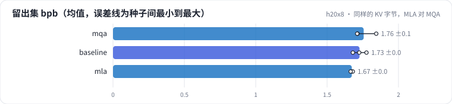
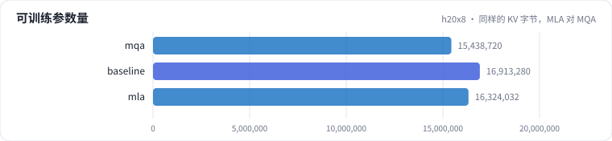
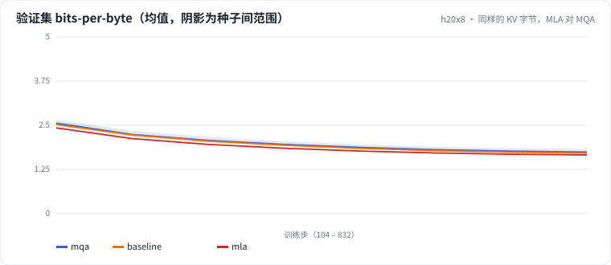

<!-- 本页由 python -m labkit docs 从 ../lesson.yaml 和 results/ 生成，不要手改 -->

[← MQA：只剩 1 组 KV](07-mqa.md) · [课程首页](../README.md) · [去掉位置编码 →](09-nope.md)

# 第 8 步 / 共 15 步：同样的 KV 字节，MLA 对 MQA

> 阶段 3 / 7：**注意力变体** · 场景：`mla`（对照 `mqa`）

MLA 每层每 token 缓存 96 维潜向量 + 32 维共享 RoPE key = 128 个元素，和 MQA（2 × 64）**完全相同**。区别在于 MLA 的每个头仍有自己的 k、v（由潜向量展开），而 MQA 所有头用同一组。

## 这一步跑了什么

| 场景 | 作用 | 说明 | 相对基线改了什么 | 种子（H20） |
| - | - | - | - | - |
| `mqa` | 对照 | MQA：6 个查询头共享 1 组 KV | `n_kv_head=1` | 3 |
| `baseline` | 参照 | 基线：MHA 6 头、RoPE、Pre-Norm、Dense SwiGLU（= L01 基线） | — | 3 |
| `mla` | 本步 | MLA：KV 压成 96 维潜向量 + 32 维共享 RoPE key（缓存字节和 MQA 相同） | `kv_lora_rank=96` | 3 |

## 先预测

**同样的 KV cache 字节，MLA 和 MQA 比，留出集 bpb 怎样？**

- **A.** MLA 更好（低 0.05 以上）
- **B.** 差不多（±0.05）
- **C.** MLA 更差（高 0.05 以上）

> 先选定一个（记下来），再展开下面的实测。bpb 差异小于 0.05（H20 上 3 种子均值之差的噪声量级）或小于种子间波动，都按“差不多”算。

## 实测

展开实测：H20 · 小 GPT（6 层 d=384）从零训练 100 MB 中文维基 · 每个场景只换一处结构 · 3 种子（已有 9 / 9 个运行）

| 场景 | 类型 | 留出集 bpb | KV 每 token 字节 | 每层注意力参数 | 训练 token/s | 留出集 bpb：与 `mqa` 差 | 留出集 bpb：各种子 | 断言 |
| - | - | - | - | - | - | - | - | - |
| `mqa` | 候选改动 | 1.756 ± 0.076 | 1,536.0 ± 0.0 | 344,064.0 ± 0.0 | 513,483.3333333333 ± 1,454.3913961975068 | — | s0 1.844 / s1 1.713 / s2 1.711 | 通过 |
| `baseline` | 基线 | 1.727 ± 0.048 | 9,216.0 ± 0.0 | 589,824.0 ± 0.0 | 475,284.0 ± 1,603.0084216871726 | -0.029 | s0 1.725 / s1 1.776 / s2 1.680 |  |
| `mla` | 候选改动 | 1.673 ± 0.008 | 1,536.0 ± 0.0 | 491,616.0 ± 0.0 | 450,076.3333333333 ± 1,598.4118159389755 | -0.083 | s0 1.673 / s1 1.680 / s2 1.665 | 通过 |

运行目录（每个目录里有 `summary.json` 指标、`evidence.json` 证据摘要、`predictions.jsonl` 逐条预测、`log.txt` 日志）：

- `mqa` [s0](../../../results/h20x8/L03/mqa/s0-18c18c/) · [s1](../../../results/h20x8/L03/mqa/s1-84ceb7/) · [s2](../../../results/h20x8/L03/mqa/s2-c6915d/)
- `baseline` [s0](../../../results/h20x8/L03/baseline/s0-39279f/) · [s1](../../../results/h20x8/L03/baseline/s1-cbec53/) · [s2](../../../results/h20x8/L03/baseline/s2-618736/)
- `mla` [s0](../../../results/h20x8/L03/mla/s0-8b6035/) · [s1](../../../results/h20x8/L03/mla/s1-1829ac/) · [s2](../../../results/h20x8/L03/mla/s2-5a8fa3/)

## 看完实测再想一步

三者的 KV 字节和 bpb 放在一起，哪个是"每字节质量"最高的？

---

[← MQA：只剩 1 组 KV](07-mqa.md) · [课程首页](../README.md) · [去掉位置编码 →](09-nope.md)
