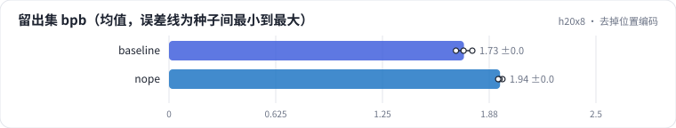
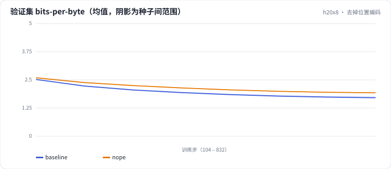

<!-- 本页由 python -m labkit docs 从 ../lesson.yaml 和 results/ 生成，不要手改 -->

[← 同样的 KV 字节，MLA 对 MQA](08-mla.md) · [课程首页](../README.md) · [12 层 Post-Norm →](10-post.md)

# 第 9 步 / 共 15 步：去掉位置编码

> 阶段 4 / 7：**位置编码** · 场景：`nope`（对照 `baseline`）

不加任何位置编码（NoPE）。模型只能靠因果 mask 隐式知道位置：第 t 个位置能看到 t 个 token，注意力的分母随位置变化。另外在 2 倍训练长度（1024 token）的窗口上评估，看外推。

## 这一步跑了什么

| 场景 | 作用 | 说明 | 相对基线改了什么 | 种子（H20） |
| - | - | - | - | - |
| `baseline` | 对照 | 基线：MHA 6 头、RoPE、Pre-Norm、Dense SwiGLU（= L01 基线） | — | 3 |
| `nope` | 本步 | 不加位置编码（NoPE） | `pos_emb=none` | 3 |

## 先预测

**去掉 RoPE，留出集 bpb 会差多少？**

- **A.** 差不到 0.05
- **B.** 差 0.05 - 0.1
- **C.** 差 0.1 以上

> 先选定一个（记下来），再展开下面的实测。bpb 差异小于 0.05（H20 上 3 种子均值之差的噪声量级）或小于种子间波动，都按“差不多”算。

## 实测

展开实测：H20 · 小 GPT（6 层 d=384）从零训练 100 MB 中文维基 · 每个场景只换一处结构 · 3 种子（已有 6 / 6 个运行）

| 场景 | 类型 | 留出集 bpb | 验证 bpb（512） | 验证 bpb（1024 窗口） | 留出集 bpb：与 `baseline` 差 | 留出集 bpb：各种子 | 断言 |
| - | - | - | - | - | - | - | - |
| `baseline` | 基线 | 1.727 ± 0.048 | 1.711 ± 0.048 | 1.793 ± 0.032 | — | s0 1.725 / s1 1.776 / s2 1.680 |  |
| `nope` | 候选改动 | 1.938 ± 0.013 | 1.927 ± 0.013 | 1.948 ± 0.007 | +0.211 | s0 1.952 / s1 1.936 / s2 1.927 |  |

运行目录（每个目录里有 `summary.json` 指标、`evidence.json` 证据摘要、`predictions.jsonl` 逐条预测、`log.txt` 日志）：

- `baseline` [s0](../../../results/h20x8/L03/baseline/s0-39279f/) · [s1](../../../results/h20x8/L03/baseline/s1-cbec53/) · [s2](../../../results/h20x8/L03/baseline/s2-618736/)
- `nope` [s0](../../../results/h20x8/L03/nope/s0-febcd0/) · [s1](../../../results/h20x8/L03/nope/s1-672350/) · [s2](../../../results/h20x8/L03/nope/s2-dd5428/)

## 看完实测再想一步

两条验证曲线在训练早期差得多，还是后期差得多？

---

[← 同样的 KV 字节，MLA 对 MQA](08-mla.md) · [课程首页](../README.md) · [12 层 Post-Norm →](10-post.md)
