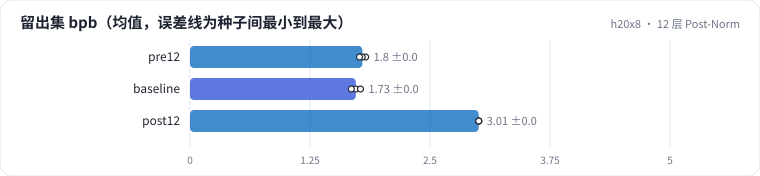
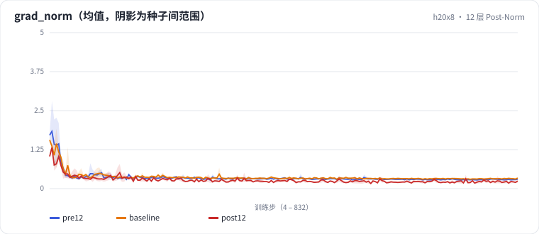

<!-- 本页由 python -m labkit docs 从 ../lesson.yaml 和 results/ 生成，不要手改 -->

[← 去掉位置编码](09-nope.md) · [课程首页](../README.md) · [MoE：同样的激活算力 →](11-moe.md)

# 第 10 步 / 共 15 步：12 层 Post-Norm

> 阶段 5 / 7：**Norm 位置** · 场景：`post12`（对照 `pre12`）

层数加到 12，对比两种 Norm 位置。Pre-Norm：x + f(norm(x))；Post-Norm（原始 Transformer、BERT）：norm(x + f(x))。学习率、warmup、梯度裁剪完全相同（lr 2e-3、warmup 2%、裁剪 1.0），没有为 Post-Norm 调参。

## 这一步跑了什么

| 场景 | 作用 | 说明 | 相对基线改了什么 | 种子（H20） |
| - | - | - | - | - |
| `pre12` | 对照 | 12 层 Pre-Norm | `n_layer=12` | 3 |
| `baseline` | 参照 | 基线：MHA 6 头、RoPE、Pre-Norm、Dense SwiGLU（= L01 基线） | — | 3 |
| `post12` | 本步 | 12 层 Post-Norm（其余同 pre12） | `n_layer=12`, `norm_pos=post` | 3 |

## 先预测

**12 层 Post-Norm 和 12 层 Pre-Norm 比，留出集 bpb 怎样？**

- **A.** 差不多（差 0.02 以内）
- **B.** 明显更差（差 0.02 - 0.2）
- **C.** 很差或发散（差 0.2 以上）

> 先选定一个（记下来），再展开下面的实测。bpb 差异小于 0.02 或小于种子间波动，都按“差不多”算。

## 实测

展开实测：H20 · 小 GPT（6 层 d=384）从零训练 100 MB 中文维基 · 每个场景只换一处结构 · 3 种子（已有 9 / 9 个运行）

| 场景 | 类型 | 留出集 bpb | 梯度范数最大值 | 梯度范数中位数 | loss 尖刺次数 | 留出集 bpb：与 `pre12` 差 | 留出集 bpb：各种子 | 断言 |
| - | - | - | - | - | - | - | - | - |
| `pre12` | 候选改动 | 1.796 ± 0.032 | 6.15 ± 1.73 | 0.310 ± 0.004 | 0 ± 0 | — | s0 1.829 / s1 1.793 / s2 1.766 | 未通过 |
| `pre12` | 候选改动 | 1.796 ± 0.032 | 6.15 ± 1.73 | 0.310 ± 0.004 | 0 ± 0 | — | s0 1.829 / s1 1.793 / s2 1.766 | 通过 |
| `baseline` | 基线 | 1.727 ± 0.048 | 5.85 ± 2.55 | 0.332 ± 0.005 | 0 ± 0 | -0.069 | s0 1.725 / s1 1.776 / s2 1.680 |  |
| `post12` | 候选改动 | 3.007 ± 0.000 | 1.51 ± 0.30 | 0.240 ± 0.003 | 0 ± 0 | +1.211 | s0 3.007 / s1 3.007 / s2 3.007 |  |

运行目录（每个目录里有 `summary.json` 指标、`evidence.json` 证据摘要、`predictions.jsonl` 逐条预测、`log.txt` 日志）：

- `pre12` [s0](../../../results/h20x8/L03/pre12/s0-b53647/) · [s1](../../../results/h20x8/L03/pre12/s1-4dfc4e/) · [s2](../../../results/h20x8/L03/pre12/s2-f4a533/)
- `baseline` [s0](../../../results/h20x8/L03/baseline/s0-39279f/) · [s1](../../../results/h20x8/L03/baseline/s1-cbec53/) · [s2](../../../results/h20x8/L03/baseline/s2-618736/)
- `post12` [s0](../../../results/h20x8/L03/post12/s0-86e45a/) · [s1](../../../results/h20x8/L03/post12/s1-6cb210/) · [s2](../../../results/h20x8/L03/post12/s2-297f77/)

## 看完实测再想一步

12 层 Pre-Norm 比 6 层好了多少？Post-Norm 吃到了加深的收益吗？

---

[← 去掉位置编码](09-nope.md) · [课程首页](../README.md) · [MoE：同样的激活算力 →](11-moe.md)
