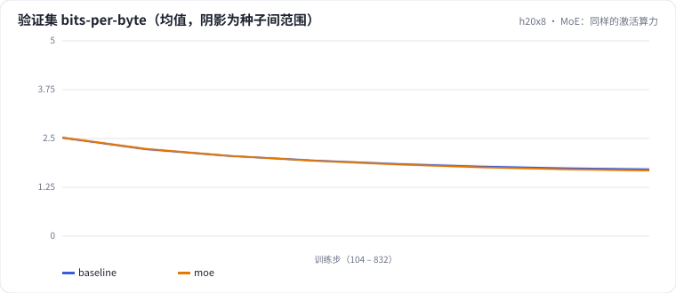

<!-- 本页由 python -m labkit docs 从 ../lesson.yaml 和 results/ 生成，不要手改 -->

[← 12 层 Post-Norm](10-post.md) · [课程首页](../README.md) · [MoE 对同总参数的宽 Dense →](12-moe-wide.md)

# 第 11 步 / 共 15 步：MoE：同样的激活算力

> 阶段 6 / 7：**MoE** · 场景：`moe`（对照 `baseline`）

FFN 换成 8 个专家（每个中间维 512）、每 token 选 top-2，负载均衡系数 0.01。每 token 的算力和 Dense 相同，总参数约 2.3 倍。

## 这一步跑了什么

| 场景 | 作用 | 说明 | 相对基线改了什么 | 种子（H20） |
| - | - | - | - | - |
| `baseline` | 对照 | 基线：MHA 6 头、RoPE、Pre-Norm、Dense SwiGLU（= L01 基线） | — | 3 |
| `moe` | 本步 | MoE：8 个专家（中间维 512）top-2，激活参数和 dense 相同，负载均衡系数 0.01 | `ffn=moe` | 3 |

## 先预测

**和 Dense 基线比，MoE 的留出集 bpb 怎样？**

- **A.** 更好（低 0.05 以上）
- **B.** 差不多（±0.05）
- **C.** 更差（高 0.05 以上）

> 先选定一个（记下来），再展开下面的实测。bpb 差异小于 0.05（H20 上 3 种子均值之差的噪声量级）或小于种子间波动，都按“差不多”算。

## 实测

展开实测：H20 · 小 GPT（6 层 d=384）从零训练 100 MB 中文维基 · 每个场景只换一处结构 · 3 种子（已有 6 / 6 个运行）

| 场景 | 类型 | 留出集 bpb | 总参数 | 激活参数 | 负载 最大/平均 | 训练秒数 | 留出集 bpb：与 `baseline` 差 | 留出集 bpb：各种子 | 断言 |
| - | - | - | - | - | - | - | - | - | - |
| `baseline` | 基线 | 1.727 ± 0.048 | 16,913,280.0 ± 0.0 | 16,913,280.0 ± 0.0 | — | 79 ± 0 | — | s0 1.725 / s1 1.776 / s2 1.680 |  |
| `moe` | 候选改动 | 1.697 ± 0.034 | 38,165,376.0 ± 0.0 | 16,931,712.0 ± 0.0 | 1.37 ± 0.07 | 128 ± 1 | -0.030 | s0 1.730 / s1 1.662 / s2 1.699 | 通过 |

运行目录（每个目录里有 `summary.json` 指标、`evidence.json` 证据摘要、`predictions.jsonl` 逐条预测、`log.txt` 日志）：

- `baseline` [s0](../../../results/h20x8/L03/baseline/s0-39279f/) · [s1](../../../results/h20x8/L03/baseline/s1-cbec53/) · [s2](../../../results/h20x8/L03/baseline/s2-618736/)
- `moe` [s0](../../../results/h20x8/L03/moe/s0-d26637/) · [s1](../../../results/h20x8/L03/moe/s1-c21a54/) · [s2](../../../results/h20x8/L03/moe/s2-728fe8/)

## 看完实测再想一步

训练早期 MoE 比 Dense 慢还是快？最后呢？

---

[← 12 层 Post-Norm](10-post.md) · [课程首页](../README.md) · [MoE 对同总参数的宽 Dense →](12-moe-wide.md)
