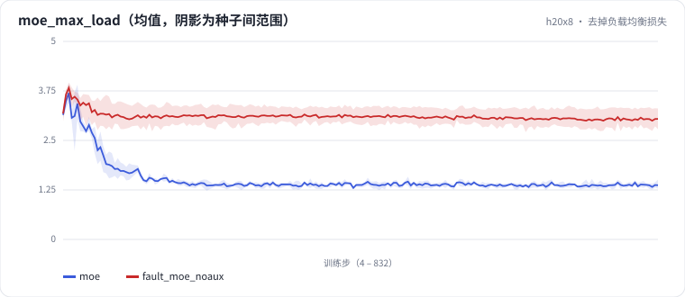

<!-- 本页由 python -m labkit docs 从 ../lesson.yaml 和 results/ 生成，不要手改 -->

[← MoE 对同总参数的宽 Dense](12-moe-wide.md) · [课程首页](../README.md) · [诊断：去掉负载均衡的代价在哪 →](14-diagnose.md)

# 第 13 步 / 共 15 步：去掉负载均衡损失

> 阶段 6 / 7：**MoE** · 场景：`fault_moe_noaux`（对照 `moe`）

同事觉得负载均衡损失"和语言建模无关、会拖累质量"，把系数设成 0 重训了一遍。其余和 MoE 场景完全相同。

## 这一步跑了什么

| 场景 | 作用 | 说明 | 相对基线改了什么 | 种子（H20） |
| - | - | - | - | - |
| `moe` | 对照 | MoE：8 个专家（中间维 512）top-2，激活参数和 dense 相同，负载均衡系数 0.01 | `ffn=moe` | 3 |
| `baseline` | 参照 | 基线：MHA 6 头、RoPE、Pre-Norm、Dense SwiGLU（= L01 基线） | — | 3 |
| `fault_moe_noaux` | 本步 | MoE 去掉负载均衡损失（moe_aux_coef = 0） | `ffn=moe`, `moe_aux_coef=0.0` | 3 |

## 先预测

**去掉负载均衡后，最忙的专家分到的 token 是平均的几倍？（top-2 / 8 专家时最多 4 倍）**

- **A.** 不到 1.5 倍：路由自己会均衡
- **B.** 1.5 - 2.5 倍
- **C.** 2.5 倍以上

> 先选定一个（记下来），再展开下面的实测。bpb 差异小于 0.02 或小于种子间波动，都按“差不多”算。

## 实测

展开实测：H20 · 小 GPT（6 层 d=384）从零训练 100 MB 中文维基 · 每个场景只换一处结构 · 3 种子（已有 9 / 9 个运行）

| 场景 | 类型 | 负载 最大/平均 | 路由熵（归一化） | 留出集 bpb | 负载 最大/平均：与 `moe` 差 | 负载 最大/平均：各种子 | 断言 |
| - | - | - | - | - | - | - | - |
| `moe` | 候选改动 | 1.37 ± 0.07 | 0.442 ± 0.040 | 1.697 ± 0.034 | — | s0 1.35 / s1 1.32 / s2 1.45 | 通过 |
| `baseline` | 基线 | — | — | 1.727 ± 0.048 | — | — |  |
| `fault_moe_noaux` | 教学故障 | 3.03 ± 0.25 | 0.375 ± 0.008 | 1.690 ± 0.031 | +1.66 | s0 3.31 / s1 2.82 / s2 2.97 | 通过 |

运行目录（每个目录里有 `summary.json` 指标、`evidence.json` 证据摘要、`predictions.jsonl` 逐条预测、`log.txt` 日志）：

- `moe` [s0](../../../results/h20x8/L03/moe/s0-d26637/) · [s1](../../../results/h20x8/L03/moe/s1-c21a54/) · [s2](../../../results/h20x8/L03/moe/s2-728fe8/)
- `baseline` [s0](../../../results/h20x8/L03/baseline/s0-39279f/) · [s1](../../../results/h20x8/L03/baseline/s1-cbec53/) · [s2](../../../results/h20x8/L03/baseline/s2-618736/)
- `fault_moe_noaux` [s0](../../../results/h20x8/L03/fault_moe_noaux/s0-f91c2a/) · [s1](../../../results/h20x8/L03/fault_moe_noaux/s1-5b148b/) · [s2](../../../results/h20x8/L03/fault_moe_noaux/s2-d186b2/)

## 看完实测再想一步

moe_max_load 曲线上，失衡是在训练早期就出现了，还是慢慢变严重？

---

[← MoE 对同总参数的宽 Dense](12-moe-wide.md) · [课程首页](../README.md) · [诊断：去掉负载均衡的代价在哪 →](14-diagnose.md)
