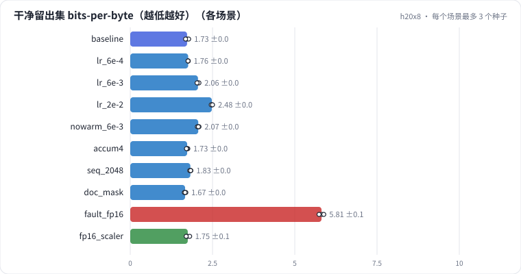

# L04 关键参数选择：学习率与 warmup、梯度累积、序列长度、packing 的文档 mask、fp16 与 loss scaling

在 L02 的训练循环上每次只改一个训练参数：学习率 ÷3、×3、×10，大学习率去掉 warmup；梯度累积 4 次（数学等价、显存降多少）；序列 512 → 2048（每步 token 不变，吞吐和注意力占比怎么变）；packing 加文档 mask。最后诊断一次"换成 fp16、不报错、效果却明显变差"：小梯度在 fp16 里下溢成 0。

## 怎么学（只看 GitHub 就够）

按下面“步骤”表从第 1 步往下点。每一页先给问题和选项，**先选定一个再展开“实测”**；实测里有结果表、证据图和运行目录链接。作业进度见 [作业看板](../../jobs/README.md)。参考答案和解析只在私有工作台里。

## 任务

**出发点**：训练发散、吞吐低、显存爆，往往是几个关键参数没定好。这些参数里有的影响**质量**（学习率、warmup），有的只影响**显存和吞吐**、数学上不改变结果（梯度累积），有的两者都影响（序列长度、精度、packing 的 mask）。先分清是哪一类，才知道该怎么调、调完看什么。

做法：沿用 L02 的基线（小 GPT、100 MB 中文维基、lr 2e-3、warmup 2%、batch 64 × 512、bf16），每个场景只改一个参数：

| 参数 | 场景 | 先问自己 |
| - | - | - |
| 学习率 | 6e-4、6e-3、2e-2 | 最优点在哪？太大时是变差还是发散？ |
| warmup | 6e-3 不做 warmup | warmup 在大学习率下值多少？ |
| 梯度累积 | 4 × 16 条 | 结果一样吗？显存省多少？ |
| 序列长度 | 2048 × 16 条 | 每步 token 一样，吞吐和注意力占比怎么变？ |
| packing mask | 文档内因果 mask | 跨文档注意力有害吗？代价是什么？ |
| 精度 | fp16（不加 / 加 GradScaler） | 不报错的数值问题怎么发现？ |

## 规模与边界

- **H20 档**：小 GPT（d=384、6 层、6 头、SwiGLU 1024、RoPE），batch 64 × 512，100 MB 中文维基过一遍；默认 bf16 autocast；每个场景 3 个种子。
- **保留了**：学习率与 warmup 的机制、梯度累积的等价性和显存账、注意力随序列长度的算力、packing 的文档 mask（块对角因果 mask + 位置重置）、fp16 的下溢与动态 loss scaling。
- **缩小了**：千万参数模型的最优学习率比 7B 大一个数量级以上；序列只到 2048；文档 mask 用显式稠密 mask 实现（生产里用 FlashAttention 的 varlen 接口，没有额外开销）。
- **未验证**：大模型上的学习率最优点和 batch 的关系（μP、临界 batch）；长序列（32K）时的显存与吞吐。

## 步骤

<!-- labkit:path -->
| # | 阶段 | 步骤 | 这一步回答的问题 | 场景 | H20 结果 |
| - | - | - | - | - | - |
| 1 | 理解任务 | [场景与痛点](steps/01-pain.md) | 发散、吞吐低、显存爆——哪些参数影响质量，哪些只影响显存和吞吐？ | — | — |
| 2 | 理解任务 | [流程结构](steps/02-flow.md) |  | — | — |
| 3 | 理解任务 | [追踪一步训练](steps/03-trace.md) |  | — | — |
| 4 | 理解任务 | [代码导读](steps/04-code.md) |  | — | — |
| 5 | 先估算 | [先估算](steps/05-estimate.md) | 基线训练时的峰值显存大约是多少？（提示：参数 + 梯度 + Adam 状态共 16 字节/参数；logits [64, 512, 16384] 有 bf16 和 fp32 两份，反向时还有同样大小的梯度） | — | — |
| 6 | 学习率与 warmup | [学习率 ÷ 3](steps/06-lr-lo.md) | 和基线比，留出集 bpb 怎样？ | `lr_6e-4` | 3 / 3 |
| 7 | 学习率与 warmup | [学习率 × 3](steps/07-lr-hi.md) | 和基线比，留出集 bpb 怎样？ | `lr_6e-3` | 3 / 3 |
| 8 | 学习率与 warmup | [学习率 × 10](steps/08-lr-xhi.md) | 和基线比，留出集 bpb 怎样？ | `lr_2e-2` | 3 / 3 |
| 9 | 学习率与 warmup | [大学习率去掉 warmup](steps/09-warmup.md) | 去掉 warmup，留出集 bpb 比有 warmup 时差多少？ | `nowarm_6e-3` | 3 / 3 |
| 10 | batch、序列与显存 | [梯度累积 4 次](steps/10-accum.md) | 和基线比，留出集 bpb 差多少？ | `accum4` | 3 / 3 |
| 11 | batch、序列与显存 | [序列 512 → 2048](steps/11-seq.md) | 训练吞吐（token/s）是基线的多少？ | `seq_2048` | 3 / 3 |
| 12 | packing | [packing 加文档 mask](steps/12-docmask.md) | 加文档 mask 后，留出集 bpb 怎样？ | `doc_mask` | 3 / 3 |
| 13 | 精度 | [换成 fp16](steps/13-fault.md) | 和 bf16 基线比，留出集 bpb 怎样？ | `fault_fp16` | 3 / 3 |
| 14 | 精度 | [诊断：fp16 为什么静默变差](steps/14-diagnose.md) | fp16 训练静默变差的根因是什么？ | `baseline` | 3 / 3 |
| 15 | 精度 | [fp16 + GradScaler](steps/15-fix.md) | 加上 GradScaler 后，fp16 和 bf16 基线比怎样？ | `fp16_scaler` | 3 / 3 |
| 16 | 带走 | [回顾](steps/16-keycard.md) |  | — | — |
<!-- /labkit:path -->

## 场景与结果

<!-- labkit:results -->

展开结果（先自己预测，再看）

**h20x8**：8 × NVIDIA H20，每张卡一个运行。语料、分词器（16K BPE）和 L01 完全相同（缓存共用）；基线小 GPT（d=384、6 层）= L01 基线，每个场景只改一个训练参数（已有 30 / 30 个运行）

| 场景 | 类型 | 留出集 bpb | 验证 bpb（512 窗口） | 梯度范数最大值 | loss 尖刺次数 | 训练峰值显存 GB | 训练 token/s | logits 梯度为 0 的比例 | 断言 |
| - | - | - | - | - | - | - | - | - | - |
| `baseline` | 基线 | 1.7271 ± 0.0478 (n=3) | 1.7113 ± 0.0480 (n=3) | 5.8545 ± 2.5481 (n=3) | 0.0000 ± 0.0000 (n=3) | 12.0670 ± 0.0000 (n=3) | 475284.0000 ± 1603.0084 (n=3) | 0.0000 ± 0.0000 (n=3) | 通过 |
| `lr_6e-4` | 候选改动 | 1.7596 ± 0.0025 (n=3) | 1.7437 ± 0.0019 (n=3) | 3.6188 ± 0.6405 (n=3) | 0.0000 ± 0.0000 (n=3) | 12.0670 ± 0.0000 (n=3) | 477232.3333 ± 839.3934 (n=3) | 0.0000 ± 0.0000 (n=3) |  |
| `lr_6e-3` | 候选改动 | 2.0588 ± 0.0280 (n=3) | 2.0443 ± 0.0274 (n=3) | 9.4773 ± 8.2192 (n=3) | 0.0000 ± 0.0000 (n=3) | 12.0670 ± 0.0000 (n=3) | 478129.6667 ± 960.3782 (n=3) | 0.0000 ± 0.0000 (n=3) |  |
| `lr_2e-2` | 候选改动 | 2.4801 ± 0.0204 (n=3) | 2.4710 ± 0.0207 (n=3) | 85.4855 ± 94.5513 (n=3) | 0.0000 ± 0.0000 (n=3) | 12.0670 ± 0.0000 (n=3) | 479308.6667 ± 1431.7983 (n=3) | 0.0000 ± 0.0000 (n=3) | 通过 |
| `nowarm_6e-3` | 候选改动 | 2.0667 ± 0.0261 (n=3) | 2.0519 ± 0.0260 (n=3) | 12.3582 ± 6.7309 (n=3) | 0.0000 ± 0.0000 (n=3) | 12.0670 ± 0.0000 (n=3) | 478673.0000 ± 1094.3181 (n=3) | 0.0000 ± 0.0000 (n=3) |  |
| `accum4` | 候选改动 | 1.7295 ± 0.0203 (n=3) | 1.7143 ± 0.0208 (n=3) | 4.2093 ± 0.3024 (n=3) | 0.0000 ± 0.0000 (n=3) | 5.8410 ± 0.0000 (n=3) | 438618.6667 ± 1263.3057 (n=3) | 0.0000 ± 0.0000 (n=3) | 通过 |
| `seq_2048` | 候选改动 | 1.8273 ± 0.0191 (n=3) | 1.8262 ± 0.0198 (n=3) | 37.3380 ± 25.2502 (n=3) | 0.3333 ± 0.5774 (n=3) | 12.0690 ± 0.0000 (n=3) | 439108.0000 ± 633.2653 (n=3) | 0.0000 ± 0.0000 (n=3) | 通过 |
| `doc_mask` | 候选改动 | 1.6664 ± 0.0228 (n=3) | 1.6506 ± 0.0232 (n=3) | 4.3525 ± 0.2460 (n=3) | 0.0000 ± 0.0000 (n=3) | 12.3190 ± 0.0000 (n=3) | 458226.0000 ± 1294.1665 (n=3) | 0.0000 ± 0.0000 (n=3) | 通过 |
| `fault_fp16` | 教学故障 | 5.8132 ± 0.0722 (n=3) | 5.8082 ± 0.0762 (n=3) | 75.5995 ± 58.8368 (n=3) | 0.0000 ± 0.0000 (n=3) | 12.0670 ± 0.0000 (n=3) | 479716.6667 ± 516.9229 (n=3) | 0.9945 ± 0.0008 (n=3) | 通过 |
| `fp16_scaler` | 修复 | 1.7473 ± 0.0537 (n=3) | 1.7323 ± 0.0542 (n=3) | 13.2542 ± 15.3307 (n=3) | 0.0000 ± 0.0000 (n=3) | 12.0670 ± 0.0000 (n=3) | 470732.6667 ± 3284.5569 (n=3) | 0.0525 ± 0.0074 (n=3) | 通过 |

<!-- /labkit:results -->

## 证据图

<!-- labkit:figures -->

展开证据图（先自己预测，再看）

- **h20x8**：[主指标](figures/h20x8-metrics.svg)

  

<!-- /labkit:figures -->

## 代码

<!-- labkit:code -->
| 代码段 | 位置 |
| - | - |
| `clean` | [projects/tinylm/corpus.py#L44](../../projects/tinylm/corpus.py#L44) |
| `minhash` | [projects/tinylm/corpus.py#L111](../../projects/tinylm/corpus.py#L111) |
| `build` | [projects/tinylm/corpus.py#L219](../../projects/tinylm/corpus.py#L219) |
| `flops_budget` | [projects/tinylm/experiment.py#L42](../../projects/tinylm/experiment.py#L42) |
| `docmask` | [projects/tinylm/model.py#L61](../../projects/tinylm/model.py#L61) |
| `moe` | [projects/tinylm/model.py#L88](../../projects/tinylm/model.py#L88) |
| `attention` | [projects/tinylm/model.py#L142](../../projects/tinylm/model.py#L142) |
| `mla` | [projects/tinylm/model.py#L161](../../projects/tinylm/model.py#L161) |
| `norm` | [projects/tinylm/model.py#L190](../../projects/tinylm/model.py#L190) |
| `gpt` | [projects/tinylm/model.py#L200](../../projects/tinylm/model.py#L200) |
| `kvcache` | [projects/tinylm/model.py#L296](../../projects/tinylm/model.py#L296) |
| `train_bpe` | [projects/tinylm/tokenizer.py#L85](../../projects/tinylm/tokenizer.py#L85) |
| `compression` | [projects/tinylm/tokenizer.py#L137](../../projects/tinylm/tokenizer.py#L137) |
| `schedule` | [projects/tinylm/train.py#L31](../../projects/tinylm/train.py#L31) |
| `batch` | [projects/tinylm/train.py#L71](../../projects/tinylm/train.py#L71) |
| `evaluate` | [projects/tinylm/train.py#L80](../../projects/tinylm/train.py#L80) |
| `budget` | [projects/tinylm/train.py#L141](../../projects/tinylm/train.py#L141) |
| `train` | [projects/tinylm/train.py#L162](../../projects/tinylm/train.py#L162) |
<!-- /labkit:code -->
