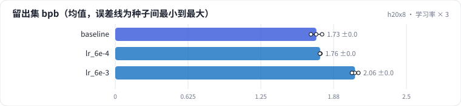
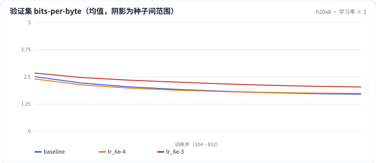

<!-- 本页由 python -m labkit docs 从 ../lesson.yaml 和 results/ 生成，不要手改 -->

[← 学习率 ÷ 3](06-lr-lo.md) · [课程首页](../README.md) · [学习率 × 10 →](08-lr-xhi.md)

# 第 7 步 / 共 16 步：学习率 × 3

> 阶段 3 / 7：**学习率与 warmup** · 场景：`lr_6e-3`（对照 `baseline`）

峰值学习率从 2e-3 提到 6e-3，warmup 仍是 2%。

## 这一步跑了什么

| 场景 | 作用 | 说明 | 相对基线改了什么 | 种子（H20） |
| - | - | - | - | - |
| `baseline` | 对照 | 基线：lr 2e-3、warmup 2%、batch 64 × 512、bf16（= L01 基线） | — | 3 |
| `lr_6e-4` | 参照 | 学习率 ÷ 3（6e-4） | `lr=0.0006` | 3 |
| `lr_6e-3` | 本步 | 学习率 × 3（6e-3） | `lr=0.006` | 3 |

## 先预测

**和基线比，留出集 bpb 怎样？**

- **A.** 更好（低 0.05 以上）
- **B.** 差不多（±0.05）
- **C.** 更差（高 0.05 以上）

> 先选定一个（记下来），再展开下面的实测。bpb 差异小于 0.05（H20 上 3 种子均值之差的噪声量级）或小于种子间波动，都按“差不多”算。

## 实测

展开实测：H20 · 小 GPT（1060 万主体参数）从零训练 100 MB 中文维基 · 每个场景只改一个训练参数 · 3 种子（已有 9 / 9 个运行）

| 场景 | 类型 | 留出集 bpb | 梯度范数最大值 | loss 尖刺次数 | 留出集 bpb：与 `baseline` 差 | 留出集 bpb：各种子 | 断言 |
| - | - | - | - | - | - | - | - |
| `baseline` | 基线 | 1.727 ± 0.048 | 5.85 ± 2.55 | 0 ± 0 | — | s0 1.725 / s1 1.776 / s2 1.680 | 通过 |
| `lr_6e-4` | 候选改动 | 1.760 ± 0.002 | 3.62 ± 0.64 | 0 ± 0 | +0.032 | s0 1.760 / s1 1.762 / s2 1.757 |  |
| `lr_6e-3` | 候选改动 | 2.059 ± 0.028 | 9.48 ± 8.22 | 0 ± 0 | +0.332 | s0 2.056 / s1 2.088 / s2 2.032 |  |

运行目录（每个目录里有 `summary.json` 指标、`evidence.json` 证据摘要、`predictions.jsonl` 逐条预测、`log.txt` 日志）：

- `baseline` [s0](../../../results/h20x8/L04/baseline/s0-39279f/) · [s1](../../../results/h20x8/L04/baseline/s1-cbec53/) · [s2](../../../results/h20x8/L04/baseline/s2-618736/)
- `lr_6e-4` [s0](../../../results/h20x8/L04/lr_6e-4/s0-e51adc/) · [s1](../../../results/h20x8/L04/lr_6e-4/s1-1d1fed/) · [s2](../../../results/h20x8/L04/lr_6e-4/s2-70859f/)
- `lr_6e-3` [s0](../../../results/h20x8/L04/lr_6e-3/s0-f7885d/) · [s1](../../../results/h20x8/L04/lr_6e-3/s1-f324df/) · [s2](../../../results/h20x8/L04/lr_6e-3/s2-881c5f/)

## 看完实测再想一步

三个学习率按 bpb 排序，U 形的底在哪？

---

[← 学习率 ÷ 3](06-lr-lo.md) · [课程首页](../README.md) · [学习率 × 10 →](08-lr-xhi.md)
