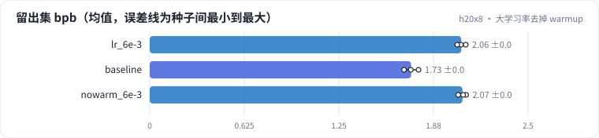
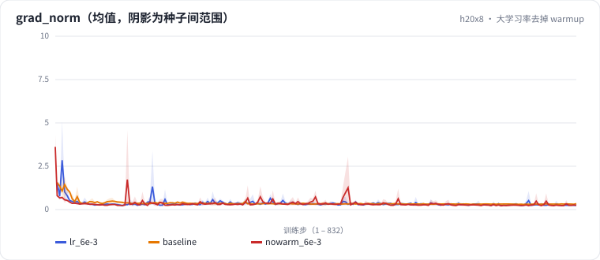

<!-- 本页由 python -m labkit docs 从 ../lesson.yaml 和 results/ 生成，不要手改 -->

[← 学习率 × 10](08-lr-xhi.md) · [课程首页](../README.md) · [梯度累积 4 次 →](10-accum.md)

# 第 9 步 / 共 16 步：大学习率去掉 warmup

> 阶段 3 / 7：**学习率与 warmup** · 场景：`nowarm_6e-3`（对照 `lr_6e-3`）

学习率 6e-3，第一步就用峰值，不做 warmup。对照组是同样 6e-3、warmup 2%。

## 这一步跑了什么

| 场景 | 作用 | 说明 | 相对基线改了什么 | 种子（H20） |
| - | - | - | - | - |
| `lr_6e-3` | 对照 | 学习率 × 3（6e-3） | `lr=0.006` | 3 |
| `baseline` | 参照 | 基线：lr 2e-3、warmup 2%、batch 64 × 512、bf16（= L01 基线） | — | 3 |
| `nowarm_6e-3` | 本步 | 学习率 6e-3 且不做 warmup | `lr=0.006`, `warmup_frac=0.0` | 3 |

## 先预测

**去掉 warmup，留出集 bpb 比有 warmup 时差多少？**

- **A.** 差不多（差 0.02 以内）
- **B.** 差 0.02 - 0.1
- **C.** 差 0.1 以上

> 先选定一个（记下来），再展开下面的实测。bpb 差异小于 0.02 或小于种子间波动，都按“差不多”算。

## 实测

展开实测：H20 · 小 GPT（1060 万主体参数）从零训练 100 MB 中文维基 · 每个场景只改一个训练参数 · 3 种子（已有 9 / 9 个运行）

| 场景 | 类型 | 留出集 bpb | 梯度范数最大值 | loss 尖刺次数 | 留出集 bpb：与 `lr_6e-3` 差 | 留出集 bpb：各种子 | 断言 |
| - | - | - | - | - | - | - | - |
| `lr_6e-3` | 候选改动 | 2.059 ± 0.028 | 9.48 ± 8.22 | 0 ± 0 | — | s0 2.056 / s1 2.088 / s2 2.032 |  |
| `baseline` | 基线 | 1.727 ± 0.048 | 5.85 ± 2.55 | 0 ± 0 | -0.332 | s0 1.725 / s1 1.776 / s2 1.680 | 通过 |
| `nowarm_6e-3` | 候选改动 | 2.067 ± 0.026 | 12.36 ± 6.73 | 0 ± 0 | +0.008 | s0 2.090 / s1 2.039 / s2 2.071 |  |

运行目录（每个目录里有 `summary.json` 指标、`evidence.json` 证据摘要、`predictions.jsonl` 逐条预测、`log.txt` 日志）：

- `lr_6e-3` [s0](../../../results/h20x8/L04/lr_6e-3/s0-f7885d/) · [s1](../../../results/h20x8/L04/lr_6e-3/s1-f324df/) · [s2](../../../results/h20x8/L04/lr_6e-3/s2-881c5f/)
- `baseline` [s0](../../../results/h20x8/L04/baseline/s0-39279f/) · [s1](../../../results/h20x8/L04/baseline/s1-cbec53/) · [s2](../../../results/h20x8/L04/baseline/s2-618736/)
- `nowarm_6e-3` [s0](../../../results/h20x8/L04/nowarm_6e-3/s0-9a06b9/) · [s1](../../../results/h20x8/L04/nowarm_6e-3/s1-6c10ce/) · [s2](../../../results/h20x8/L04/nowarm_6e-3/s2-ca92e1/)

## 看完实测再想一步

训练前 50 步的 loss 曲线，两者差在哪？

---

[← 学习率 × 10](08-lr-xhi.md) · [课程首页](../README.md) · [梯度累积 4 次 →](10-accum.md)
