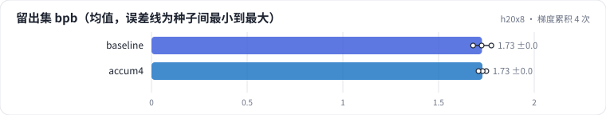
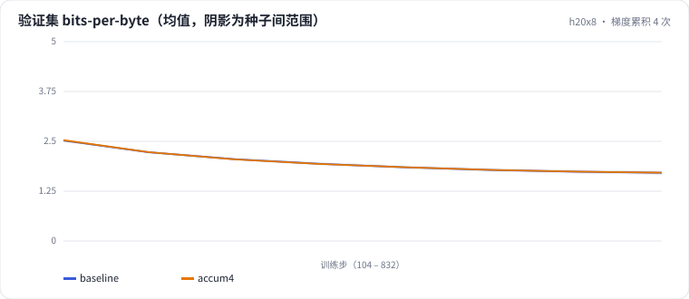

<!-- 本页由 python -m labkit docs 从 ../lesson.yaml 和 results/ 生成，不要手改 -->

[← 大学习率去掉 warmup](09-warmup.md) · [课程首页](../README.md) · [序列 512 → 2048 →](11-seq.md)

# 第 10 步 / 共 16 步：梯度累积 4 次

> 阶段 4 / 7：**batch、序列与显存** · 场景：`accum4`（对照 `baseline`）

每步仍是 64 条，但拆成 4 次前向反向（每次 16 条），梯度累加后更新一次。学习率、步数、数据顺序都不变。

## 这一步跑了什么

| 场景 | 作用 | 说明 | 相对基线改了什么 | 种子（H20） |
| - | - | - | - | - |
| `baseline` | 对照 | 基线：lr 2e-3、warmup 2%、batch 64 × 512、bf16（= L01 基线） | — | 3 |
| `accum4` | 本步 | 梯度累积 4 次（每步仍是 64 条，每次前向 16 条） | `grad_accum=4` | 3 |

## 先预测

**和基线比，留出集 bpb 差多少？**

- **A.** 更好（低 0.01 以上）
- **B.** 几乎一样（±0.01）
- **C.** 更差（高 0.01 以上）

> 先选定一个（记下来），再展开下面的实测。bpb 差异小于 0.02 或小于种子间波动，都按“差不多”算。

## 实测

展开实测：H20 · 小 GPT（1060 万主体参数）从零训练 100 MB 中文维基 · 每个场景只改一个训练参数 · 3 种子（已有 6 / 6 个运行）

| 场景 | 类型 | 留出集 bpb | 峰值显存 GB | 训练 token/s | 留出集 bpb：与 `baseline` 差 | 留出集 bpb：各种子 | 断言 |
| - | - | - | - | - | - | - | - |
| `baseline` | 基线 | 1.7271 ± 0.0478 | 12.07 ± 0.00 | 475,284.0 ± 1,603.0084216871726 | — | s0 1.7251 / s1 1.7759 / s2 1.6803 | 通过 |
| `accum4` | 候选改动 | 1.7295 ± 0.0203 | 5.84 ± 0.00 | 438,618.6666666667 ± 1,263.3057164967367 | +0.0024 | s0 1.7494 / s1 1.7303 / s2 1.7089 | 未通过 |
| `accum4` | 候选改动 | 1.7295 ± 0.0203 | 5.84 ± 0.00 | 438,618.6666666667 ± 1,263.3057164967367 | +0.0024 | s0 1.7494 / s1 1.7303 / s2 1.7089 | 通过 |

运行目录（每个目录里有 `summary.json` 指标、`evidence.json` 证据摘要、`predictions.jsonl` 逐条预测、`log.txt` 日志）：

- `baseline` [s0](../../../results/h20x8/L04/baseline/s0-39279f/) · [s1](../../../results/h20x8/L04/baseline/s1-cbec53/) · [s2](../../../results/h20x8/L04/baseline/s2-618736/)
- `accum4` [s0](../../../results/h20x8/L04/accum4/s0-6134be/) · [s1](../../../results/h20x8/L04/accum4/s1-2cc924/) · [s2](../../../results/h20x8/L04/accum4/s2-6604cd/)

## 看完实测再想一步

两条 loss 曲线几乎重合吗？

---

[← 大学习率去掉 warmup](09-warmup.md) · [课程首页](../README.md) · [序列 512 → 2048 →](11-seq.md)
