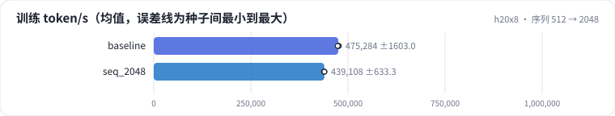
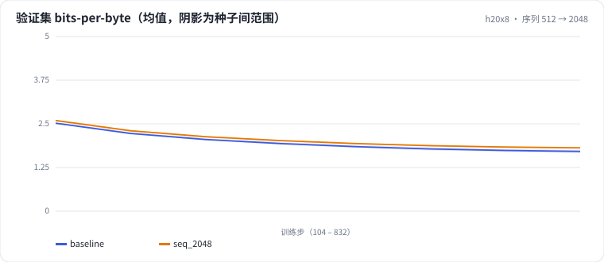

<!-- 本页由 python -m labkit docs 从 ../lesson.yaml 和 results/ 生成，不要手改 -->

[← 梯度累积 4 次](10-accum.md) · [课程首页](../README.md) · [packing 加文档 mask →](12-docmask.md)

# 第 11 步 / 共 16 步：序列 512 → 2048

> 阶段 4 / 7：**batch、序列与显存** · 场景：`seq_2048`（对照 `baseline`）

序列长度 2048、batch 16，每步 token 数（32768）和总步数都不变。注意力的每 token 算力和序列长度成正比，其余部分不变。为了公平，质量用同样的 512 窗口评估。

## 这一步跑了什么

| 场景 | 作用 | 说明 | 相对基线改了什么 | 种子（H20） |
| - | - | - | - | - |
| `baseline` | 对照 | 基线：lr 2e-3、warmup 2%、batch 64 × 512、bf16（= L01 基线） | — | 3 |
| `seq_2048` | 本步 | 序列 2048、batch 16（每步 token 数不变） | `seq_len=2048`, `batch_size=16` | 3 |

## 先预测

**训练吞吐（token/s）是基线的多少？**

- **A.** 不到 70%
- **B.** 70% - 95%
- **C.** 95% 以上：差不多

> 先选定一个（记下来），再展开下面的实测。bpb 差异小于 0.05（H20 上 3 种子均值之差的噪声量级）或小于种子间波动，都按“差不多”算。

## 实测

展开实测：H20 · 小 GPT（1060 万主体参数）从零训练 100 MB 中文维基 · 每个场景只改一个训练参数 · 3 种子（已有 6 / 6 个运行）

| 场景 | 类型 | 训练 token/s | 注意力占比 | 峰值显存 GB | 验证 bpb（512 窗口） | 训练 token/s：与 `baseline` 差 | 训练 token/s：各种子 | 断言 |
| - | - | - | - | - | - | - | - | - |
| `baseline` | 基线 | 475,284.0 ± 1,603.0084216871726 | 6.5% ± 0.0 | 12.07 ± 0.00 | 1.711 ± 0.048 | — | s0 476,638 / s1 475,700 / s2 473,514 | 通过 |
| `seq_2048` | 候选改动 | 439,108.0 ± 633.2653472281584 | 21.8% ± 0.0 | 12.07 ± 0.00 | 1.826 ± 0.020 | -36,176.0 | s0 438,383 / s1 439,553 / s2 439,388 | 通过 |

运行目录（每个目录里有 `summary.json` 指标、`evidence.json` 证据摘要、`predictions.jsonl` 逐条预测、`log.txt` 日志）：

- `baseline` [s0](../../../results/h20x8/L04/baseline/s0-39279f/) · [s1](../../../results/h20x8/L04/baseline/s1-cbec53/) · [s2](../../../results/h20x8/L04/baseline/s2-618736/)
- `seq_2048` [s0](../../../results/h20x8/L04/seq_2048/s0-bdca01/) · [s1](../../../results/h20x8/L04/seq_2048/s1-6c4a82/) · [s2](../../../results/h20x8/L04/seq_2048/s2-d99630/)

## 看完实测再想一步

吞吐下降的比例和注意力占比上升的比例对得上吗？

---

[← 梯度累积 4 次](10-accum.md) · [课程首页](../README.md) · [packing 加文档 mask →](12-docmask.md)
