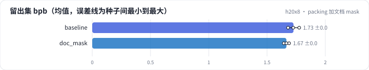
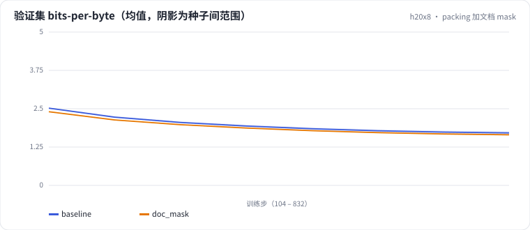

<!-- 本页由 python -m labkit docs 从 ../lesson.yaml 和 results/ 生成，不要手改 -->

[← 序列 512 → 2048](11-seq.md) · [课程首页](../README.md) · [换成 fp16 →](13-fault.md)

# 第 12 步 / 共 16 步：packing 加文档 mask

> 阶段 5 / 7：**packing** · 场景：`doc_mask`（对照 `baseline`）

基线把文档首尾相接切成 512 的块，后一篇文档能看到前一篇（以 EOS 隔开）。打开文档 mask：块对角因果 mask，每篇文档只看自己，位置从 0 重新计。维基文章平均约 1000 字，一个 512 的块里常常是一篇的结尾 + 下一篇的开头。

## 这一步跑了什么

| 场景 | 作用 | 说明 | 相对基线改了什么 | 种子（H20） |
| - | - | - | - | - |
| `baseline` | 对照 | 基线：lr 2e-3、warmup 2%、batch 64 × 512、bf16（= L01 基线） | — | 3 |
| `doc_mask` | 本步 | packing 加文档 mask：每篇文档只看自己，位置从 0 重新计 | `doc_mask=True` | 3 |

## 先预测

**加文档 mask 后，留出集 bpb 怎样？**

- **A.** 更好（低 0.05 以上）
- **B.** 差不多（±0.05）
- **C.** 更差（高 0.05 以上）

> 先选定一个（记下来），再展开下面的实测。bpb 差异小于 0.05（H20 上 3 种子均值之差的噪声量级）或小于种子间波动，都按“差不多”算。

## 实测

展开实测：H20 · 小 GPT（1060 万主体参数）从零训练 100 MB 中文维基 · 每个场景只改一个训练参数 · 3 种子（已有 6 / 6 个运行）

| 场景 | 类型 | 留出集 bpb | 广告逐条 bpb | 训练 token/s | 峰值显存 GB | 留出集 bpb：与 `baseline` 差 | 留出集 bpb：各种子 | 断言 |
| - | - | - | - | - | - | - | - | - |
| `baseline` | 基线 | 1.727 ± 0.048 | 3.562 ± 0.021 | 475,284.0 ± 1,603.0084216871726 | 12.07 ± 0.00 | — | s0 1.725 / s1 1.776 / s2 1.680 | 通过 |
| `doc_mask` | 候选改动 | 1.666 ± 0.023 | 3.558 ± 0.012 | 458,226.0 ± 1,294.1665271517418 | 12.32 ± 0.00 | -0.061 | s0 1.689 / s1 1.644 / s2 1.666 | 通过 |

运行目录（每个目录里有 `summary.json` 指标、`evidence.json` 证据摘要、`predictions.jsonl` 逐条预测、`log.txt` 日志）：

- `baseline` [s0](../../../results/h20x8/L04/baseline/s0-39279f/) · [s1](../../../results/h20x8/L04/baseline/s1-cbec53/) · [s2](../../../results/h20x8/L04/baseline/s2-618736/)
- `doc_mask` [s0](../../../results/h20x8/L04/doc_mask/s0-915f5c/) · [s1](../../../results/h20x8/L04/doc_mask/s1-d6f8d3/) · [s2](../../../results/h20x8/L04/doc_mask/s2-477310/)

## 看完实测再想一步

质量差和吞吐差，哪个更值得在意？

---

[← 序列 512 → 2048](11-seq.md) · [课程首页](../README.md) · [换成 fp16 →](13-fault.md)
