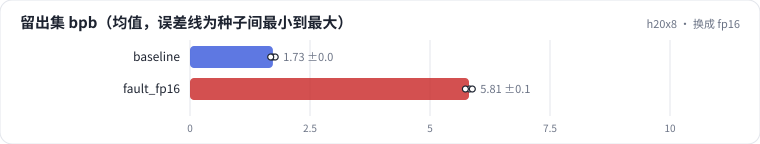
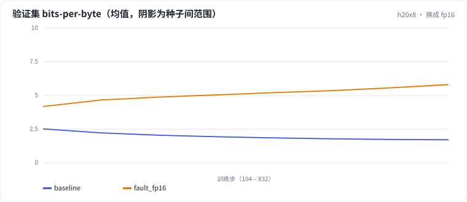

<!-- 本页由 python -m labkit docs 从 ../lesson.yaml 和 results/ 生成，不要手改 -->

[← packing 加文档 mask](12-docmask.md) · [课程首页](../README.md) · [诊断：fp16 为什么静默变差 →](14-diagnose.md)

# 第 13 步 / 共 16 步：换成 fp16

> 阶段 6 / 7：**精度** · 场景：`fault_fp16`（对照 `baseline`）

为了兼容一批只支持 fp16 的老卡，同事把 autocast 从 bf16 换成了 fp16，其余不变。训练跑完了，没有 NaN，没有报错。

## 这一步跑了什么

| 场景 | 作用 | 说明 | 相对基线改了什么 | 种子（H20） |
| - | - | - | - | - |
| `baseline` | 对照 | 基线：lr 2e-3、warmup 2%、batch 64 × 512、bf16（= L01 基线） | — | 3 |
| `fault_fp16` | 本步 | 换成 fp16 autocast，没有 loss scaling | `precision=fp16` | 3 |

## 先预测

**和 bf16 基线比，留出集 bpb 怎样？**

- **A.** 差不多（差 0.05 以内）
- **B.** 差 0.05 - 0.1
- **C.** 差 0.1 以上

> 先选定一个（记下来），再展开下面的实测。bpb 差异小于 0.05（H20 上 3 种子均值之差的噪声量级）或小于种子间波动，都按“差不多”算。

## 实测

展开实测：H20 · 小 GPT（1060 万主体参数）从零训练 100 MB 中文维基 · 每个场景只改一个训练参数 · 3 种子（已有 6 / 6 个运行）

| 场景 | 类型 | 留出集 bpb | 梯度范数中位数 | 出现 NaN 的步 | 留出集 bpb：与 `baseline` 差 | 留出集 bpb：各种子 | 断言 |
| - | - | - | - | - | - | - | - |
| `baseline` | 基线 | 1.727 ± 0.048 | 0.3321 ± 0.0051 | — | — | s0 1.725 / s1 1.776 / s2 1.680 | 通过 |
| `fault_fp16` | 教学故障 | 5.813 ± 0.072 | 3.5610 ± 0.0964 | — | +4.086 | s0 5.822 / s1 5.737 / s2 5.881 | 通过 |

运行目录（每个目录里有 `summary.json` 指标、`evidence.json` 证据摘要、`predictions.jsonl` 逐条预测、`log.txt` 日志）：

- `baseline` [s0](../../../results/h20x8/L04/baseline/s0-39279f/) · [s1](../../../results/h20x8/L04/baseline/s1-cbec53/) · [s2](../../../results/h20x8/L04/baseline/s2-618736/)
- `fault_fp16` [s0](../../../results/h20x8/L04/fault_fp16/s0-a87ad9/) · [s1](../../../results/h20x8/L04/fault_fp16/s1-faa0ba/) · [s2](../../../results/h20x8/L04/fault_fp16/s2-4a817e/)

## 看完实测再想一步

fp16 的 loss 曲线是一开始就慢，还是中途才变慢？

---

[← packing 加文档 mask](12-docmask.md) · [课程首页](../README.md) · [诊断：fp16 为什么静默变差 →](14-diagnose.md)
