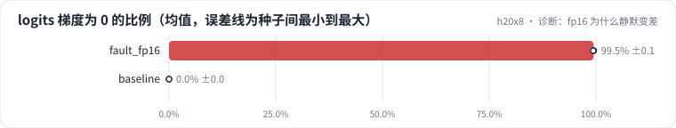
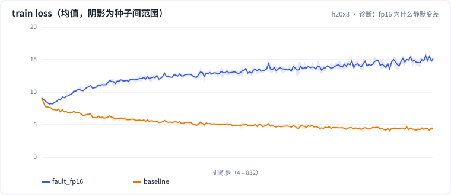

<!-- 本页由 python -m labkit docs 从 ../lesson.yaml 和 results/ 生成，不要手改 -->

[← 换成 fp16](13-fault.md) · [课程首页](../README.md) · [fp16 + GradScaler →](15-fix.md)

# 第 14 步 / 共 16 步：诊断：fp16 为什么静默变差

> 阶段 6 / 7：**精度** · 场景：`baseline`（对照 `fault_fp16`）

只把 bf16 换成了 fp16，没有 NaN、没有报错，效果明显变差。按需逐级点开线索，然后点选根因。

## 这一步跑了什么

| 场景 | 作用 | 说明 | 相对基线改了什么 | 种子（H20） |
| - | - | - | - | - |
| `fault_fp16` | 对照 | 换成 fp16 autocast，没有 loss scaling | `precision=fp16` | 3 |
| `baseline` | 本步 | 基线：lr 2e-3、warmup 2%、batch 64 × 512、bf16（= L01 基线） | — | 3 |

## 线索

逐条展开，看到能下判断为止。

线索 1

看 loss 曲线和梯度范数：梯度范数中位数 bf16 0.3321 ± 0.0051，fp16 3.5610 ± 0.0964。没有出现 NaN。

线索 2

统计 logits 梯度里恰好为 0 的比例：bf16 0.0% ± 0.0%，fp16 99.5% ± 0.1%。交叉熵的梯度要除以 32768 个 token。

线索 3

加上 GradScaler 之后：bpb 1.747 ± 0.054（bf16 1.727 ± 0.048），零梯度比例 5.2% ± 0.7%，最终 scale 6.554e+04 ± 0。

## 先预测

**fp16 训练静默变差的根因是什么？**

- **A.** fp16 的尾数只有 10 位，前向的 loss 算不准
- **B.** 没有 loss scaling：交叉熵对 logits 的小梯度在 fp16 里下溢成 0，大部分词收不到梯度
- **C.** 梯度上溢成 inf，这些步被跳过了
- **D.** fp16 要配更小的学习率

> 先选定一个（记下来），再展开下面的实测。bpb 差异小于 0.02 或小于种子间波动，都按“差不多”算。

## 实测

展开实测：H20 · 小 GPT（1060 万主体参数）从零训练 100 MB 中文维基 · 每个场景只改一个训练参数 · 3 种子（已有 6 / 6 个运行）

| 场景 | 类型 | logits 梯度为 0 的比例 | 梯度范数中位数 | 留出集 bpb | logits 梯度为 0 的比例：与 `fault_fp16` 差 | logits 梯度为 0 的比例：各种子 | 断言 |
| - | - | - | - | - | - | - | - |
| `fault_fp16` | 教学故障 | 99.5% ± 0.1 | 3.5610 ± 0.0964 | 5.813 ± 0.072 | — | s0 99.5% / s1 99.5% / s2 99.4% | 通过 |
| `baseline` | 基线 | 0.0% ± 0.0 | 0.3321 ± 0.0051 | 1.727 ± 0.048 | -99.5 个点 | s0 0.0% / s1 0.0% / s2 0.0% | 通过 |

运行目录（每个目录里有 `summary.json` 指标、`evidence.json` 证据摘要、`predictions.jsonl` 逐条预测、`log.txt` 日志）：

- `fault_fp16` [s0](../../../results/h20x8/L04/fault_fp16/s0-a87ad9/) · [s1](../../../results/h20x8/L04/fault_fp16/s1-faa0ba/) · [s2](../../../results/h20x8/L04/fault_fp16/s2-4a817e/)
- `baseline` [s0](../../../results/h20x8/L04/baseline/s0-39279f/) · [s1](../../../results/h20x8/L04/baseline/s1-cbec53/) · [s2](../../../results/h20x8/L04/baseline/s2-618736/)

---

[← 换成 fp16](13-fault.md) · [课程首页](../README.md) · [fp16 + GradScaler →](15-fix.md)
