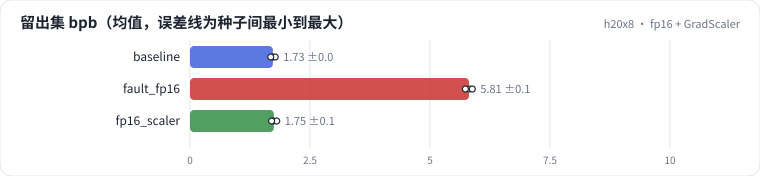
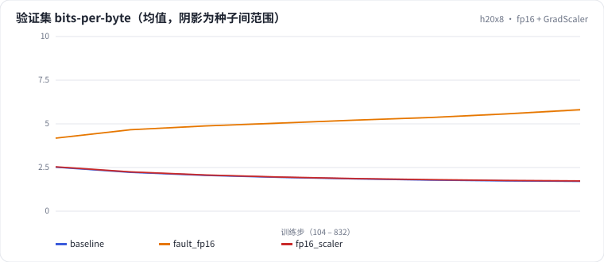

<!-- 本页由 python -m labkit docs 从 ../lesson.yaml 和 results/ 生成，不要手改 -->

[← 诊断：fp16 为什么静默变差](14-diagnose.md) · [课程首页](../README.md) · [回顾 →](16-keycard.md)

# 第 15 步 / 共 16 步：fp16 + GradScaler

> 阶段 6 / 7：**精度** · 场景：`fp16_scaler`（对照 `baseline`）

修复：fp16 加上动态 loss scaling（初始 scale 65536，连续 2000 步没有 inf 就翻倍，遇到 inf 就减半并跳过这一步）。

## 这一步跑了什么

| 场景 | 作用 | 说明 | 相对基线改了什么 | 种子（H20） |
| - | - | - | - | - |
| `baseline` | 对照 | 基线：lr 2e-3、warmup 2%、batch 64 × 512、bf16（= L01 基线） | — | 3 |
| `fault_fp16` | 参照 | 换成 fp16 autocast，没有 loss scaling | `precision=fp16` | 3 |
| `fp16_scaler` | 本步 | fp16 + GradScaler（动态 loss scaling） | `precision=fp16`, `grad_scaler=True` | 3 |

## 先预测

**加上 GradScaler 后，fp16 和 bf16 基线比怎样？**

- **A.** 比 bf16 更好（低 0.05 以上）
- **B.** 和 bf16 差不多（±0.05）
- **C.** 仍然更差（高 0.05 以上）

> 先选定一个（记下来），再展开下面的实测。bpb 差异小于 0.05（H20 上 3 种子均值之差的噪声量级）或小于种子间波动，都按“差不多”算。

## 实测

展开实测：H20 · 小 GPT（1060 万主体参数）从零训练 100 MB 中文维基 · 每个场景只改一个训练参数 · 3 种子（已有 9 / 9 个运行）

| 场景 | 类型 | 留出集 bpb | logits 梯度为 0 的比例 | 跳过的步 | 留出集 bpb：与 `baseline` 差 | 留出集 bpb：各种子 | 断言 |
| - | - | - | - | - | - | - | - |
| `baseline` | 基线 | 1.727 ± 0.048 | 0.0% ± 0.0 | — | — | s0 1.725 / s1 1.776 / s2 1.680 | 通过 |
| `fault_fp16` | 教学故障 | 5.813 ± 0.072 | 99.5% ± 0.1 | — | +4.086 | s0 5.822 / s1 5.737 / s2 5.881 | 通过 |
| `fp16_scaler` | 修复 | 1.747 ± 0.054 | 5.2% ± 0.7 | 0 ± 0 | +0.020 | s0 1.735 / s1 1.806 / s2 1.701 | 通过 |

运行目录（每个目录里有 `summary.json` 指标、`evidence.json` 证据摘要、`predictions.jsonl` 逐条预测、`log.txt` 日志）：

- `baseline` [s0](../../../results/h20x8/L04/baseline/s0-39279f/) · [s1](../../../results/h20x8/L04/baseline/s1-cbec53/) · [s2](../../../results/h20x8/L04/baseline/s2-618736/)
- `fault_fp16` [s0](../../../results/h20x8/L04/fault_fp16/s0-a87ad9/) · [s1](../../../results/h20x8/L04/fault_fp16/s1-faa0ba/) · [s2](../../../results/h20x8/L04/fault_fp16/s2-4a817e/)
- `fp16_scaler` [s0](../../../results/h20x8/L04/fp16_scaler/s0-2b4996/) · [s1](../../../results/h20x8/L04/fp16_scaler/s1-e7aedd/) · [s2](../../../results/h20x8/L04/fp16_scaler/s2-2aa887/)

## 看完实测再想一步

三条 loss 曲线里，fp16 + GradScaler 和 bf16 重合吗？

---

[← 诊断：fp16 为什么静默变差](14-diagnose.md) · [课程首页](../README.md) · [回顾 →](16-keycard.md)
