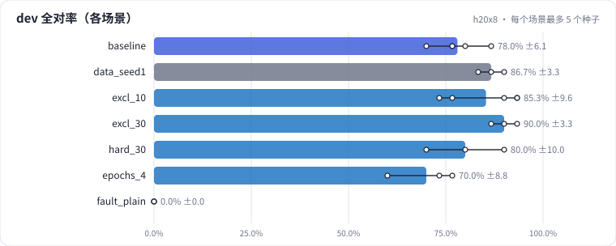
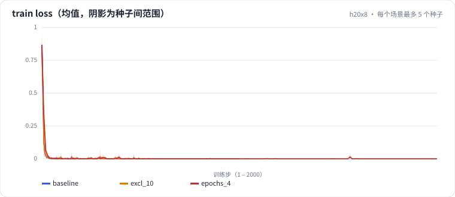

# L06 围绕错误迭代：错例 → 单变量改动 → 多种子 + 逐样本 → 保留集

从 L05 的 7B SFT 错例出发：先量出噪声（训练种子、数据采样），再只改一个变量（把一部分训练样本替换成排除型条件），用多种子均值、按标签分组和逐样本修好/弄坏判断是否真修好；顺带看 loss 和任务指标为什么不同步；诊断一次"离线好好的、上线全错"的训练推理模板不一致；最后在保留 test 集上做一次检验。

## 怎么学（只看 GitHub 就够）

按下面“步骤”表从第 1 步往下点。每一页先给问题和选项，**先选定一个再展开“实测”**；实测里有结果表、证据图和运行目录链接。作业进度见 [作业看板](../../jobs/README.md)。参考答案和解析只在私有工作台里。

## 任务

**出发点**：L05 的 7B SFT 基线在 dev 上还错几条，错误集中在**条件**上：排除型条件（"特价商品除外"）这一类，SFT 前后都只对 1/3。训练集的生成器里**根本没有**"X 除外 / X 不参与"这种句式。

这一课只做一件事：**针对一类错误改一个变量，再判断它是不是真的修好了。** 改的变量是 `exclusion_ratio`：把一定比例的训练样本**替换**成排除型条件样本。

- 替换而不是追加：样本数和训练 token 基本不变，对照里不会混进"多训了一些"；
- 排除词表刻意避开 dev/test 里出现过的原句，dev 上如果变好，说明学到的是句式，不是背下了评估集的词；
- 其余样本和基线逐条相同（同一个 data_seed），对照的唯一差别就是被替换的那批。

| 集合 | 条数 | 用途 |
| - | - | - |
| 训练集 | 4000（合成） | 拟合 |
| dev | 30（排除型条件 3 条） | 迭代时看 |
| test | 30（排除型条件 3 条） | **只在最后看一次** |

## 规模与边界

- **H20 档**：Qwen2.5-7B-Instruct（bf16）、4000 条合成训练样本；基线和主改动各 5 个种子，其余 3 个；每轮结束在 dev 上做一次生成评估。
- **保留了**：错例 → 假设 → 单变量改动 → 多种子 → 分组 + 逐样本核对 → 保留集检验的完整闭环；loss 与任务指标分开观察；训练/推理格式一致性检查。
- **缩小了**：dev、test 各 30 条，一条样本 3.3 个百分点；目标错误类型各只有 3 条，任何结论都要配合分组和逐样本看。
- **未验证**：真实广告里排除型条件的写法多样性。

## 步骤

<!-- labkit:path -->
| # | 阶段 | 步骤 | 这一步回答的问题 | 场景 | H20 结果 |
| - | - | - | - | - | - |
| 1 | 理解任务 | [场景与痛点](steps/01-pain.md) | 离线指标涨了，怎么知道不是噪声、也不是背了评估集？ | — | — |
| 2 | 理解任务 | [迭代闭环](steps/02-flow.md) |  | — | — |
| 3 | 先估算 | [先估算](steps/03-estimate.md) | 排除型条件在 dev 里只有 3 条。就算把这 3 条全修好、别的都不变，dev 全对率最多能涨多少？ | — | — |
| 4 | 先量噪声 | [同一配置，5 个种子](steps/04-noise.md) | 5 个种子之间，dev 全对率的"最高 − 最低"大约多少？ | `baseline` | 5 / 5 |
| 5 | 先量噪声 | [换一份同分布的训练数据](steps/05-dataseed.md) | 和基线（5 种子均值）比，dev 全对率（3 种子均值）差多少？ | `data_seed1` | 3 / 3 |
| 6 | 只改一个变量 | [针对错例补数据：替换 10%](steps/06-excl.md) | dev 里 3 条排除型条件样本（1 条 = 33 个点），全对率（5 种子均值）会怎样？ | `excl_10` | 5 / 5 |
| 7 | 只改一个变量 | [剂量加到 30%](steps/07-dose.md) | 和替换 10% 比，dev 全对率（整体）会怎样？ | `excl_30` | 3 / 3 |
| 8 | 只改一个变量 | [不针对错例：泛泛加难样本](steps/08-generic.md) | 排除型条件（3 条，1 条 = 33 个点）的全对率，和基线比会怎样？ | `hard_30` | 3 / 3 |
| 9 | loss 与指标 | [多训两轮：更好还是更差](steps/09-epochs.md) | 训练完 4 轮，dev 全对率（3 种子均值）和 2 轮的基线（5 种子均值）比会怎样？ | `epochs_4` | 3 / 3 |
| 10 | 诊断故障 | [离线好好的，上线全错](steps/10-fault.md) | 线上这种调用方式，dev 全对率会接近多少？ | `fault_plain` | 3 / 3 |
| 11 | 诊断故障 | [诊断：训练推理不一致](steps/11-diagnose.md) | 根因是什么？ | `baseline` | 5 / 5 |
| 12 | 保留集检验 | [保留 test 集：提升还在吗](steps/12-test.md) | test 集上，替换 10% 相对基线的全对率（5 种子均值）差多少？ | `excl_10` | 5 / 5 |
| 13 | 带走 | [回顾](steps/13-keycard.md) |  | — | — |
<!-- /labkit:path -->

## 场景与结果

<!-- labkit:results -->

展开结果（先自己预测，再看）

**h20x8**：8 × NVIDIA H20，Qwen2.5-7B-Instruct（bf16），4000 条合成训练样本；每轮结束在 dev 上做一次生成评估，最后在保留 test 集上评估一次（已有 25 / 25 个运行）

| 场景 | 类型 | dev 全对率 | dev 排除型条件 | dev 条件保留率 | test 全对率 | 断言 |
| - | - | - | - | - | - | - |
| `baseline` | 基线 | 0.7800 ± 0.0606 (n=5) | 0.3332 ± 0.2358 (n=5) | 0.8762 ± 0.0639 (n=5) | 0.7533 ± 0.0767 (n=5) | 通过 |
| `data_seed1` | 参照 | 0.8667 ± 0.0334 (n=3) | 0.6667 ± 0.3335 (n=3) | 0.9524 ± 0.0476 (n=3) | 0.7556 ± 0.0770 (n=3) |  |
| `excl_10` | 候选改动 | 0.8533 ± 0.0960 (n=5) | 0.9334 ± 0.1489 (n=5) | 0.9905 ± 0.0213 (n=5) | 0.8133 ± 0.1096 (n=5) | 通过 |
| `excl_30` | 候选改动 | 0.9000 ± 0.0333 (n=3) | 1.0000 ± 0.0000 (n=3) | 0.9841 ± 0.0275 (n=3) | 0.8333 ± 0.0334 (n=3) | 通过 |
| `hard_30` | 候选改动 | 0.8000 ± 0.1000 (n=3) | 0.5557 ± 0.1928 (n=3) | 0.9206 ± 0.0550 (n=3) | 0.7556 ± 0.1018 (n=3) |  |
| `epochs_4` | 候选改动 | 0.7000 ± 0.0882 (n=3) | 0.4443 ± 0.1928 (n=3) | 0.8254 ± 0.0991 (n=3) | 0.7222 ± 0.1072 (n=3) |  |
| `fault_plain` | 教学故障 | 0.0000 ± 0.0000 (n=3) | 0.0000 ± 0.0000 (n=3) | 0.0000 ± 0.0000 (n=3) | 0.0000 ± 0.0000 (n=3) | 通过 |

<!-- /labkit:results -->

## 证据图

<!-- labkit:figures -->

展开证据图（先自己预测，再看）

- **h20x8**：[主指标](figures/h20x8-metrics.svg)、[train loss 曲线](figures/h20x8-loss.svg)

  

  

<!-- /labkit:figures -->

## 代码

<!-- labkit:code -->
| 代码段 | 位置 |
| - | - |
| `encode` | [projects/adextract/data.py#L57](../../projects/adextract/data.py#L57) |
| `collate` | [projects/adextract/data.py#L88](../../projects/adextract/data.py#L88) |
| `generate` | [projects/adextract/infer.py#L13](../../projects/adextract/infer.py#L13) |
| `lora` | [projects/adextract/modeling.py#L56](../../projects/adextract/modeling.py#L56) |
| `messages` | [projects/adextract/prompts.py#L29](../../projects/adextract/prompts.py#L29) |
| `score_one` | [projects/adextract/schema.py#L82](../../projects/adextract/schema.py#L82) |
| `aggregate` | [projects/adextract/schema.py#L137](../../projects/adextract/schema.py#L137) |
| `make_ad` | [projects/adextract/synth.py#L85](../../projects/adextract/synth.py#L85) |
| `generate` | [projects/adextract/synth.py#L134](../../projects/adextract/synth.py#L134) |
| `loss` | [projects/adextract/train.py#L14](../../projects/adextract/train.py#L14) |
| `train_loop` | [projects/adextract/train.py#L72](../../projects/adextract/train.py#L72) |
<!-- /labkit:code -->
