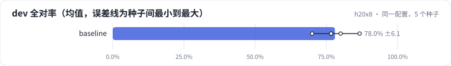
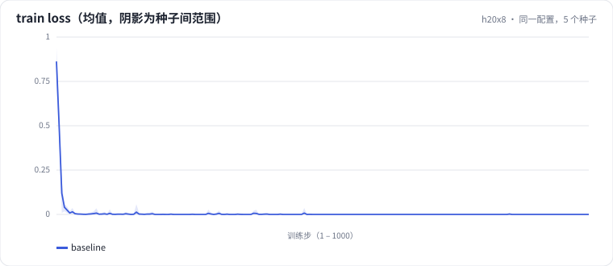

<!-- 本页由 python -m labkit docs 从 ../lesson.yaml 和 results/ 生成，不要手改 -->

[← 先估算](03-estimate.md) · [课程首页](../README.md) · [换一份同分布的训练数据 →](05-dataseed.md)

# 第 4 步 / 共 13 步：同一配置，5 个种子

> 阶段 3 / 8：**先量噪声** · 场景：`baseline`

基线和 L05 的 SFT 基线配置完全相同，只是跑了 5 个训练种子（种子影响 LoRA A 的初始化和数据打乱顺序，训练数据逐条相同）。

## 这一步跑了什么

| 场景 | 作用 | 说明 | 相对基线改了什么 | 种子（H20） |
| - | - | - | - | - |
| `baseline` | 本步 | 基线：和 L05 的 SFT 基线同配置（LoRA r=16 挂 7 类线性层，assistant-only，2 轮），5 个训练种子量噪声 | — | 5 |

## 先预测

**5 个种子之间，dev 全对率的"最高 − 最低"大约多少？**

- **A.** 不到 4 个点（最多差 1 条样本）
- **B.** 4 - 12 个点（差 2-3 条样本）
- **C.** 12 个点以上（差 4 条样本以上）

> 先选定一个（记下来），再展开下面的实测。差异小于 6.7 个点（dev 两条样本）或小于种子间波动，都按“差不多”算。

## 实测

展开实测：H20 · Qwen2.5-7B · 基线和主改动 5 种子，其余 3 种子（已有 5 / 5 个运行）

| 场景 | 类型 | dev 全对率 | 条件保留率 | 排除型条件（3 条） | 合成验证全对率 | dev 全对率：各种子 | 断言 |
| - | - | - | - | - | - | - | - |
| `baseline` | 基线 | 78.0% ± 6.1 | 87.6% ± 6.4 | 33.3% ± 23.6 | 100.0% ± 0.0 | s0 86.7% / s1 70.0% / s2 76.7% / s3 76.7% / s4 80.0% | 通过 |

运行目录（每个目录里有 `summary.json` 指标、`evidence.json` 证据摘要、`predictions.jsonl` 逐条预测、`log.txt` 日志）：

- `baseline` [s0](../../../results/h20x8/L06/baseline/s0-4c72c9/) · [s1](../../../results/h20x8/L06/baseline/s1-1f95b8/) · [s2](../../../results/h20x8/L06/baseline/s2-f202e6/) · [s3](../../../results/h20x8/L06/baseline/s3-788947/) · [s4](../../../results/h20x8/L06/baseline/s4-26b88b/)

## 看完实测再想一步

看"各种子"一列：5 个种子里，最高和最低差几条样本？合成验证集（分布内）的种子波动和 dev 比，哪个大？为什么？

---

[← 先估算](03-estimate.md) · [课程首页](../README.md) · [换一份同分布的训练数据 →](05-dataseed.md)
