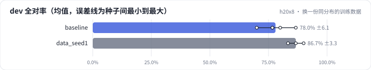

<!-- 本页由 python -m labkit docs 从 ../lesson.yaml 和 results/ 生成，不要手改 -->

[← 同一配置，5 个种子](04-noise.md) · [课程首页](../README.md) · [针对错例补数据：替换 10% →](06-excl.md)

# 第 5 步 / 共 13 步：换一份同分布的训练数据

> 阶段 3 / 8：**先量噪声** · 场景：`data_seed1`（对照 `baseline`）

训练种子不变，只换数据采样种子（data_seed 0 → 1）：生成器、比例、条数都一样，但抽到的是另一批 4000 条。

## 这一步跑了什么

| 场景 | 作用 | 说明 | 相对基线改了什么 | 种子（H20） |
| - | - | - | - | - |
| `baseline` | 对照 | 基线：和 L05 的 SFT 基线同配置（LoRA r=16 挂 7 类线性层，assistant-only，2 轮），5 个训练种子量噪声 | — | 5 |
| `data_seed1` | 本步 | 训练数据换一个采样种子（data_seed 0 → 1），其余不变：量"数据采样"带来的波动 | `data_seed=1` | 3 |

## 先预测

**和基线（5 种子均值）比，dev 全对率（3 种子均值）差多少？**

- **A.** 差不多（±6.7 个点以内）
- **B.** 明显更好（> +6.7 个点）
- **C.** 明显更差（< −6.7 个点）

> 先选定一个（记下来），再展开下面的实测。差异小于 6.7 个点（dev 两条样本）或小于种子间波动，都按“差不多”算。

## 实测

展开实测：H20 · Qwen2.5-7B · 基线和主改动 5 种子，其余 3 种子（已有 8 / 8 个运行）

| 场景 | 类型 | dev 全对率 | 合成验证全对率 | dev 全对率：与 `baseline` 差 | dev 全对率：各种子 | 断言 |
| - | - | - | - | - | - | - |
| `baseline` | 基线 | 78.0% ± 6.1 | 100.0% ± 0.0 | — | s0 86.7% / s1 70.0% / s2 76.7% / s3 76.7% / s4 80.0% | 通过 |
| `data_seed1` | 参照 | 86.7% ± 3.3 | 100.0% ± 0.0 | +8.7 个点 | s0 90.0% / s1 86.7% / s2 83.3% |  |

运行目录（每个目录里有 `summary.json` 指标、`evidence.json` 证据摘要、`predictions.jsonl` 逐条预测、`log.txt` 日志）：

- `baseline` [s0](../../../results/h20x8/L06/baseline/s0-4c72c9/) · [s1](../../../results/h20x8/L06/baseline/s1-1f95b8/) · [s2](../../../results/h20x8/L06/baseline/s2-f202e6/) · [s3](../../../results/h20x8/L06/baseline/s3-788947/) · [s4](../../../results/h20x8/L06/baseline/s4-26b88b/)
- `data_seed1` [s0](../../../results/h20x8/L06/data_seed1/s0-c13ee3/) · [s1](../../../results/h20x8/L06/data_seed1/s1-c3b12a/) · [s2](../../../results/h20x8/L06/data_seed1/s2-a0ef15/)

## 看完实测再想一步

训练数据换了一份，差值有没有超过上一步量出的种子波动？

---

[← 同一配置，5 个种子](04-noise.md) · [课程首页](../README.md) · [针对错例补数据：替换 10% →](06-excl.md)
