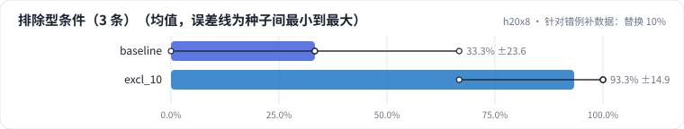
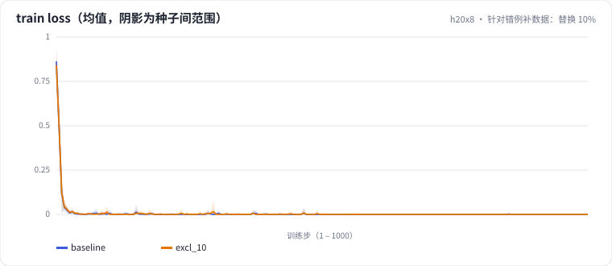

<!-- 本页由 python -m labkit docs 从 ../lesson.yaml 和 results/ 生成，不要手改 -->

[← 换一份同分布的训练数据](05-dataseed.md) · [课程首页](../README.md) · [剂量加到 30% →](07-dose.md)

# 第 6 步 / 共 13 步：针对错例补数据：替换 10%

> 阶段 4 / 8：**只改一个变量** · 场景：`excl_10`（对照 `baseline`）

把 10%（400 条）训练样本替换成排除型条件样本（"活动款除外""联名款不参与"……，词表避开 dev/test 原句）。其余 3600 条和基线逐条相同，训练种子同样跑 5 个。

## 这一步跑了什么

| 场景 | 作用 | 说明 | 相对基线改了什么 | 种子（H20） |
| - | - | - | - | - |
| `baseline` | 对照 | 基线：和 L05 的 SFT 基线同配置（LoRA r=16 挂 7 类线性层，assistant-only，2 轮），5 个训练种子量噪声 | — | 5 |
| `excl_10` | 本步 | 把 10% 的训练样本替换成排除型条件（"活动款除外""联名款不参与"），样本总数不变 | `exclusion_ratio=0.1` | 5 |

## 先预测

**dev 里 3 条排除型条件样本（1 条 = 33 个点），全对率（5 种子均值）会怎样？**

- **A.** 平均差不到 1 条（±33 个点以内）
- **B.** 平均多对 1 条以上（+33 个点以上）
- **C.** 平均少对 1 条以上

> 先选定一个（记下来），再展开下面的实测。差异小于 6.7 个点（dev 两条样本）或小于种子间波动，都按“差不多”算。

## 实测

展开实测：H20 · Qwen2.5-7B · 基线和主改动 5 种子，其余 3 种子（已有 10 / 10 个运行）

| 场景 | 类型 | 排除型条件（3 条） | dev 全对率 | 条件保留率 | 合成验证全对率 | 排除型条件（3 条）：与 `baseline` 差 | 排除型条件（3 条）：各种子 | 断言 |
| - | - | - | - | - | - | - | - | - |
| `baseline` | 基线 | 33.3% ± 23.6 | 78.0% ± 6.1 | 87.6% ± 6.4 | 100.0% ± 0.0 | — | s0 66.7% / s1 33.3% / s2 0.0% / s3 33.3% / s4 33.3% | 通过 |
| `excl_10` | 候选改动 | 93.3% ± 14.9 | 85.3% ± 9.6 | 99.0% ± 2.1 | 100.0% ± 0.0 | +60.0 个点 | s0 100.0% / s1 100.0% / s2 100.0% / s3 100.0% / s4 66.7% | 通过 |

**dev 错误类型分布**（每个运行的错误条数，多种子取均值；dev 共 30 条，一条样本可能有多个错误）

| 错误类型 | `baseline` | `excl_10` |
| - | - | - |
| 漏条件 | 2.2 | 0.2 |
| 漏卖点 | 2.0 | 2.0 |
| 多条件 | 1.8 | 1.2 |
| 多卖点 | 0.0 | 0.8 |
| 多优惠（原文无此优惠或把否定句当优惠） | 0.6 | 0.2 |
| 格式错误 | 0.4 | 0.0 |
| 无依据内容 | 0.2 | 0.2 |
| 漏优惠 | 0.2 | 0.0 |

**逐样本：`baseline` → `excl_10`**（dev 30 条；修好 = 对照错、本步对；弄坏 = 对照对、本步错）

| 种子 | 修好 | 弄坏 | 两边都对 | 两边都错 |
| - | - | - | - | - |
| s0（对照 s0） | 2 | 1 | 25 | 2 |
| s1（对照 s1） | 7 | 0 | 21 | 2 |
| s2（对照 s2） | 4 | 5 | 18 | 3 |
| s3（对照 s3） | 5 | 0 | 23 | 2 |
| s4（对照 s4） | 2 | 3 | 21 | 4 |

第一个种子里的例子（最多各 8 条；最后一列是出错一方的错误类型）：

| | 样本 | 文案 | 错误 |
| - | - | - | - |
| 修好 | `dev-20` | 精酿啤酒，麦芽香浓郁，限量发售，整箱购买享85折 | 多条件 |
| 修好 | `dev-30` | 轻跃儿童滑板车，闪光轮，三档调高。满2件减30，不与其他优惠同享 | 漏条件 |
| 弄坏 | `dev-17` | 小禾电动牙刷，声波清洁，续航90天。今晚8点开抢，前1小时第二支半价 | 无依据内容 |

运行目录（每个目录里有 `summary.json` 指标、`evidence.json` 证据摘要、`predictions.jsonl` 逐条预测、`log.txt` 日志）：

- `baseline` [s0](../../../results/h20x8/L06/baseline/s0-4c72c9/) · [s1](../../../results/h20x8/L06/baseline/s1-1f95b8/) · [s2](../../../results/h20x8/L06/baseline/s2-f202e6/) · [s3](../../../results/h20x8/L06/baseline/s3-788947/) · [s4](../../../results/h20x8/L06/baseline/s4-26b88b/)
- `excl_10` [s0](../../../results/h20x8/L06/excl_10/s0-d31aa6/) · [s1](../../../results/h20x8/L06/excl_10/s1-b18c11/) · [s2](../../../results/h20x8/L06/excl_10/s2-059b9f/) · [s3](../../../results/h20x8/L06/excl_10/s3-bedd5e/) · [s4](../../../results/h20x8/L06/excl_10/s4-f0ec02/)

## 看完实测再想一步

逐样本表里，被修好的样本是不是排除型条件那几条？有没有被弄坏的？整体全对率的差值超过种子波动了吗？

---

[← 换一份同分布的训练数据](05-dataseed.md) · [课程首页](../README.md) · [剂量加到 30% →](07-dose.md)
