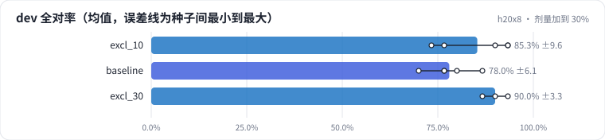

<!-- 本页由 python -m labkit docs 从 ../lesson.yaml 和 results/ 生成，不要手改 -->

[← 针对错例补数据：替换 10%](06-excl.md) · [课程首页](../README.md) · [不针对错例：泛泛加难样本 →](08-generic.md)

# 第 7 步 / 共 13 步：剂量加到 30%

> 阶段 4 / 8：**只改一个变量** · 场景：`excl_30`（对照 `excl_10`）

同样的做法，替换比例从 10% 加到 30%（1200 条）。排除型条件之外的句式相应少了 20%。

## 这一步跑了什么

| 场景 | 作用 | 说明 | 相对基线改了什么 | 种子（H20） |
| - | - | - | - | - |
| `excl_10` | 对照 | 把 10% 的训练样本替换成排除型条件（"活动款除外""联名款不参与"），样本总数不变 | `exclusion_ratio=0.1` | 5 |
| `baseline` | 参照 | 基线：和 L05 的 SFT 基线同配置（LoRA r=16 挂 7 类线性层，assistant-only，2 轮），5 个训练种子量噪声 | — | 5 |
| `excl_30` | 本步 | 替换比例加到 30%：剂量加大，会不会挤掉其他句式 | `exclusion_ratio=0.3` | 3 |

## 先预测

**和替换 10% 比，dev 全对率（整体）会怎样？**

- **A.** 差不多（±6.7 个点以内）
- **B.** 继续明显变好（> +6.7 个点）
- **C.** 明显变差（< −6.7 个点）

> 先选定一个（记下来），再展开下面的实测。差异小于 6.7 个点（dev 两条样本）或小于种子间波动，都按“差不多”算。

## 实测

展开实测：H20 · Qwen2.5-7B · 基线和主改动 5 种子，其余 3 种子（已有 13 / 13 个运行）

| 场景 | 类型 | dev 全对率 | 排除型条件（3 条） | 买赠门槛（4 条） | 合成验证全对率 | dev 全对率：与 `excl_10` 差 | dev 全对率：各种子 | 断言 |
| - | - | - | - | - | - | - | - | - |
| `excl_10` | 候选改动 | 85.3% ± 9.6 | 93.3% ± 14.9 | 80.0% ± 32.6 | 100.0% ± 0.0 | — | s0 90.0% / s1 93.3% / s2 73.3% / s3 93.3% / s4 76.7% | 通过 |
| `baseline` | 基线 | 78.0% ± 6.1 | 33.3% ± 23.6 | 75.0% ± 17.7 | 100.0% ± 0.0 | -7.3 个点 | s0 86.7% / s1 70.0% / s2 76.7% / s3 76.7% / s4 80.0% | 通过 |
| `excl_30` | 候选改动 | 90.0% ± 3.3 | 100.0% ± 0.0 | 91.7% ± 14.4 | 100.0% ± 0.0 | +4.7 个点 | s0 86.7% / s1 93.3% / s2 90.0% | 通过 |

运行目录（每个目录里有 `summary.json` 指标、`evidence.json` 证据摘要、`predictions.jsonl` 逐条预测、`log.txt` 日志）：

- `excl_10` [s0](../../../results/h20x8/L06/excl_10/s0-d31aa6/) · [s1](../../../results/h20x8/L06/excl_10/s1-b18c11/) · [s2](../../../results/h20x8/L06/excl_10/s2-059b9f/) · [s3](../../../results/h20x8/L06/excl_10/s3-bedd5e/) · [s4](../../../results/h20x8/L06/excl_10/s4-f0ec02/)
- `baseline` [s0](../../../results/h20x8/L06/baseline/s0-4c72c9/) · [s1](../../../results/h20x8/L06/baseline/s1-1f95b8/) · [s2](../../../results/h20x8/L06/baseline/s2-f202e6/) · [s3](../../../results/h20x8/L06/baseline/s3-788947/) · [s4](../../../results/h20x8/L06/baseline/s4-26b88b/)
- `excl_30` [s0](../../../results/h20x8/L06/excl_30/s0-f709b0/) · [s1](../../../results/h20x8/L06/excl_30/s1-85bde5/) · [s2](../../../results/h20x8/L06/excl_30/s2-a71ab2/)

## 看完实测再想一步

排除型条件还有没有继续变好？其他类别（买赠门槛、多优惠）和合成验证集有没有往下掉？

---

[← 针对错例补数据：替换 10%](06-excl.md) · [课程首页](../README.md) · [不针对错例：泛泛加难样本 →](08-generic.md)
