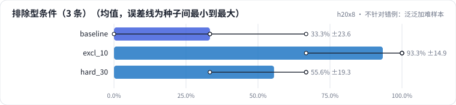

<!-- 本页由 python -m labkit docs 从 ../lesson.yaml 和 results/ 生成，不要手改 -->

[← 剂量加到 30%](07-dose.md) · [课程首页](../README.md) · [多训两轮：loss 和指标同步吗 →](09-epochs.md)

# 第 8 步 / 共 13 步：不针对错例：泛泛加难样本

> 阶段 4 / 8：**只改一个变量** · 场景：`hard_30`（对照 `baseline`）

另一种常见做法：不分析错例，把"困难样本"（多优惠、远距离条件、无品类、否定句）的比例从 15% 提到 30%。生成器里的困难样本**不包含**排除型条件。

## 这一步跑了什么

| 场景 | 作用 | 说明 | 相对基线改了什么 | 种子（H20） |
| - | - | - | - | - |
| `baseline` | 对照 | 基线：和 L05 的 SFT 基线同配置（LoRA r=16 挂 7 类线性层，assistant-only，2 轮），5 个训练种子量噪声 | — | 5 |
| `excl_10` | 参照 | 把 10% 的训练样本替换成排除型条件（"活动款除外""联名款不参与"），样本总数不变 | `exclusion_ratio=0.1` | 5 |
| `hard_30` | 本步 | 不针对错例、泛泛地把困难样本比例从 15% 提到 30%（对照"针对性补数据"） | `hard_ratio=0.3` | 3 |

## 先预测

**排除型条件（3 条）的全对率，和基线比会怎样？**

- **A.** 基本没变（±15 个点以内）
- **B.** 明显变好（+15 个点以上）
- **C.** 明显变差

> 先选定一个（记下来），再展开下面的实测。差异小于 6.7 个点（dev 两条样本）或小于种子间波动，都按“差不多”算。

## 实测

展开实测：H20 · Qwen2.5-7B · 基线和主改动 5 种子，其余 3 种子（已有 13 / 13 个运行）

| 场景 | 类型 | 排除型条件（3 条） | dev 全对率 | 多优惠（2 条） | 排除型条件（3 条）：与 `baseline` 差 | 排除型条件（3 条）：各种子 | 断言 |
| - | - | - | - | - | - | - | - |
| `baseline` | 基线 | 33.3% ± 23.6 | 78.0% ± 6.1 | 80.0% ± 44.7 | — | s0 66.7% / s1 33.3% / s2 0.0% / s3 33.3% / s4 33.3% | 通过 |
| `excl_10` | 候选改动 | 93.3% ± 14.9 | 85.3% ± 9.6 | 90.0% ± 22.4 | +60.0 个点 | s0 100.0% / s1 100.0% / s2 100.0% / s3 100.0% / s4 66.7% | 通过 |
| `hard_30` | 候选改动 | 55.6% ± 19.3 | 80.0% ± 10.0 | 83.3% ± 28.9 | +22.2 个点 | s0 33.3% / s1 66.7% / s2 66.7% |  |

运行目录（每个目录里有 `summary.json` 指标、`evidence.json` 证据摘要、`predictions.jsonl` 逐条预测、`log.txt` 日志）：

- `baseline` [s0](../../../results/h20x8/L06/baseline/s0-4c72c9/) · [s1](../../../results/h20x8/L06/baseline/s1-1f95b8/) · [s2](../../../results/h20x8/L06/baseline/s2-f202e6/) · [s3](../../../results/h20x8/L06/baseline/s3-788947/) · [s4](../../../results/h20x8/L06/baseline/s4-26b88b/)
- `excl_10` [s0](../../../results/h20x8/L06/excl_10/s0-d31aa6/) · [s1](../../../results/h20x8/L06/excl_10/s1-b18c11/) · [s2](../../../results/h20x8/L06/excl_10/s2-059b9f/) · [s3](../../../results/h20x8/L06/excl_10/s3-bedd5e/) · [s4](../../../results/h20x8/L06/excl_10/s4-f0ec02/)
- `hard_30` [s0](../../../results/h20x8/L06/hard_30/s0-08b103/) · [s1](../../../results/h20x8/L06/hard_30/s1-337119/) · [s2](../../../results/h20x8/L06/hard_30/s2-ef9274/)

## 看完实测再想一步

泛泛加难样本，目标类别动了吗？它变好的是哪几类？

---

[← 剂量加到 30%](07-dose.md) · [课程首页](../README.md) · [多训两轮：loss 和指标同步吗 →](09-epochs.md)
