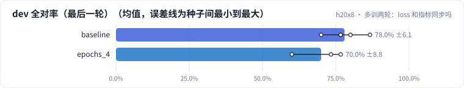
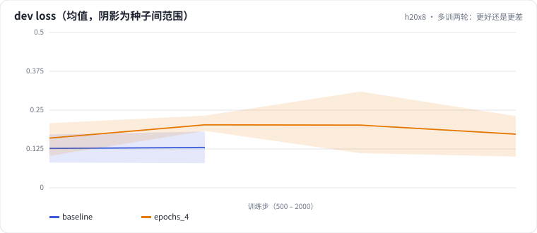

<!-- 本页由 python -m labkit docs 从 ../lesson.yaml 和 results/ 生成，不要手改 -->

[← 不针对错例：泛泛加难样本](08-generic.md) · [课程首页](../README.md) · [离线好好的，上线全错 →](10-fault.md)

# 第 9 步 / 共 13 步：多训两轮：更好还是更差

> 阶段 5 / 8：**loss 与指标** · 场景：`epochs_4`（对照 `baseline`）

训练 4 轮（基线 2 轮；学习率按总步数线性降到 0，所以 4 轮的前 2 轮学习率比基线高），每轮结束都在 dev 上算一次 loss，并做一次生成评估。

## 这一步跑了什么

| 场景 | 作用 | 说明 | 相对基线改了什么 | 种子（H20） |
| - | - | - | - | - |
| `baseline` | 对照 | 基线：和 L05 的 SFT 基线同配置（LoRA r=16 挂 7 类线性层，assistant-only，2 轮），5 个训练种子量噪声 | — | 5 |
| `epochs_4` | 本步 | 训练 4 轮（基线 2 轮），每轮都评估：dev loss 和 dev 全对率是否同步 | `epochs=4` | 3 |

## 先预测

**训练完 4 轮，dev 全对率（3 种子均值）和 2 轮的基线（5 种子均值）比会怎样？**

- **A.** 明显更好（> +6.7 个点）
- **B.** 差不多（±6.7 个点以内）
- **C.** 明显更差（< −6.7 个点）

> 先选定一个（记下来），再展开下面的实测。差异小于 6.7 个点（dev 两条样本）或小于种子间波动，都按“差不多”算。

## 实测

展开实测：H20 · Qwen2.5-7B · 基线和主改动 5 种子，其余 3 种子（已有 8 / 8 个运行）

| 场景 | 类型 | dev 全对率（最后一轮） | dev loss（最后一轮） | train loss（最后） | dev 全对率（最后一轮）：与 `baseline` 差 | dev 全对率（最后一轮）：各种子 | 断言 |
| - | - | - | - | - | - | - | - |
| `baseline` | 基线 | 78.0% ± 6.1 | 0.130 ± 0.046 | 6.0e-06 ± 5.5e-06 | — | s0 86.7% / s1 70.0% / s2 76.7% / s3 76.7% / s4 80.0% | 通过 |
| `epochs_4` | 候选改动 | 70.0% ± 8.8 | 0.173 ± 0.066 | 3.3e-06 ± 5.8e-06 | -8.0 个点 | s0 73.3% / s1 60.0% / s2 76.7% |  |

运行目录（每个目录里有 `summary.json` 指标、`evidence.json` 证据摘要、`predictions.jsonl` 逐条预测、`log.txt` 日志）：

- `baseline` [s0](../../../results/h20x8/L06/baseline/s0-4c72c9/) · [s1](../../../results/h20x8/L06/baseline/s1-1f95b8/) · [s2](../../../results/h20x8/L06/baseline/s2-f202e6/) · [s3](../../../results/h20x8/L06/baseline/s3-788947/) · [s4](../../../results/h20x8/L06/baseline/s4-26b88b/)
- `epochs_4` [s0](../../../results/h20x8/L06/epochs_4/s0-4218d1/) · [s1](../../../results/h20x8/L06/epochs_4/s1-3f5b22/) · [s2](../../../results/h20x8/L06/epochs_4/s2-6e5ac3/)

## 看完实测再想一步

dev loss 曲线各种子在哪一轮跳高？train loss 到了什么量级？逐轮全对率在运行目录的 metrics.jsonl（dev_exact_all_ok）里。

---

[← 不针对错例：泛泛加难样本](08-generic.md) · [课程首页](../README.md) · [离线好好的，上线全错 →](10-fault.md)
