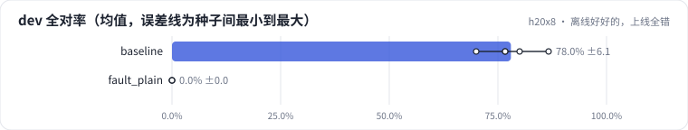

<!-- 本页由 python -m labkit docs 从 ../lesson.yaml 和 results/ 生成，不要手改 -->

[← 多训两轮：更好还是更差](09-epochs.md) · [课程首页](../README.md) · [诊断：训练推理不一致 →](11-diagnose.md)

# 第 10 步 / 共 13 步：离线好好的，上线全错

> 阶段 6 / 8：**诊断故障** · 场景：`fault_plain`（对照 `baseline`）

同一个训练好的适配器交给服务端同事接入。离线评估是在训练脚本里跑的，没有问题；线上服务自己拼了输入：`广告：{文案}\n输出：`，然后调用 generate。

## 这一步跑了什么

| 场景 | 作用 | 说明 | 相对基线改了什么 | 种子（H20） |
| - | - | - | - | - |
| `baseline` | 对照 | 基线：和 L05 的 SFT 基线同配置（LoRA r=16 挂 7 类线性层，assistant-only，2 轮），5 个训练种子量噪声 | — | 5 |
| `fault_plain` | 本步 | 推理时没走聊天模板（"广告：…\n输出："），训练用的是聊天模板 | `infer_template=plain` | 3 |

## 先预测

**线上这种调用方式，dev 全对率会接近多少？**

- **A.** 和离线差不多
- **B.** 掉 10-30 个点
- **C.** 接近 0

> 先选定一个（记下来），再展开下面的实测。差异小于 6.7 个点（dev 两条样本）或小于种子间波动，都按“差不多”算。

## 实测

展开实测：H20 · Qwen2.5-7B · 基线和主改动 5 种子，其余 3 种子（已有 8 / 8 个运行）

| 场景 | 类型 | dev 全对率 | 格式合法率 | 品类准确率 | dev 全对率：与 `baseline` 差 | dev 全对率：各种子 | 断言 |
| - | - | - | - | - | - | - | - |
| `baseline` | 基线 | 78.0% ± 6.1 | 98.7% ± 3.0 | 98.7% ± 3.0 | — | s0 86.7% / s1 70.0% / s2 76.7% / s3 76.7% / s4 80.0% | 通过 |
| `fault_plain` | 教学故障 | 0.0% ± 0.0 | 0.0% ± 0.0 | 0.0% ± 0.0 | -78.0 个点 | s0 0.0% / s1 0.0% / s2 0.0% | 通过 |

运行目录（每个目录里有 `summary.json` 指标、`evidence.json` 证据摘要、`predictions.jsonl` 逐条预测、`log.txt` 日志）：

- `baseline` [s0](../../../results/h20x8/L06/baseline/s0-4c72c9/) · [s1](../../../results/h20x8/L06/baseline/s1-1f95b8/) · [s2](../../../results/h20x8/L06/baseline/s2-f202e6/) · [s3](../../../results/h20x8/L06/baseline/s3-788947/) · [s4](../../../results/h20x8/L06/baseline/s4-26b88b/)
- `fault_plain` [s0](../../../results/h20x8/L06/fault_plain/s0-f5531b/) · [s1](../../../results/h20x8/L06/fault_plain/s1-868df1/) · [s2](../../../results/h20x8/L06/fault_plain/s2-0a1cb2/)

---

[← 多训两轮：更好还是更差](09-epochs.md) · [课程首页](../README.md) · [诊断：训练推理不一致 →](11-diagnose.md)
