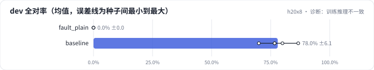

<!-- 本页由 python -m labkit docs 从 ../lesson.yaml 和 results/ 生成，不要手改 -->

[← 离线好好的，上线全错](10-fault.md) · [课程首页](../README.md) · [保留 test 集：提升还在吗 →](12-test.md)

# 第 11 步 / 共 13 步：诊断：训练推理不一致

> 阶段 6 / 8：**诊断故障** · 场景：`baseline`（对照 `fault_plain`）

权重、适配器、解码参数都一样，只有"怎么把文案变成模型输入"不同。按需逐级点开线索，然后点选根因。

## 这一步跑了什么

| 场景 | 作用 | 说明 | 相对基线改了什么 | 种子（H20） |
| - | - | - | - | - |
| `fault_plain` | 对照 | 推理时没走聊天模板（"广告：…\n输出："），训练用的是聊天模板 | `infer_template=plain` | 3 |
| `baseline` | 本步 | 基线：和 L05 的 SFT 基线同配置（LoRA r=16 挂 7 类线性层，assistant-only，2 轮），5 个训练种子量噪声 | — | 5 |

## 线索

逐条展开，看到能下判断为止。

线索 1

看格式合法率：线上方式 0% ± 0%，离线 99% ± 3%。输出连 JSON 都不是，说明模型根本不知道要做什么任务。

线索 2

看合成验证集（和训练集同一个生成器）：线上方式全对率 0% ± 0%。如果是线上文案分布不同，分布内的合成数据应该不受影响。

线索 3

对照训练样本的 token 序列（L05 追踪一步）：训练输入以 <|im_start|>system 开头，字段定义写在系统提示里，回复前是 <|im_start|>assistant。线上输入里有这些吗？

## 先预测

**根因是什么？**

- **A.** 线上 generate 的解码参数（温度、top_p）和离线不同
- **B.** 线上输入没走聊天模板：没有系统提示（字段定义在里面）、没有 <|im_start|>assistant，和训练分布不一致
- **C.** 适配器在服务端没有加载上
- **D.** 线上流量的文案分布和 dev 不一样

> 先选定一个（记下来），再展开下面的实测。差异小于 6.7 个点（dev 两条样本）或小于种子间波动，都按“差不多”算。

## 实测

展开实测：H20 · Qwen2.5-7B · 基线和主改动 5 种子，其余 3 种子（已有 8 / 8 个运行）

| 场景 | 类型 | dev 全对率 | 格式合法率 | 合成验证全对率 | dev 全对率：与 `fault_plain` 差 | dev 全对率：各种子 | 断言 |
| - | - | - | - | - | - | - | - |
| `fault_plain` | 教学故障 | 0.0% ± 0.0 | 0.0% ± 0.0 | 0.0% ± 0.0 | — | s0 0.0% / s1 0.0% / s2 0.0% | 通过 |
| `baseline` | 基线 | 78.0% ± 6.1 | 98.7% ± 3.0 | 100.0% ± 0.0 | +78.0 个点 | s0 86.7% / s1 70.0% / s2 76.7% / s3 76.7% / s4 80.0% | 通过 |

运行目录（每个目录里有 `summary.json` 指标、`evidence.json` 证据摘要、`predictions.jsonl` 逐条预测、`log.txt` 日志）：

- `fault_plain` [s0](../../../results/h20x8/L06/fault_plain/s0-f5531b/) · [s1](../../../results/h20x8/L06/fault_plain/s1-868df1/) · [s2](../../../results/h20x8/L06/fault_plain/s2-0a1cb2/)
- `baseline` [s0](../../../results/h20x8/L06/baseline/s0-4c72c9/) · [s1](../../../results/h20x8/L06/baseline/s1-1f95b8/) · [s2](../../../results/h20x8/L06/baseline/s2-f202e6/) · [s3](../../../results/h20x8/L06/baseline/s3-788947/) · [s4](../../../results/h20x8/L06/baseline/s4-26b88b/)

---

[← 离线好好的，上线全错](10-fault.md) · [课程首页](../README.md) · [保留 test 集：提升还在吗 →](12-test.md)
