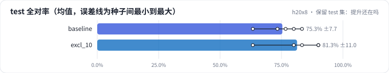

<!-- 本页由 python -m labkit docs 从 ../lesson.yaml 和 results/ 生成，不要手改 -->

[← 诊断：训练推理不一致](11-diagnose.md) · [课程首页](../README.md) · [回顾 →](13-keycard.md)

# 第 12 步 / 共 13 步：保留 test 集：提升还在吗

> 阶段 7 / 8：**保留集检验** · 场景：`excl_10`（对照 `baseline`）

迭代结束，决定采用"替换 10% 排除型条件"。现在第一次打开保留的 test 集（30 条，其中排除型条件 3 条，写法和 dev 不同，也没出现在训练词表里）。

## 这一步跑了什么

| 场景 | 作用 | 说明 | 相对基线改了什么 | 种子（H20） |
| - | - | - | - | - |
| `baseline` | 对照 | 基线：和 L05 的 SFT 基线同配置（LoRA r=16 挂 7 类线性层，assistant-only，2 轮），5 个训练种子量噪声 | — | 5 |
| `excl_10` | 本步 | 把 10% 的训练样本替换成排除型条件（"活动款除外""联名款不参与"），样本总数不变 | `exclusion_ratio=0.1` | 5 |

## 先预测

**test 集上，替换 10% 相对基线的全对率（5 种子均值）差多少？**

- **A.** 明显更好（> +6.7 个点）
- **B.** 差不多（±6.7 个点以内）
- **C.** 明显更差（< −6.7 个点）

> 先选定一个（记下来），再展开下面的实测。差异小于 6.7 个点（dev 两条样本）或小于种子间波动，都按“差不多”算。

## 实测

展开实测：H20 · Qwen2.5-7B · 基线和主改动 5 种子，其余 3 种子（已有 10 / 10 个运行）

| 场景 | 类型 | test 全对率 | test 排除型条件（3 条） | dev 全对率 | test 条件保留率 | test 全对率：与 `baseline` 差 | test 全对率：各种子 | 断言 |
| - | - | - | - | - | - | - | - | - |
| `baseline` | 基线 | 75.3% ± 7.7 | 13.3% ± 18.2 | 78.0% ± 6.1 | 77.3% ± 5.6 | — | s0 83.3% / s1 73.3% / s2 63.3% / s3 76.7% / s4 80.0% | 通过 |
| `excl_10` | 候选改动 | 81.3% ± 11.0 | 46.7% ± 29.8 | 85.3% ± 9.6 | 86.4% ± 7.2 | +6.0 个点 | s0 83.3% / s1 90.0% / s2 80.0% / s3 90.0% / s4 63.3% | 通过 |

运行目录（每个目录里有 `summary.json` 指标、`evidence.json` 证据摘要、`predictions.jsonl` 逐条预测、`log.txt` 日志）：

- `baseline` [s0](../../../results/h20x8/L06/baseline/s0-4c72c9/) · [s1](../../../results/h20x8/L06/baseline/s1-1f95b8/) · [s2](../../../results/h20x8/L06/baseline/s2-f202e6/) · [s3](../../../results/h20x8/L06/baseline/s3-788947/) · [s4](../../../results/h20x8/L06/baseline/s4-26b88b/)
- `excl_10` [s0](../../../results/h20x8/L06/excl_10/s0-d31aa6/) · [s1](../../../results/h20x8/L06/excl_10/s1-b18c11/) · [s2](../../../results/h20x8/L06/excl_10/s2-059b9f/) · [s3](../../../results/h20x8/L06/excl_10/s3-bedd5e/) · [s4](../../../results/h20x8/L06/excl_10/s4-f0ec02/)

## 看完实测再想一步

test 上的差值和 dev 上的差值比，哪个大？test 的排除型条件有没有变好？

---

[← 诊断：训练推理不一致](11-diagnose.md) · [课程首页](../README.md) · [回顾 →](13-keycard.md)
