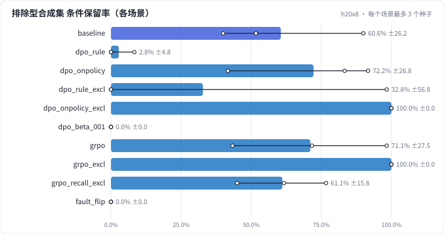

# L07 偏好优化：DPO 与 GRPO（偏好对来源、参考模型与 β、可验证奖励）

在 L05 的 7B SFT 模型上继续做偏好优化。DPO：偏好对从哪来（规则构造 vs 在线采样）、prompt 选在模型会错的地方才有信号、参考模型和 β 管住偏离、chosen 的对数概率为什么也会降；GRPO：组内归一化优势、"无信号组"、可验证奖励只优化它覆盖到的维度、时间花在生成上；最后诊断一次偏好对方向写反。

## 怎么学（只看 GitHub 就够）

按下面“步骤”表从第 1 步往下点。每一页先给问题和选项，**先选定一个再展开“实测”**；实测里有结果表、证据图和运行目录链接。作业进度见 [作业看板](../../jobs/README.md)。参考答案和解析只在私有工作台里。

## 任务

**出发点**：L05 的 7B SFT 模型在合成验证集上已经全对，但遇到训练集里没有的句式（排除型条件"活动款除外"）还是会把条件丢掉。L06 用"补 SFT 数据"解决；这一课换一条路：**不改 SFT 数据，在 SFT 模型上做偏好优化**。

- **DPO**：给模型看成对的回答（chosen 好、rejected 坏），让它相对**参考模型**（就是 SFT 模型本身）更偏向 chosen；
- **GRPO**：让模型自己对每个 prompt 采样一组回答，用**可验证奖励**（规则打分）给组内高于平均的回答加权，低于平均的减权。

偏好阶段的 prompt 是 512 条新合成样本（和 SFT 训练集、评估集都不重叠）。评估多了一个 **排除型条件合成集**（60 条，每条 1 个排除型条件），专门量偏好阶段在目标错误上有没有效果。

| 集合 | 条数 | 用途 |
| - | - | - |
| dev | 30（人工） | 整体效果，和 L05/L06 同口径 |
| 合成验证 | 60 | 分布内，SFT 已经全对：看有没有"弄坏" |
| 排除型合成集 | 60 | 目标错误：条件保留率，1 条 = 1.7 个点 |

## 规模与边界

- **H20 档**：Qwen2.5-7B-Instruct（bf16）；SFT 与 L05 基线同配置（4000 条、2 轮、LoRA r=16 挂 7 类线性层）；偏好阶段合并 SFT 适配器后新挂一个同规格 LoRA，512 个 prompt；每个场景 3 个种子。
- **保留了**：DPO 的完整做法（偏好对、冻结参考模型、β、隐式奖励）；GRPO 的组采样、组内归一化优势、KL 惩罚、可验证奖励；偏好数据来源的对照；故障复现。
- **缩小了**：偏好阶段只有 512 个 prompt、1 轮；GRPO 每步只更新一次（PPO 裁剪不起作用）；奖励是规则打分，不是奖励模型。
- **未验证**：开放式生成任务（没有标准答案，必须用奖励模型或人工偏好）；在线 RL 的长程稳定性。

## 步骤

<!-- labkit:path -->
| # | 阶段 | 步骤 | 这一步回答的问题 | 场景 | H20 结果 |
| - | - | - | - | - | - |
| 1 | 理解任务 | [场景与痛点](steps/01-pain.md) | SFT 之后还有错，偏好优化能不能修、代价多大、会不会修错方向？ | — | — |
| 2 | 理解任务 | [流程结构](steps/02-flow.md) |  | — | — |
| 3 | 理解任务 | [代码导读](steps/03-code.md) |  | — | — |
| 4 | 先估算 | [先估算](steps/04-estimate.md) | DPO 需要一个冻结的参考模型 π_ref（这里就是 SFT 模型）。本课的实现要为它多占多少显存？ | — | — |
| 5 | DPO：偏好对从哪来 | [规则偏好对，同分布 prompt](steps/05-rule.md) | 和只做 SFT 比，dev 全对率（3 种子均值）会怎样？ | `dpo_rule` | 3 / 3 |
| 6 | DPO：偏好对从哪来 | [在线采样偏好对，同分布 prompt](steps/06-onpolicy.md) | 512 个 prompt 里，大约多少比例能产出偏好对（至少有一条采样不全对）？ | `dpo_onpolicy` | 3 / 3 |
| 7 | DPO：偏好对从哪来 | [prompt 换到模型会错的地方](steps/07-excl.md) | 排除型合成集（60 条）的条件保留率，和只做 SFT 比会怎样？ | `dpo_rule_excl` | 3 / 3 |
| 8 | DPO：偏好对从哪来 | [在线采样 + 排除型 prompt](steps/08-onpolicy-excl.md) | 和规则偏好对（同样的 prompt）比，排除型合成集的条件保留率会怎样？ | `dpo_onpolicy_excl` | 3 / 3 |
| 9 | DPO：参考模型与 β | [chosen 的概率涨了吗](steps/09-logp.md) | 训练结束时，chosen 的 log π − log π_ref 大约是？ | `dpo_rule_excl` | 3 / 3 |
| 10 | DPO：参考模型与 β | [β 从 0.1 降到 0.01](steps/10-beta.md) | 和 β = 0.1 比，dev 全对率（3 种子均值）会怎样？ | `dpo_beta_001` | 3 / 3 |
| 11 | GRPO：可验证奖励 | [GRPO，同分布 prompt](steps/11-grpo.md) | 每组 4 条回答奖励完全相同（优势全为 0，没有学习信号）的组，平均占多少？ | `grpo` | 3 / 3 |
| 12 | GRPO：可验证奖励 | [GRPO，一半排除型 prompt](steps/12-grpo-excl.md) | 排除型合成集的条件保留率，和只做 SFT 比会怎样？ | `grpo_excl` | 3 / 3 |
| 13 | GRPO：可验证奖励 | [奖励只看召回](steps/13-reward.md) | 和字段奖励比，排除型合成集的条件保留率会怎样？ | `grpo_recall_excl` | 3 / 3 |
| 14 | GRPO：可验证奖励 | [时间花在哪](steps/14-cost.md) | 偏好阶段的时间里，生成占多少？ | `grpo_excl` | 3 / 3 |
| 15 | 诊断故障 | [训练日志一切正常，上线条件全丢](steps/15-fault.md) | 合成验证集（SFT 是满分）的条件保留率会怎样？ | `fault_flip` | 3 / 3 |
| 16 | 诊断故障 | [诊断：偏好对方向](steps/16-diagnose.md) | 根因是什么？ | `baseline` | 3 / 3 |
| 17 | 带走 | [回顾](steps/17-keycard.md) |  | — | — |
<!-- /labkit:path -->

## 场景与结果

<!-- labkit:results -->

展开结果（先自己预测，再看）

**h20x8**：8 × NVIDIA H20，Qwen2.5-7B-Instruct（bf16）。先做与 L05 基线同配置的 SFT（4000 条，2 轮），合并后挂新 LoRA 做偏好阶段（512 个新 prompt）（已有 30 / 30 个运行）

| 场景 | 类型 | dev 全对率 | 排除型 条件保留率 | 合成验证 条件保留率 | 偏好对产出率 | GRPO 无信号组比例 | GRPO 生成耗时占比 | 断言 |
| - | - | - | - | - | - | - | - | - |
| `baseline` | 基线 | 0.7889 ± 0.0509 (n=3) | 0.6056 ± 0.2616 (n=3) | 1.0000 ± 0.0000 (n=3) | — | — | — | 通过 |
| `dpo_rule` | 候选改动 | 0.0111 ± 0.0192 (n=3) | 0.0278 ± 0.0481 (n=3) | 0.0090 ± 0.0156 (n=3) | 1.0000 ± 0.0000 (n=3) | — | — | 通过 |
| `dpo_onpolicy` | 候选改动 | 0.7444 ± 0.0509 (n=3) | 0.7222 ± 0.2679 (n=3) | 1.0000 ± 0.0000 (n=3) | 0.0013 ± 0.0012 (n=3) | — | — |  |
| `dpo_rule_excl` | 候选改动 | 0.2111 ± 0.3372 (n=3) | 0.3278 ± 0.5677 (n=3) | 0.3153 ± 0.5461 (n=3) | 1.0000 ± 0.0000 (n=3) | — | — |  |
| `dpo_onpolicy_excl` | 候选改动 | 0.8333 ± 0.0577 (n=3) | 1.0000 ± 0.0000 (n=3) | 1.0000 ± 0.0000 (n=3) | 0.2083 ± 0.0266 (n=3) | — | — |  |
| `dpo_beta_001` | 候选改动 | 0.0000 ± 0.0000 (n=3) | 0.0000 ± 0.0000 (n=3) | 0.0000 ± 0.0000 (n=3) | 1.0000 ± 0.0000 (n=3) | — | — |  |
| `grpo` | 候选改动 | 0.7778 ± 0.0694 (n=3) | 0.7111 ± 0.2750 (n=3) | 1.0000 ± 0.0000 (n=3) | — | 0.9993 ± 0.0012 (n=3) | 0.4019 ± 0.0040 (n=3) |  |
| `grpo_excl` | 候选改动 | 0.8111 ± 0.0509 (n=3) | 1.0000 ± 0.0000 (n=3) | 1.0000 ± 0.0000 (n=3) | — | 0.9831 ± 0.0081 (n=3) | 0.4001 ± 0.0024 (n=3) |  |
| `grpo_recall_excl` | 候选改动 | 0.7667 ± 0.0000 (n=3) | 0.6111 ± 0.1584 (n=3) | 1.0000 ± 0.0000 (n=3) | — | 0.9928 ± 0.0060 (n=3) | 0.4005 ± 0.0015 (n=3) |  |
| `fault_flip` | 教学故障 | 0.0000 ± 0.0000 (n=3) | 0.0000 ± 0.0000 (n=3) | 0.0000 ± 0.0000 (n=3) | 1.0000 ± 0.0000 (n=3) | — | — | 通过 |

<!-- /labkit:results -->

## 证据图

<!-- labkit:figures -->

展开证据图（先自己预测，再看）

- **h20x8**：[主指标](figures/h20x8-metrics.svg)

  

<!-- /labkit:figures -->

## 代码

<!-- labkit:code -->
| 代码段 | 位置 |
| - | - |
| `token_logps` | [projects/adpref/optim.py#L23](../../projects/adpref/optim.py#L23) |
| `dpo` | [projects/adpref/optim.py#L45](../../projects/adpref/optim.py#L45) |
| `grpo` | [projects/adpref/optim.py#L123](../../projects/adpref/optim.py#L123) |
| `sample` | [projects/adpref/pairs.py#L26](../../projects/adpref/pairs.py#L26) |
| `rule_pairs` | [projects/adpref/pairs.py#L70](../../projects/adpref/pairs.py#L70) |
| `encode_response` | [projects/adpref/pairs.py#L130](../../projects/adpref/pairs.py#L130) |
| `reward` | [projects/adpref/reward.py#L28](../../projects/adpref/reward.py#L28) |
<!-- /labkit:code -->
