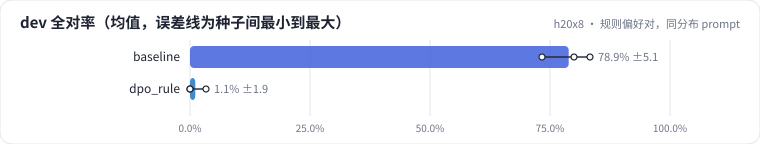
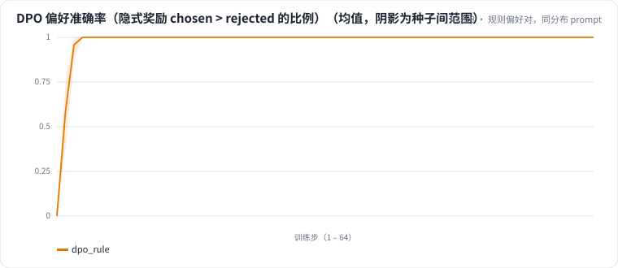

<!-- 本页由 python -m labkit docs 从 ../lesson.yaml 和 results/ 生成，不要手改 -->

[← 先估算](04-estimate.md) · [课程首页](../README.md) · [在线采样偏好对，同分布 prompt →](06-onpolicy.md)

# 第 5 步 / 共 17 步：规则偏好对，同分布 prompt

> 阶段 3 / 7：**DPO：偏好对从哪来** · 场景：`dpo_rule`（对照 `baseline`）

512 个新合成 prompt（和 SFT 训练集同一个生成器、同样的句式分布）。chosen = 标准答案；rejected = 在标准答案上删掉一个条件，或者塞一个原文没有的卖点。DPO，β = 0.1，1 轮。

## 这一步跑了什么

| 场景 | 作用 | 说明 | 相对基线改了什么 | 种子（H20） |
| - | - | - | - | - |
| `baseline` | 对照 | 只做 SFT（与 L05 基线同配置），偏好阶段的起点和对照 | `pref_method=none` | 3 |
| `dpo_rule` | 本步 | DPO，规则构造的偏好对（删条件 / 塞无依据卖点），prompt 与 SFT 训练集同分布 | `pref_method=dpo`, `pref_pairs=rule` | 3 |

## 先预测

**和只做 SFT 比，dev 全对率（3 种子均值）会怎样？**

- **A.** 差不多（±6.7 个点以内）
- **B.** 明显更好（> +6.7 个点）
- **C.** 明显更差（< −6.7 个点）

> 先选定一个（记下来），再展开下面的实测。dev 差异小于 6.7 个点（两条样本）、排除型合成集差异小于 5 个点（三条样本）或小于种子间波动，都按“差不多”算。

## 实测

展开实测：H20 · Qwen2.5-7B · SFT + 偏好阶段 · 每个场景 3 种子（已有 6 / 6 个运行）

| 场景 | 类型 | dev 全对率 | dev 条件保留率 | 排除型 条件保留率 | 合成验证全对率 | 偏好准确率（末步） | dev 全对率：与 `baseline` 差 | dev 全对率：各种子 | 断言 |
| - | - | - | - | - | - | - | - | - | - |
| `baseline` | 基线 | 78.9% ± 5.1 | 87.3% ± 7.3 | 60.6% ± 26.2 | 100.0% ± 0.0 | — | — | s0 83.3% / s1 73.3% / s2 80.0% | 通过 |
| `dpo_rule` | 候选改动 | 1.1% ± 1.9 | 0.0% ± 0.0 | 2.8% ± 4.8 | 2.2% ± 3.9 | 1.00 ± 0.00 | -77.8 个点 | s0 0.0% / s1 0.0% / s2 3.3% | 通过 |

运行目录（每个目录里有 `summary.json` 指标、`evidence.json` 证据摘要、`predictions.jsonl` 逐条预测、`log.txt` 日志）：

- `baseline` [s0](../../../results/h20x8/L07/baseline/s0-606cc1/) · [s1](../../../results/h20x8/L07/baseline/s1-4e1f34/) · [s2](../../../results/h20x8/L07/baseline/s2-c2b0c4/)
- `dpo_rule` [s0](../../../results/h20x8/L07/dpo_rule/s0-889743/) · [s1](../../../results/h20x8/L07/dpo_rule/s1-2adedb/) · [s2](../../../results/h20x8/L07/dpo_rule/s2-d63825/)

## 看完实测再想一步

偏好准确率曲线多快到顶？到顶之后模型还在学什么？

---

[← 先估算](04-estimate.md) · [课程首页](../README.md) · [在线采样偏好对，同分布 prompt →](06-onpolicy.md)
