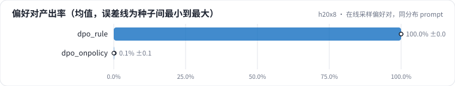

<!-- 本页由 python -m labkit docs 从 ../lesson.yaml 和 results/ 生成，不要手改 -->

[← 规则偏好对，同分布 prompt](05-rule.md) · [课程首页](../README.md) · [prompt 换到模型会错的地方 →](07-excl.md)

# 第 6 步 / 共 17 步：在线采样偏好对，同分布 prompt

> 阶段 3 / 7：**DPO：偏好对从哪来** · 场景：`dpo_onpolicy`（对照 `baseline`）

换一种负例：SFT 模型对每个 prompt 用温度 1 采样 4 条，rejected = 4 条里奖励最低、且不全对的一条；**4 条全对的 prompt 不产生偏好对**。prompt 还是 512 个同分布合成样本。

## 这一步跑了什么

| 场景 | 作用 | 说明 | 相对基线改了什么 | 种子（H20） |
| - | - | - | - | - |
| `baseline` | 对照 | 只做 SFT（与 L05 基线同配置），偏好阶段的起点和对照 | `pref_method=none` | 3 |
| `dpo_rule` | 参照 | DPO，规则构造的偏好对（删条件 / 塞无依据卖点），prompt 与 SFT 训练集同分布 | `pref_method=dpo`, `pref_pairs=rule` | 3 |
| `dpo_onpolicy` | 本步 | DPO，在线采样的偏好对（标准答案 vs SFT 自己采样出的最差回答），prompt 同分布 | `pref_method=dpo`, `pref_pairs=onpolicy` | 3 |

## 先预测

**512 个 prompt 里，大约多少比例能产出偏好对（至少有一条采样不全对）？**

- **A.** 不到 10%
- **B.** 10% - 50%
- **C.** 50% 以上

> 先选定一个（记下来），再展开下面的实测。dev 差异小于 6.7 个点（两条样本）、排除型合成集差异小于 5 个点（三条样本）或小于种子间波动，都按“差不多”算。

## 实测

展开实测：H20 · Qwen2.5-7B · SFT + 偏好阶段 · 每个场景 3 种子（已有 9 / 9 个运行）

| 场景 | 类型 | 偏好对产出率 | 采样平均奖励 | dev 全对率 | 排除型 条件保留率 | dev 全对率：与 `baseline` 差 | dev 全对率：各种子 | 断言 |
| - | - | - | - | - | - | - | - | - |
| `baseline` | 基线 | — | — | 78.9% ± 5.1 | 60.6% ± 26.2 | — | s0 83.3% / s1 73.3% / s2 80.0% | 通过 |
| `dpo_rule` | 候选改动 | 100.0% ± 0.0 | — | 1.1% ± 1.9 | 2.8% ± 4.8 | -77.8 个点 | s0 0.0% / s1 0.0% / s2 3.3% | 通过 |
| `dpo_onpolicy` | 候选改动 | 0.1% ± 0.1 | 1.000 ± 0.000 | 74.4% ± 5.1 | 72.2% ± 26.8 | -4.4 个点 | s0 80.0% / s1 70.0% / s2 73.3% |  |

运行目录（每个目录里有 `summary.json` 指标、`evidence.json` 证据摘要、`predictions.jsonl` 逐条预测、`log.txt` 日志）：

- `baseline` [s0](../../../results/h20x8/L07/baseline/s0-606cc1/) · [s1](../../../results/h20x8/L07/baseline/s1-4e1f34/) · [s2](../../../results/h20x8/L07/baseline/s2-c2b0c4/)
- `dpo_rule` [s0](../../../results/h20x8/L07/dpo_rule/s0-889743/) · [s1](../../../results/h20x8/L07/dpo_rule/s1-2adedb/) · [s2](../../../results/h20x8/L07/dpo_rule/s2-d63825/)
- `dpo_onpolicy` [s0](../../../results/h20x8/L07/dpo_onpolicy/s0-54bd3f/) · [s1](../../../results/h20x8/L07/dpo_onpolicy/s1-351b2c/) · [s2](../../../results/h20x8/L07/dpo_onpolicy/s2-36ceeb/)

## 看完实测再想一步

产出率和规则偏好对（512 个，100%）比差多少？采样的算力花在了哪里？

---

[← 规则偏好对，同分布 prompt](05-rule.md) · [课程首页](../README.md) · [prompt 换到模型会错的地方 →](07-excl.md)
