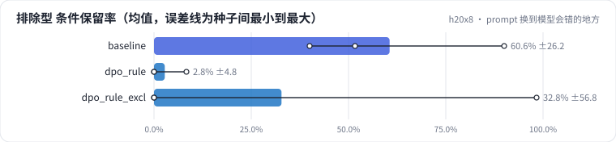

<!-- 本页由 python -m labkit docs 从 ../lesson.yaml 和 results/ 生成，不要手改 -->

[← 在线采样偏好对，同分布 prompt](06-onpolicy.md) · [课程首页](../README.md) · [在线采样 + 排除型 prompt →](08-onpolicy-excl.md)

# 第 7 步 / 共 17 步：prompt 换到模型会错的地方

> 阶段 3 / 7：**DPO：偏好对从哪来** · 场景：`dpo_rule_excl`（对照 `baseline`）

还是规则偏好对，但偏好阶段的 512 个 prompt 里**一半换成排除型条件**（"满 199 减 30，活动款除外"）。SFT 训练集里没有这种句式。这些 prompt 的 rejected 就是"把排除条件删掉"——正好是 SFT 模型在这类句式上犯的错。

## 这一步跑了什么

| 场景 | 作用 | 说明 | 相对基线改了什么 | 种子（H20） |
| - | - | - | - | - |
| `baseline` | 对照 | 只做 SFT（与 L05 基线同配置），偏好阶段的起点和对照 | `pref_method=none` | 3 |
| `dpo_rule` | 参照 | DPO，规则构造的偏好对（删条件 / 塞无依据卖点），prompt 与 SFT 训练集同分布 | `pref_method=dpo`, `pref_pairs=rule` | 3 |
| `dpo_rule_excl` | 本步 | DPO，规则偏好对，prompt 里一半是排除型条件（SFT 没见过的句式） | `pref_method=dpo`, `pref_pairs=rule`, `pref_exclusion_ratio=0.5` | 3 |

## 先预测

**排除型合成集（60 条）的条件保留率，和只做 SFT 比会怎样？**

- **A.** 基本不变（±5 个点以内）
- **B.** 提升 5 - 20 个点
- **C.** 提升 20 个点以上
- **D.** 下降超过 5 个点

> 先选定一个（记下来），再展开下面的实测。dev 差异小于 6.7 个点（两条样本）、排除型合成集差异小于 5 个点（三条样本）或小于种子间波动，都按“差不多”算。

## 实测

展开实测：H20 · Qwen2.5-7B · SFT + 偏好阶段 · 每个场景 3 种子（已有 9 / 9 个运行）

| 场景 | 类型 | 排除型 条件保留率 | 排除型 全对率 | dev 排除型条件（3 条） | dev 全对率 | 合成验证全对率 | 排除型 条件保留率：与 `baseline` 差 | 排除型 条件保留率：各种子 | 断言 |
| - | - | - | - | - | - | - | - | - | - |
| `baseline` | 基线 | 60.6% ± 26.2 | 60.6% ± 26.2 | 33.3% ± 33.4 | 78.9% ± 5.1 | 100.0% ± 0.0 | — | s0 90.0% / s1 51.7% / s2 40.0% | 通过 |
| `dpo_rule` | 候选改动 | 2.8% ± 4.8 | 0.6% ± 1.0 | 0.0% ± 0.0 | 1.1% ± 1.9 | 2.2% ± 3.9 | -57.8 个点 | s0 0.0% / s1 0.0% / s2 8.3% | 通过 |
| `dpo_rule_excl` | 候选改动 | 32.8% ± 56.8 | 32.8% ± 56.8 | 22.2% ± 38.5 | 21.1% ± 33.7 | 17.2% ± 21.8 | -27.8 个点 | s0 98.3% / s1 0.0% / s2 0.0% |  |

**dev 错误类型分布**（每个运行的错误条数，多种子取均值；dev 共 30 条，一条样本可能有多个错误）

| 错误类型 | `baseline` | `dpo_rule` | `dpo_rule_excl` |
| - | - | - | - |
| 格式错误 | 0.0 | 29.7 | 20.3 |
| 漏条件 | 2.7 | 0.0 | 0.3 |
| 多条件 | 1.0 | 0.0 | 2.0 |
| 漏卖点 | 1.7 | 0.0 | 0.3 |
| 无依据内容 | 1.3 | 0.0 | 1.3 |
| 多优惠（原文无此优惠或把否定句当优惠） | 0.7 | 0.0 | 0.0 |
| 多卖点 | 0.3 | 0.0 | 0.0 |
| 无品类却编造品类 | 0.0 | 0.0 | 0.3 |
| 漏优惠 | 0.3 | 0.0 | 0.3 |

运行目录（每个目录里有 `summary.json` 指标、`evidence.json` 证据摘要、`predictions.jsonl` 逐条预测、`log.txt` 日志）：

- `baseline` [s0](../../../results/h20x8/L07/baseline/s0-606cc1/) · [s1](../../../results/h20x8/L07/baseline/s1-4e1f34/) · [s2](../../../results/h20x8/L07/baseline/s2-c2b0c4/)
- `dpo_rule` [s0](../../../results/h20x8/L07/dpo_rule/s0-889743/) · [s1](../../../results/h20x8/L07/dpo_rule/s1-2adedb/) · [s2](../../../results/h20x8/L07/dpo_rule/s2-d63825/)
- `dpo_rule_excl` [s0](../../../results/h20x8/L07/dpo_rule_excl/s0-e37ea1/) · [s1](../../../results/h20x8/L07/dpo_rule_excl/s1-ba5bcc/) · [s2](../../../results/h20x8/L07/dpo_rule_excl/s2-019344/)

## 看完实测再想一步

目标集合涨了多少？dev 的排除型条件和合成验证集（看有没有弄坏）分别怎样？

---

[← 在线采样偏好对，同分布 prompt](06-onpolicy.md) · [课程首页](../README.md) · [在线采样 + 排除型 prompt →](08-onpolicy-excl.md)
