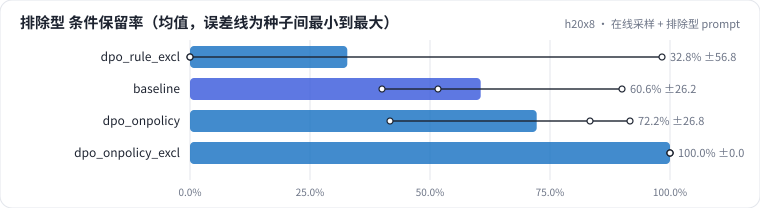

<!-- 本页由 python -m labkit docs 从 ../lesson.yaml 和 results/ 生成，不要手改 -->

[← prompt 换到模型会错的地方](07-excl.md) · [课程首页](../README.md) · [chosen 的概率涨了吗 →](09-logp.md)

# 第 8 步 / 共 17 步：在线采样 + 排除型 prompt

> 阶段 3 / 7：**DPO：偏好对从哪来** · 场景：`dpo_onpolicy_excl`（对照 `dpo_rule_excl`）

在线采样偏好对，prompt 同样一半是排除型条件。这次 SFT 模型在一半 prompt 上真的会错，产出率会高很多；rejected 是它"自己的错"，不一定是"删条件"。

## 这一步跑了什么

| 场景 | 作用 | 说明 | 相对基线改了什么 | 种子（H20） |
| - | - | - | - | - |
| `dpo_rule_excl` | 对照 | DPO，规则偏好对，prompt 里一半是排除型条件（SFT 没见过的句式） | `pref_method=dpo`, `pref_pairs=rule`, `pref_exclusion_ratio=0.5` | 3 |
| `baseline` | 参照 | 只做 SFT（与 L05 基线同配置），偏好阶段的起点和对照 | `pref_method=none` | 3 |
| `dpo_onpolicy` | 参照 | DPO，在线采样的偏好对（标准答案 vs SFT 自己采样出的最差回答），prompt 同分布 | `pref_method=dpo`, `pref_pairs=onpolicy` | 3 |
| `dpo_onpolicy_excl` | 本步 | DPO，在线采样偏好对，prompt 里一半是排除型条件 | `pref_method=dpo`, `pref_pairs=onpolicy`, `pref_exclusion_ratio=0.5` | 3 |

## 先预测

**和规则偏好对（同样的 prompt）比，排除型合成集的条件保留率会怎样？**

- **A.** 在线采样明显更好（> +5 个点）
- **B.** 差不多（±5 个点以内）
- **C.** 规则偏好对明显更好（在线采样 < −5 个点）

> 先选定一个（记下来），再展开下面的实测。dev 差异小于 6.7 个点（两条样本）、排除型合成集差异小于 5 个点（三条样本）或小于种子间波动，都按“差不多”算。

## 实测

展开实测：H20 · Qwen2.5-7B · SFT + 偏好阶段 · 每个场景 3 种子（已有 12 / 12 个运行）

| 场景 | 类型 | 排除型 条件保留率 | 偏好对产出率 | 偏好对数 | dev 全对率 | 合成验证全对率 | 排除型 条件保留率：与 `dpo_rule_excl` 差 | 排除型 条件保留率：各种子 | 断言 |
| - | - | - | - | - | - | - | - | - | - |
| `dpo_rule_excl` | 候选改动 | 32.8% ± 56.8 | 100.0% ± 0.0 | 512 ± 0 | 21.1% ± 33.7 | 17.2% ± 21.8 | — | s0 98.3% / s1 0.0% / s2 0.0% |  |
| `baseline` | 基线 | 60.6% ± 26.2 | — | — | 78.9% ± 5.1 | 100.0% ± 0.0 | +27.8 个点 | s0 90.0% / s1 51.7% / s2 40.0% | 通过 |
| `dpo_onpolicy` | 候选改动 | 72.2% ± 26.8 | 0.1% ± 0.1 | 1 ± 1 | 74.4% ± 5.1 | 100.0% ± 0.0 | +39.4 个点 | s0 91.7% / s1 41.7% / s2 83.3% |  |
| `dpo_onpolicy_excl` | 候选改动 | 100.0% ± 0.0 | 20.8% ± 2.7 | 107 ± 14 | 83.3% ± 5.8 | 89.4% ± 14.0 | +67.2 个点 | s0 100.0% / s1 100.0% / s2 100.0% |  |

运行目录（每个目录里有 `summary.json` 指标、`evidence.json` 证据摘要、`predictions.jsonl` 逐条预测、`log.txt` 日志）：

- `dpo_rule_excl` [s0](../../../results/h20x8/L07/dpo_rule_excl/s0-e37ea1/) · [s1](../../../results/h20x8/L07/dpo_rule_excl/s1-ba5bcc/) · [s2](../../../results/h20x8/L07/dpo_rule_excl/s2-019344/)
- `baseline` [s0](../../../results/h20x8/L07/baseline/s0-606cc1/) · [s1](../../../results/h20x8/L07/baseline/s1-4e1f34/) · [s2](../../../results/h20x8/L07/baseline/s2-c2b0c4/)
- `dpo_onpolicy` [s0](../../../results/h20x8/L07/dpo_onpolicy/s0-54bd3f/) · [s1](../../../results/h20x8/L07/dpo_onpolicy/s1-351b2c/) · [s2](../../../results/h20x8/L07/dpo_onpolicy/s2-36ceeb/)
- `dpo_onpolicy_excl` [s0](../../../results/h20x8/L07/dpo_onpolicy_excl/s0-7e8e63/) · [s1](../../../results/h20x8/L07/dpo_onpolicy_excl/s1-ea0acf/) · [s2](../../../results/h20x8/L07/dpo_onpolicy_excl/s2-6fc5ea/)

## 看完实测再想一步

产出率比同分布 prompt 高了多少？偏好对数少一些时，效果和规则对比如何？

---

[← prompt 换到模型会错的地方](07-excl.md) · [课程首页](../README.md) · [chosen 的概率涨了吗 →](09-logp.md)
